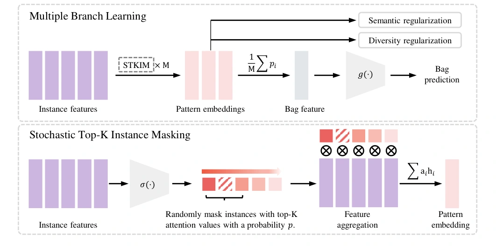
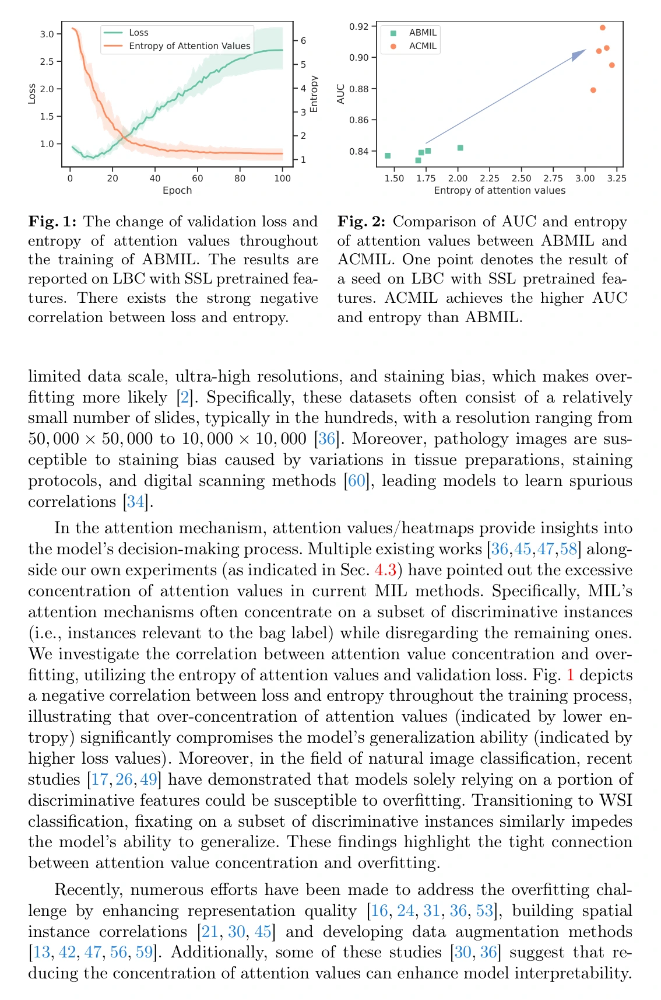
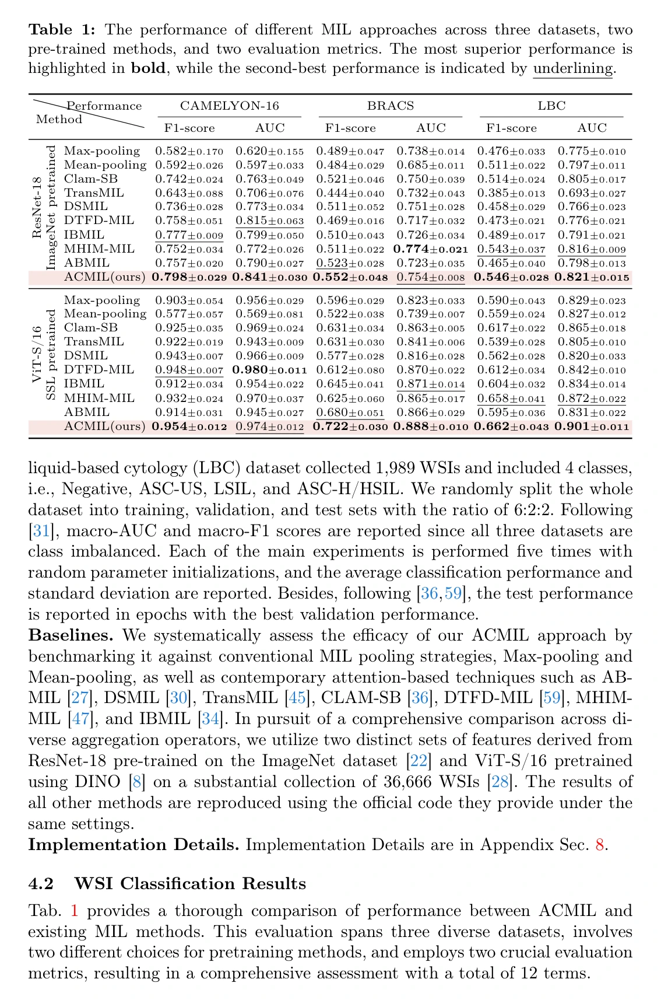
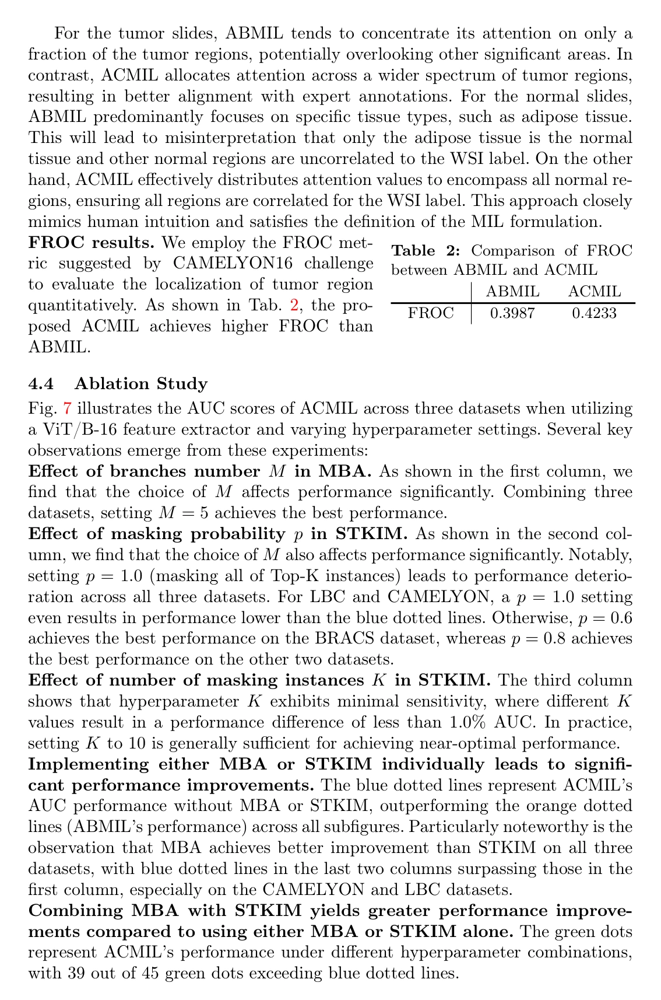
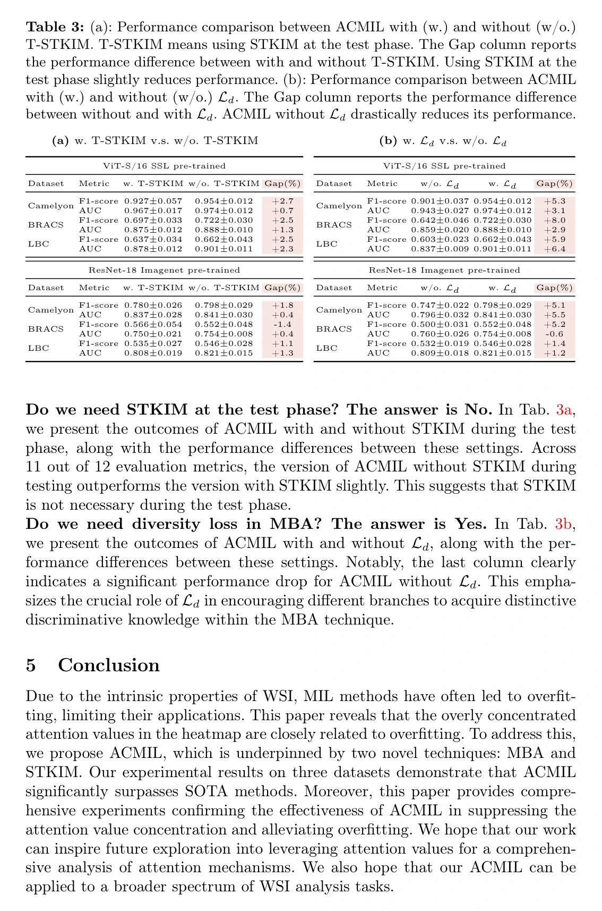
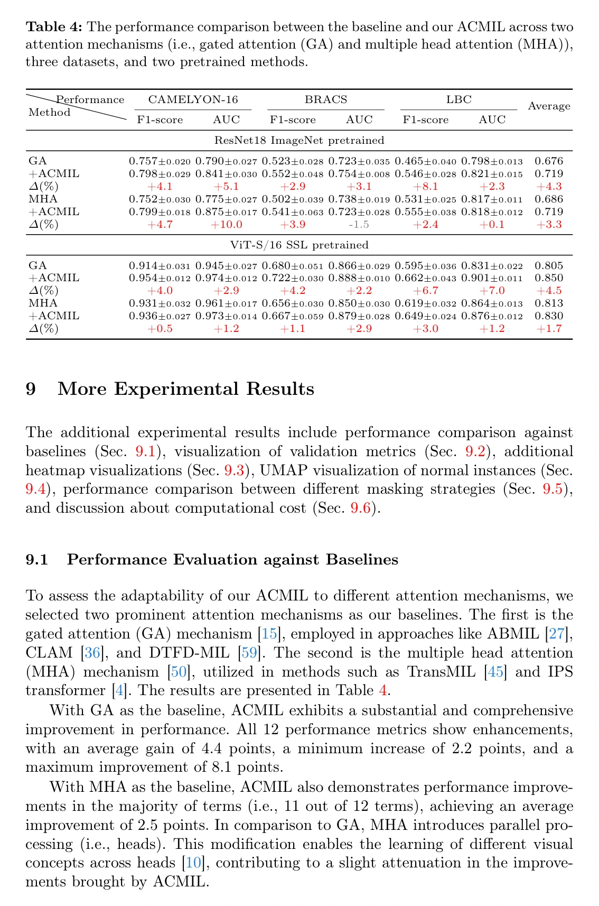
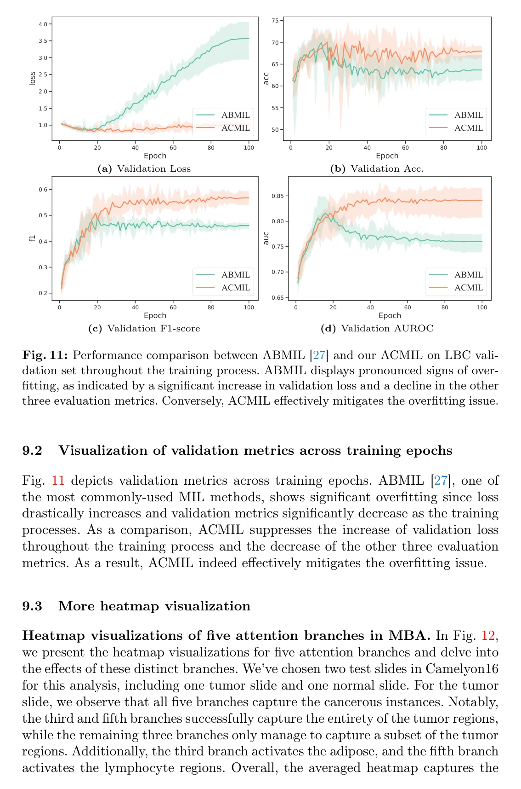
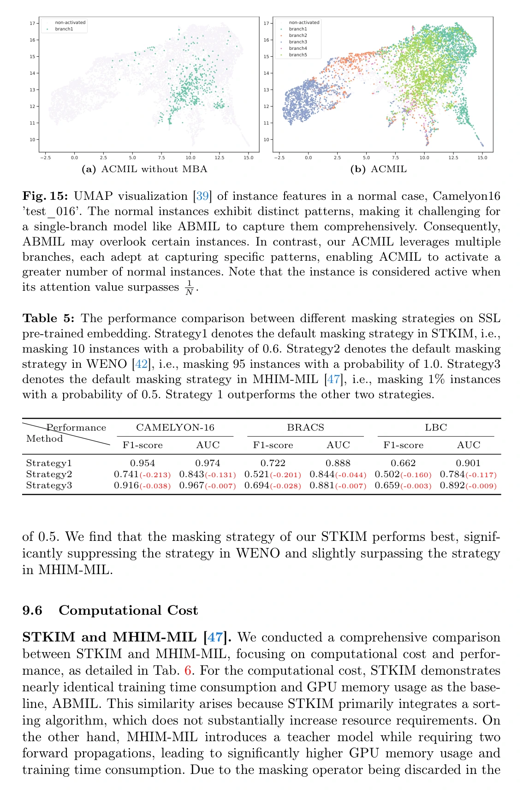
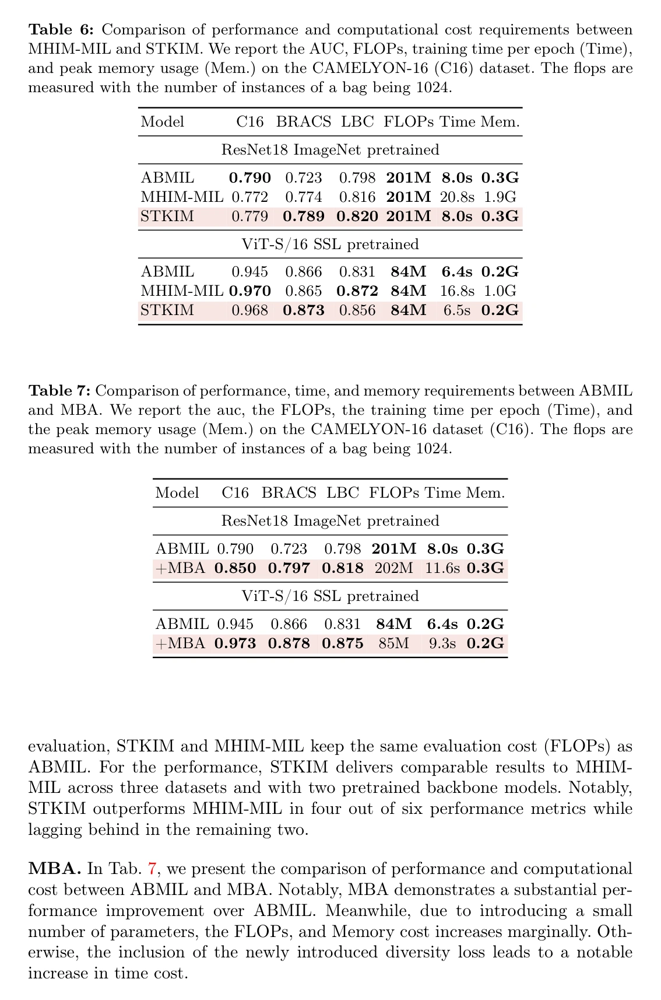
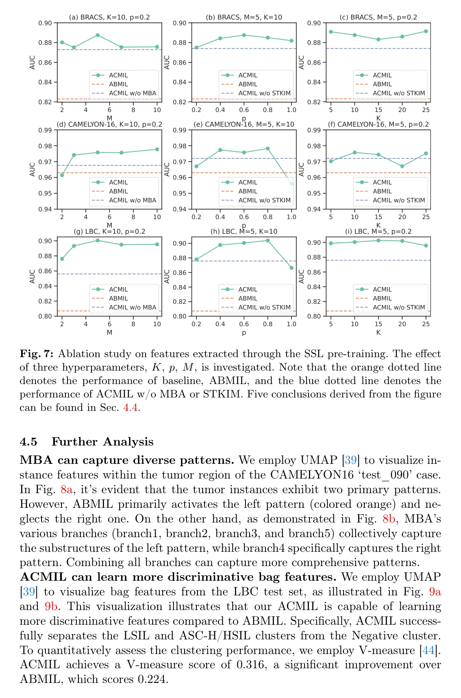

## Attention-Challenging Multiple Instance Learning for Whole Slide Image Classification

> data: CAMELYON16、BRACS、内部 LBC
>
> ECCV 2024 · [论文](https://arxiv.org/abs/2311.07125) · [作者代码](https://github.com/dazhangyu123/ACMIL)

#### 引言

结合多分支注意力和随机 Top-K 实例掩码，促使模型发现更多判别区域，缓解少量高注意力实例主导训练的问题。

#### 方法

（1）多分支注意力：不同分支捕捉不同的判别组织模式。

（2）随机 Top-K 遮蔽：只随机遮掉部分高注意力实例，避免抹去全部有效证据。

（3）联合训练：使剩余实例重新获得权重，减少少数 patch 支配预测。

<!-- wsi-complete-model -->
##### 模型结构图

**图 4 · 模型结构**（PDF 第 6 页）

> 原文图注：Fig. 4: Overview of the proposed MBA (top view) and STKIM (bottom view). In the MBA, M discriminative patterns are extracted from patch features using the attention operator regularized by semantic and diversity regularization terms. Then, the mean operator is applied to these M pattern features to produce the bag feature, which is utilized for bag-level prediction. In the STKIM, instances with Top-K attention values are randomly masked with a probability p.

[查看原尺寸](assest/ACMIL/figure-4-complete.webp)

<!-- /wsi-complete-model -->

#### 实验

##### 实验设置

在不同预训练特征下评估；BRACS 保留 395/65/87 的官方划分，CAMELYON16 训练/验证为 9:1。

##### 主要结果

研究重点是多分支发现更多判别模式，以及掩码重新分配注意力；热图之外还比较定位指标 FROC。

<!-- wsi-complete-results -->
##### 完整实验指标与对照

下列实验原页保留表头、全部行列、子图、误差说明和脚注，点击可查看原尺寸。比较时请对应相同的数据集、特征编码器和训练设置；`±`、置信区间、百分比和小数均保留原文的单位与统计口径。

| 原表/图中指标 | 读取方式 |
| --- | --- |
| ROC-AUC / AUROC | 越高越好；若原表明确为 PR-AUC，则按 PR 曲线面积读取 |
| FROC | 越高越好；对应预设假阳性工作点下的定位敏感度 |
| 时间 / FLOPs / 参数量 | 结合硬件、包长度和计时范围比较；小模型不一定推理更快 |

| 原文页 | 阅读内容 | 图表及正文引用 |
| --- | --- | --- |
| PDF 第 2 页 | 实验结果 | Figure 2 |
| PDF 第 9 页 | 实验结果 | Table 1 |
| PDF 第 11 页 | 实验结果 | Table 2 |
| PDF 第 12 页 | 消融与参数分析 | Figure 7 |
| PDF 第 14 页 | 实验结果 | Table 3 |
| PDF 第 20 页 | 实验结果 | Table 4 |
| PDF 第 21 页 | 实验结果 | Figure 11 |
| PDF 第 25 页 | 实验结果 | Table 5 |
| PDF 第 26 页 | 实验结果 | Table 6、Table 7 |

**实验原页 · PDF 第 2 页**（图表及正文引用：Figure 2）

[查看原尺寸](assest/ACMIL/experiment-page-02.webp)

**实验原页 · PDF 第 9 页**（图表及正文引用：Table 1）

[查看原尺寸](assest/ACMIL/experiment-page-09.webp)

**实验原页 · PDF 第 11 页**（图表及正文引用：Table 2）

[查看原尺寸](assest/ACMIL/experiment-page-11.webp)

**实验原页 · PDF 第 14 页**（图表及正文引用：Table 3）

[查看原尺寸](assest/ACMIL/experiment-page-14.webp)

**实验原页 · PDF 第 20 页**（图表及正文引用：Table 4）

[查看原尺寸](assest/ACMIL/experiment-page-20.webp)

**实验原页 · PDF 第 21 页**（图表及正文引用：Figure 11）

[查看原尺寸](assest/ACMIL/experiment-page-21.webp)

**实验原页 · PDF 第 25 页**（图表及正文引用：Table 5）

[查看原尺寸](assest/ACMIL/experiment-page-25.webp)

**实验原页 · PDF 第 26 页**（图表及正文引用：Table 6、Table 7）

[查看原尺寸](assest/ACMIL/experiment-page-26.webp)

展开消融、参数、数据设置及效率原页

**实验原页 · PDF 第 12 页**（图表及正文引用：Figure 7）

[查看原尺寸](assest/ACMIL/experiment-page-12.webp)

<!-- /wsi-complete-results -->

##### 消融与讨论

考察分支数、Top-K 和掩码概率；完全遮掉 Top-K（p=1）反而损害性能，说明掩码不是越强越好。

#### 参考文献

> Attention-Challenging Multiple Instance Learning for Whole Slide Image Classification
>
> ECCV 2024 · [论文](https://arxiv.org/abs/2311.07125) · [作者代码](https://github.com/dazhangyu123/ACMIL)
