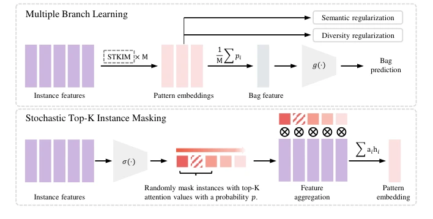
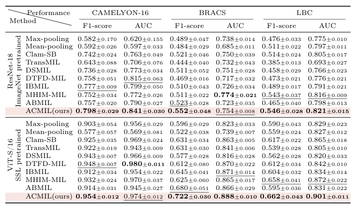

## Attention-Challenging Multiple Instance Learning for Whole Slide Image Classification

> data: CAMELYON16、BRACS、内部 LBC
>
> ECCV 2024 · [论文](https://arxiv.org/abs/2311.07125) · [作者代码](https://github.com/dazhangyu123/ACMIL)

#### 引言

结合多分支注意力和随机 Top-K 实例掩码，促使模型发现更多判别区域，缓解少量高注意力实例主导训练的问题。

#### 方法

（1）多分支注意力：不同分支捕捉不同的判别组织模式。

（2）随机 Top-K 遮蔽：只随机遮掉部分高注意力实例，避免抹去全部有效证据。

（3）联合训练：使剩余实例重新获得权重，减少少数 patch 支配预测。

原文Fig. 4，PDF 第 6 页。

#### 实验

##### 实验设置

在不同预训练特征下评估；BRACS 保留 395/65/87 的官方划分，CAMELYON16 训练/验证为 9:1。

##### 主要结果

研究重点是多分支发现更多判别模式，以及掩码重新分配注意力；热图之外还比较定位指标 FROC。

原文Table 1，PDF 第 9 页。

##### 消融与讨论

考察分支数、Top-K 和掩码概率；完全遮掉 Top-K（p=1）反而损害性能，说明掩码不是越强越好。

#### 参考文献

> Attention-Challenging Multiple Instance Learning for Whole Slide Image Classification
>
> ECCV 2024 · [论文](https://arxiv.org/abs/2311.07125) · [作者代码](https://github.com/dazhangyu123/ACMIL)
