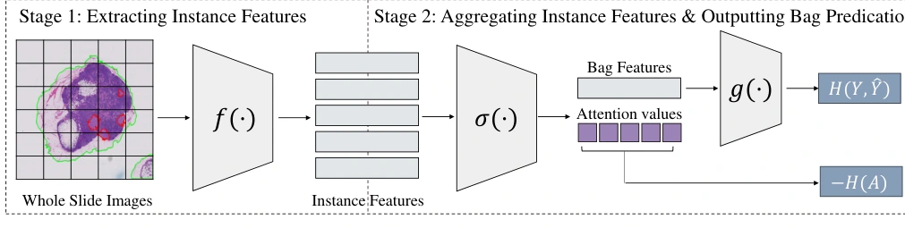

## ADR: Attention Diversification Regularization for Mitigating Overfitting in Multiple Instance Learning based Whole Slide Image Classification

> data: CAMELYON16、CAMELYON17、内部 LBC
>
> arXiv 2024 · [论文](https://arxiv.org/abs/2406.15303) · [作者代码](https://github.com/dazhangyu123/ADR)

#### 引言

为注意力分数加入负 Shannon 熵正则，鼓励注意力覆盖更多实例，以较小的训练改动缓解过拟合与注意力过度集中。

#### 方法

（1）注意力诊断：检查注意力熵与分类表现之间的关系。

（2）熵正则：在原 MIL 损失中加入负 Shannon 熵，鼓励较分散的权重。

（3）直接接入：保持原聚合器主体，通过训练目标调整注意力分配。

##### 模型结构图

图 3（PDF 第 3 页）

#### 实验

##### 实验设置

同时覆盖域内分类和跨医院域外评估；CAMELYON16 官方训练集再按 9:1 划分训练/验证。

##### 关键指标 { #key-results }

| 数据集 | F1 | AUC |
| --- | --- | --- |
| CAMELYON16 | 0.951 ± 0.004 | 0.967 ± 0.008 |
| CAMELYON17 | 0.638 ± 0.007 | 0.883 ± 0.013 |
| LBC | 0.664 ± 0.021 | 0.874 ± 0.012 |

数据来源为原文表 2，PDF 第 6 页。

##### 结果解读

ADR 加入负熵正则，降低训练时注意力集中在少量 patch 的程度。CAMELYON17 和 LBC 的 F1 明显低于 CAMELYON16，应结合各自的类别构成解读。

##### 消融与讨论

比较 ABMIL、DSMIL、TransMIL 等接入方式；需区分相关性分析与增加熵正则后的干预式实验。

#### 参考文献

> ADR: Attention Diversification Regularization for Mitigating Overfitting in Multiple Instance Learning based Whole Slide Image Classification
>
> arXiv 2024 · [论文](https://arxiv.org/abs/2406.15303) · [作者代码](https://github.com/dazhangyu123/ADR)
