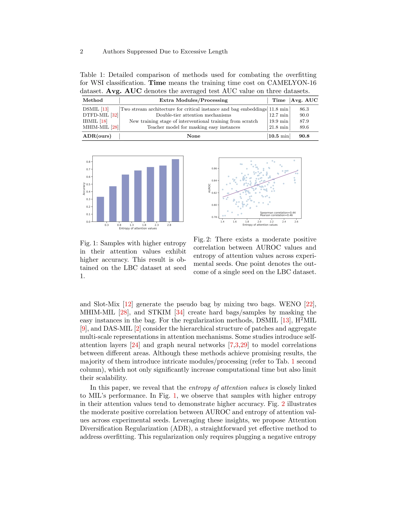
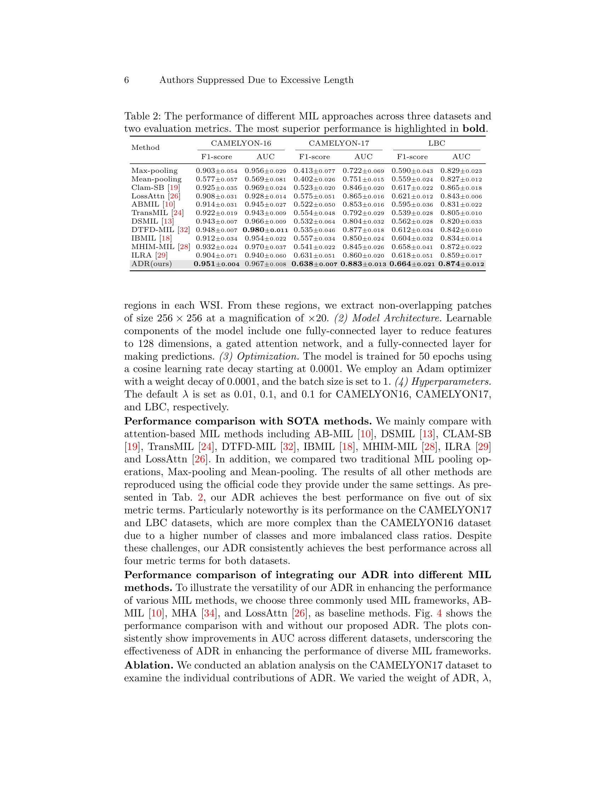
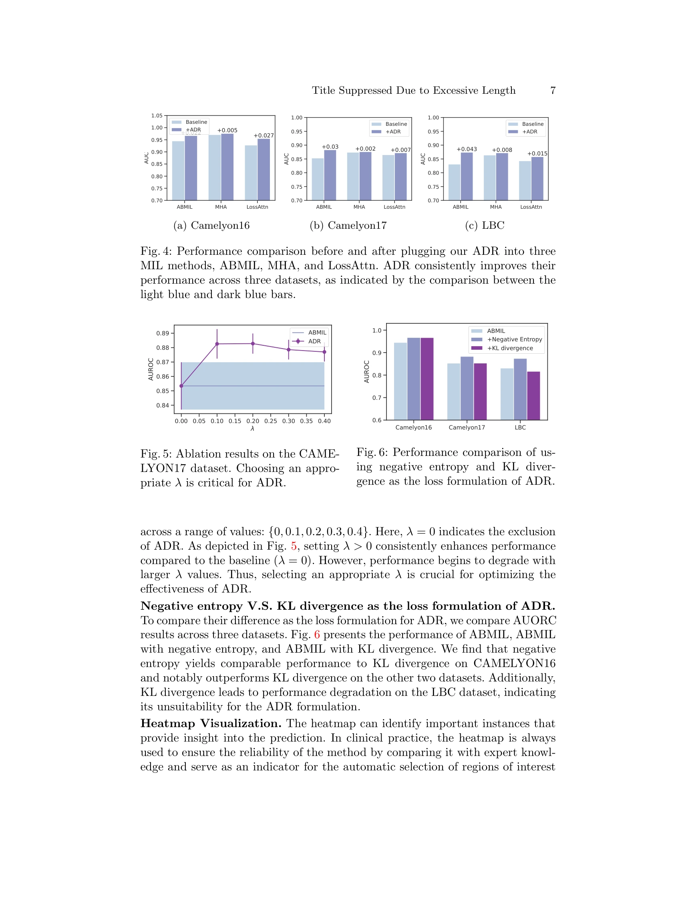

## ADR: Attention Diversification Regularization for Mitigating Overfitting in Multiple Instance Learning based Whole Slide Image Classification

> data: CAMELYON16、CAMELYON17、内部 LBC
>
> arXiv 2024 · [论文](https://arxiv.org/abs/2406.15303) · [作者代码](https://github.com/dazhangyu123/ADR)

#### 引言

为注意力分数加入负 Shannon 熵正则，鼓励注意力覆盖更多实例，以较小的训练改动缓解过拟合与注意力过度集中。

#### 方法

（1）注意力诊断：检查注意力熵与分类表现之间的关系。

（2）熵正则：在原 MIL 损失中加入负 Shannon 熵，鼓励较分散的权重。

（3）直接接入：保持原聚合器主体，通过训练目标调整注意力分配。

<!-- wsi-complete-model -->
##### 模型结构图

**图 3 · 模型结构**（PDF 第 3 页）

> 原文图注：Fig. 3: Overview of plugging ADR into MIL framework. ADR adds only a nega- tive entropy regularization for attention values to the regular MIL framework.

[查看原尺寸](assest/ADR/figure-3-complete.webp)

<!-- /wsi-complete-model -->

#### 实验

##### 实验设置

同时覆盖域内分类和跨医院域外评估；CAMELYON16 官方训练集再按 9:1 划分训练/验证。

##### 主要结果

效果以加入 ADR 前后的聚合器对比为主；作者还展示注意力熵和性能的关系及热图变化。

<!-- wsi-complete-results -->
##### 完整实验指标与对照

下列实验原页保留表头、全部行列、子图、误差说明和脚注，点击可查看原尺寸。比较时请对应相同的数据集、特征编码器和训练设置；`±`、置信区间、百分比和小数均保留原文的单位与统计口径。

| 原表/图中指标 | 读取方式 |
| --- | --- |
| ROC-AUC / AUROC | 越高越好；若原表明确为 PR-AUC，则按 PR 曲线面积读取 |
| ACC / Accuracy | 越高越好；平衡准确率、平均准确率以原表标注为准 |
| 时间 / FLOPs / 参数量 | 结合硬件、包长度和计时范围比较；小模型不一定推理更快 |

| 原文页 | 阅读内容 | 图表及正文引用 |
| --- | --- | --- |
| PDF 第 2 页 | 实验结果 | Table 1、Figure 1、Figure 2 |
| PDF 第 6 页 | 实验结果 | Table 2 |
| PDF 第 7 页 | 实验结果 | Figure 4、Figure 5、Figure 6 |

**实验原页 · PDF 第 2 页**（图表及正文引用：Table 1、Figure 1、Figure 2）

[查看原尺寸](assest/ADR/experiment-page-02.webp)

**实验原页 · PDF 第 6 页**（图表及正文引用：Table 2）

[查看原尺寸](assest/ADR/experiment-page-06.webp)

**实验原页 · PDF 第 7 页**（图表及正文引用：Figure 4、Figure 5、Figure 6）

[查看原尺寸](assest/ADR/experiment-page-07.webp)

<!-- /wsi-complete-results -->

##### 消融与讨论

比较 ABMIL、DSMIL、TransMIL 等接入方式；需区分相关性分析与增加熵正则后的干预式实验。

#### 参考文献

> ADR: Attention Diversification Regularization for Mitigating Overfitting in Multiple Instance Learning based Whole Slide Image Classification
>
> arXiv 2024 · [论文](https://arxiv.org/abs/2406.15303) · [作者代码](https://github.com/dazhangyu123/ADR)
