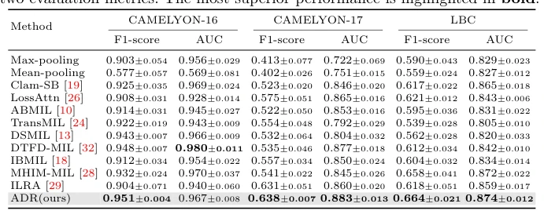

## ADR: Attention Diversification Regularization for Mitigating Overfitting in Multiple Instance Learning based Whole Slide Image Classification

> data: CAMELYON16、CAMELYON17、内部 LBC
>
> arXiv 2024 · [论文](https://arxiv.org/abs/2406.15303) · [作者代码](https://github.com/dazhangyu123/ADR)

#### 引言

为注意力分数加入负 Shannon 熵正则，鼓励注意力覆盖更多实例，以较小的训练改动缓解过拟合与注意力过度集中。

#### 方法

（1）注意力诊断：检查注意力熵与分类表现之间的关系。

（2）熵正则：在原 MIL 损失中加入负 Shannon 熵，鼓励较分散的权重。

（3）直接接入：保持原聚合器主体，通过训练目标调整注意力分配。

#### 实验

##### 实验设置

同时覆盖域内分类和跨医院域外评估；CAMELYON16 官方训练集再按 9:1 划分训练/验证。

##### 主要结果

效果以加入 ADR 前后的聚合器对比为主；作者还展示注意力熵和性能的关系及热图变化。

原文Table 2，PDF 第 6 页。

##### 消融与讨论

比较 ABMIL、DSMIL、TransMIL 等接入方式；需区分相关性分析与增加熵正则后的干预式实验。

#### 参考文献

> ADR: Attention Diversification Regularization for Mitigating Overfitting in Multiple Instance Learning based Whole Slide Image Classification
>
> arXiv 2024 · [论文](https://arxiv.org/abs/2406.15303) · [作者代码](https://github.com/dazhangyu123/ADR)
