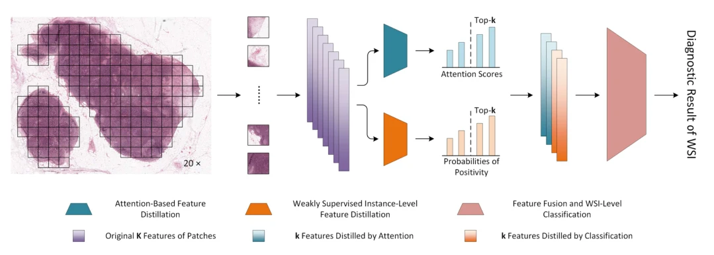

## Distilling High Diagnostic Value Patches for Whole Slide Image Classification Using Attention Mechanism

> data: CAMELYON16、TCGA-NSCLC
>
> arXiv 2024 · [论文](https://arxiv.org/abs/2407.19821) · [作者代码](https://github.com/MasyerN/AFD-MIL)

#### 引言

在弱监督流程中先排除冗余 patch，再用注意力进行诊断特征蒸馏，并通过全局损失联合优化，降低低价值实例的干扰。

#### 方法

（1）冗余过滤：先排除低诊断价值 patch，减少噪声进入后续聚合。

（2）特征蒸馏：用注意力提炼关键诊断特征，而非等价处理全部实例。

（3）联合优化：通过全局损失协调特征蒸馏与切片分类。

原文Fig. 1，PDF 第 3 页。

#### 实验

##### 实验设置

比较不同诊断特征蒸馏方式及其与 MIL 分类器的组合，指标为 ACC、AUC。

##### 主要结果

摘要报告 CAMELYON16 的 ACC/AUC 为 91.47%/94.29%，TCGA-NSCLC 为 93.33%/98.17%。

##### 消融与讨论

两个数据集采用不同的蒸馏设置；不能把结果理解为同一固定配置在所有任务上直接通用。

#### 参考文献

> Distilling High Diagnostic Value Patches for Whole Slide Image Classification Using Attention Mechanism
>
> arXiv 2024 · [论文](https://arxiv.org/abs/2407.19821) · [作者代码](https://github.com/MasyerN/AFD-MIL)
