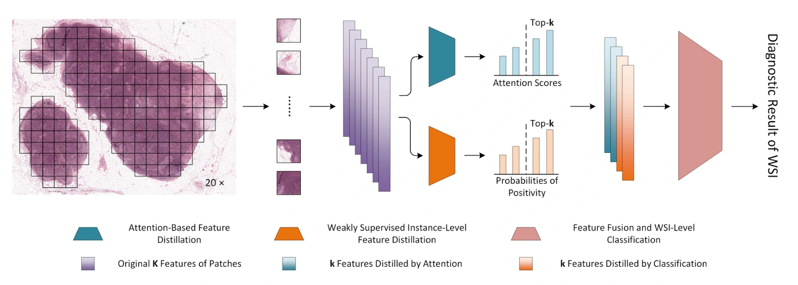
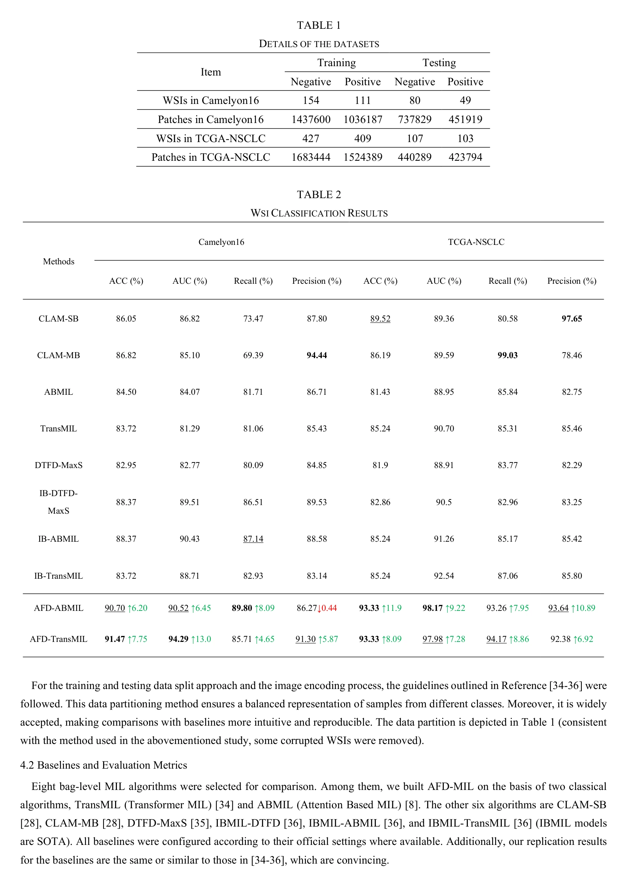
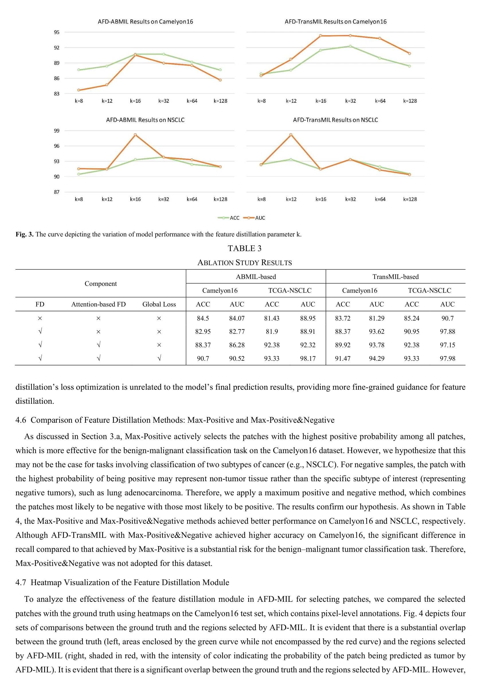
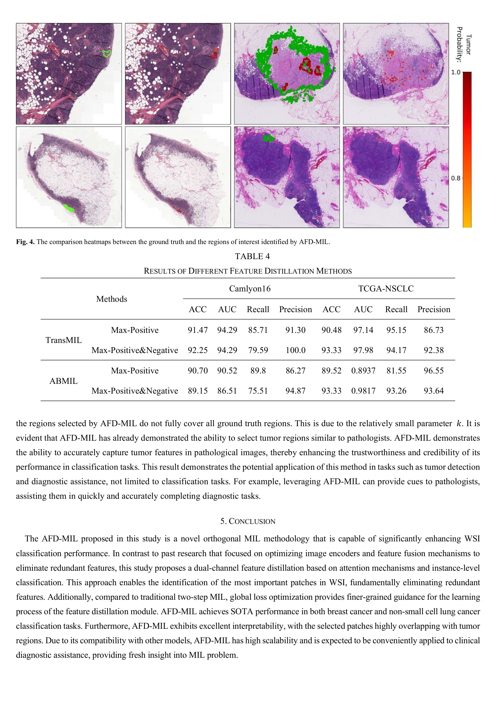

## Distilling High Diagnostic Value Patches for Whole Slide Image Classification Using Attention Mechanism

> data: CAMELYON16、TCGA-NSCLC
>
> arXiv 2024 · [论文](https://arxiv.org/abs/2407.19821) · [作者代码](https://github.com/MasyerN/AFD-MIL)

#### 引言

在弱监督流程中先排除冗余 patch，再用注意力进行诊断特征蒸馏，并通过全局损失联合优化，降低低价值实例的干扰。

#### 方法

（1）冗余过滤：先排除低诊断价值 patch，减少噪声进入后续聚合。

（2）特征蒸馏：用注意力提炼关键诊断特征，而非等价处理全部实例。

（3）联合优化：通过全局损失协调特征蒸馏与切片分类。

<!-- wsi-complete-model -->
##### 模型结构图

**图 1 · 模型结构**（PDF 第 3 页）

> 原文图注：Fig. 1. The AFD-MIL model utilizes a feature distillation module to extract effective patch-level features. The features are fused and a classification network is

[查看原尺寸](assest/AFD-MIL/figure-1-complete.webp)

<!-- /wsi-complete-model -->

#### 实验

##### 实验设置

比较不同诊断特征蒸馏方式及其与 MIL 分类器的组合，指标为 ACC、AUC。

##### 主要结果

摘要报告 CAMELYON16 的 ACC/AUC 为 91.47%/94.29%，TCGA-NSCLC 为 93.33%/98.17%。

<!-- wsi-complete-results -->
##### 完整实验指标与对照

下列实验原页保留表头、全部行列、子图、误差说明和脚注，点击可查看原尺寸。比较时请对应相同的数据集、特征编码器和训练设置；`±`、置信区间、百分比和小数均保留原文的单位与统计口径。

| 原表/图中指标 | 读取方式 |
| --- | --- |
| ROC-AUC / AUROC | 越高越好；若原表明确为 PR-AUC，则按 PR 曲线面积读取 |
| ACC / Accuracy | 越高越好；平衡准确率、平均准确率以原表标注为准 |

| 原文页 | 阅读内容 | 图表及正文引用 |
| --- | --- | --- |
| PDF 第 7 页 | 实验结果 | Table 1、Table 2 |
| PDF 第 9 页 | 实验结果 | Figure 3、Table 3 |
| PDF 第 10 页 | 实验结果 | Table 4 |

**实验原页 · PDF 第 7 页**（图表及正文引用：Table 1、Table 2）

[查看原尺寸](assest/AFD-MIL/experiment-page-07.webp)

**实验原页 · PDF 第 9 页**（图表及正文引用：Figure 3、Table 3）

[查看原尺寸](assest/AFD-MIL/experiment-page-09.webp)

**实验原页 · PDF 第 10 页**（图表及正文引用：Table 4）

[查看原尺寸](assest/AFD-MIL/experiment-page-10.webp)

<!-- /wsi-complete-results -->

##### 消融与讨论

两个数据集采用不同的蒸馏设置；不能把结果理解为同一固定配置在所有任务上直接通用。

#### 参考文献

> Distilling High Diagnostic Value Patches for Whole Slide Image Classification Using Attention Mechanism
>
> arXiv 2024 · [论文](https://arxiv.org/abs/2407.19821) · [作者代码](https://github.com/MasyerN/AFD-MIL)
