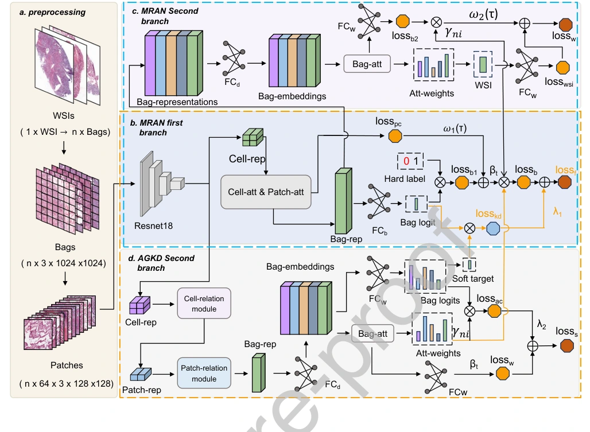
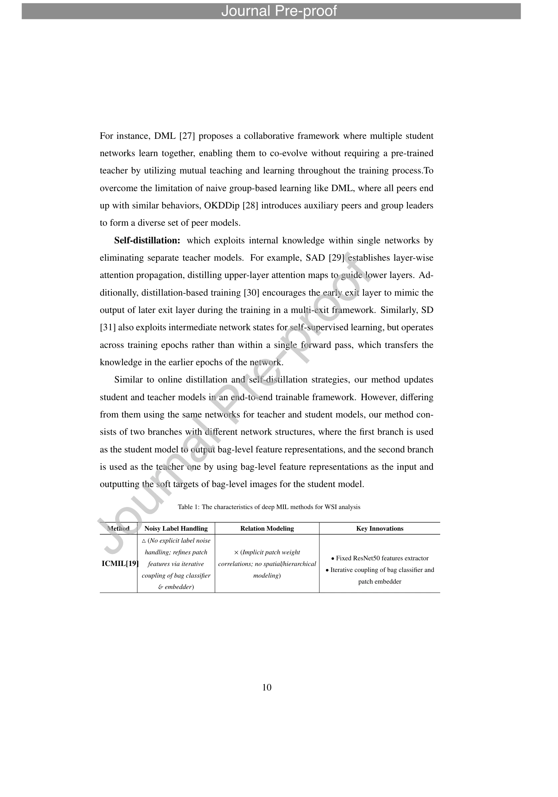
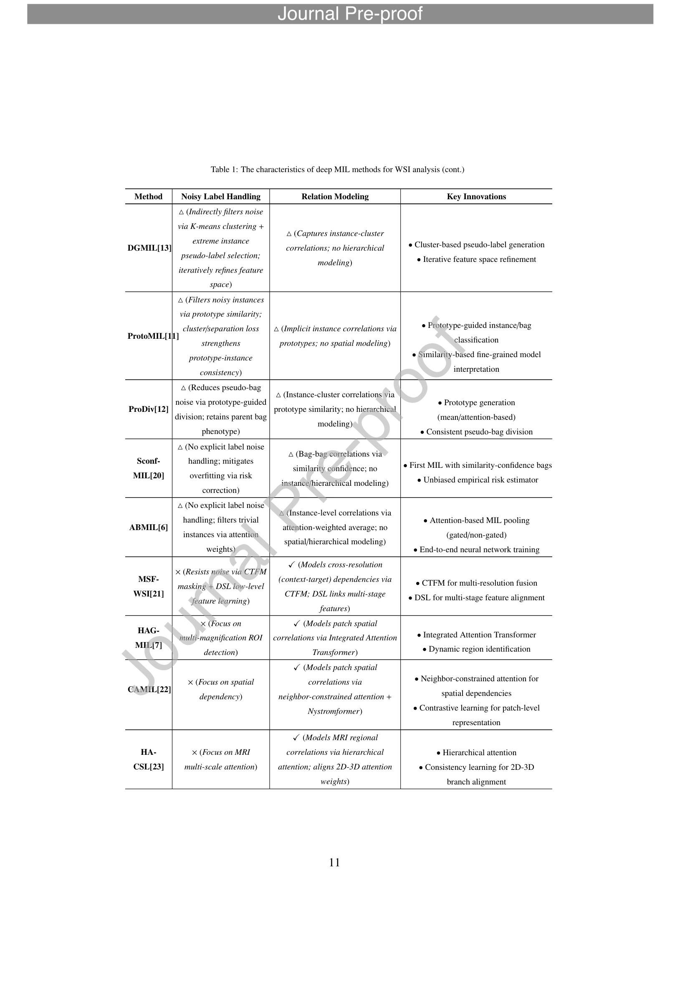
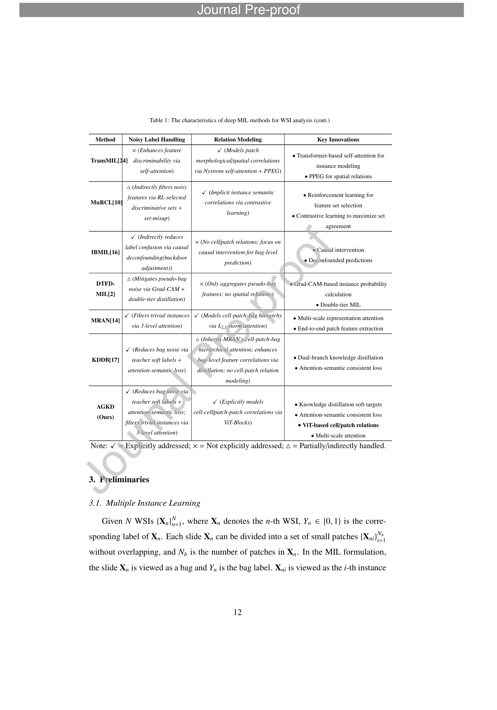
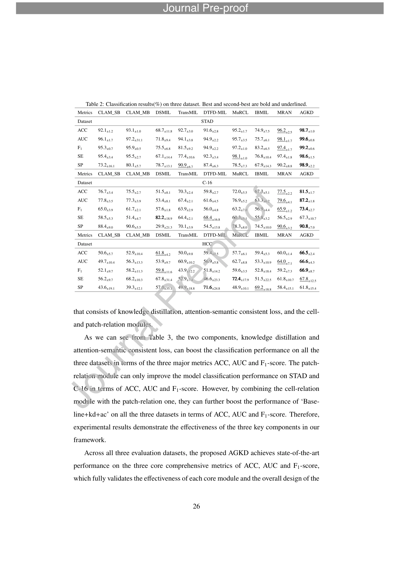
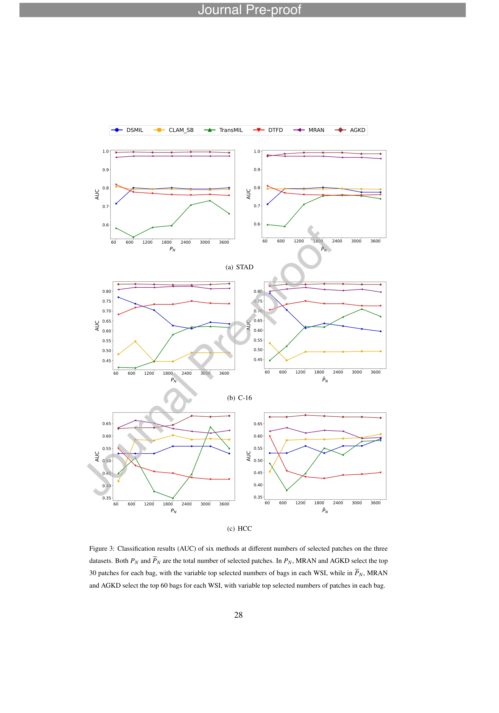
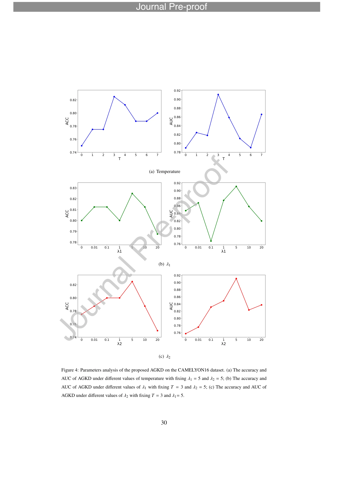
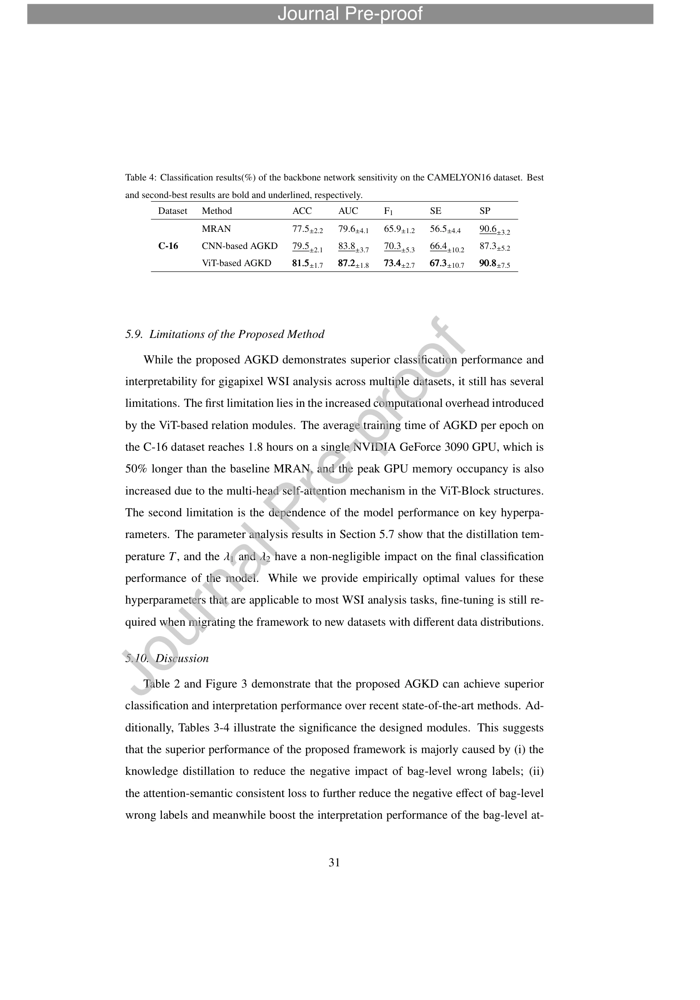
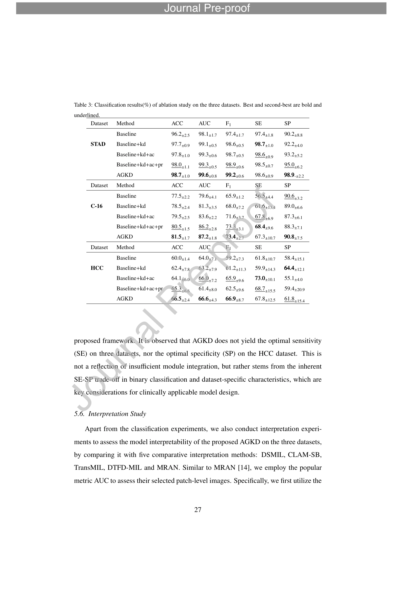

## Attention-Guided Knowledge Distillation based Deep Multiple Instance Learning for Gigapixel Whole Slide Image Analysis

> data: TCGA-STAD、CAMELYON16、内部 HCC
>
> Pattern Recognition 2026 · [论文](https://doi.org/10.1016/j.patcog.2026.113642) · [作者代码](https://github.com/zhouyike1313/AGKD)

#### 引言

以知识蒸馏降低包标签噪声，通过注意力语义一致性损失对齐注意力和预测，再结合细胞、patch 关系模块增强多尺度表征。

#### 方法

（1）软目标蒸馏：减轻直接使用噪声包标签的影响。

（2）语义一致性：使注意力分配与包预测方向相符。

（3）多层关系：通过细胞和 patch 关系模块增强教师，再指导学生。

<!-- wsi-complete-model -->
##### 模型结构图

**图 1 · 模型结构**（PDF 第 15 页）

> 原文图注：Figure 1: The structure pass of MRAN and the proposed AGKD, where the blue and yellow dashed boxes

[查看原尺寸](assest/AGKD/figure-1-complete.webp)

<!-- /wsi-complete-model -->

#### 实验

##### 实验设置

STAD 按受试者 60:20:20，C16 按切片 60:20:20，HCC 按切片 80:10:10 划分；以 MRAN 为基础比较。

##### 主要结果

主表比较胃癌、淋巴结转移和 HCC 早复发相关分类；三种数据的划分和预测对象不同。

<!-- wsi-complete-results -->
##### 完整实验指标与对照

下列实验原页保留表头、全部行列、子图、误差说明和脚注，点击可查看原尺寸。比较时请对应相同的数据集、特征编码器和训练设置；`±`、置信区间、百分比和小数均保留原文的单位与统计口径。

| 原表/图中指标 | 读取方式 |
| --- | --- |
| ROC-AUC / AUROC | 越高越好；若原表明确为 PR-AUC，则按 PR 曲线面积读取 |
| ACC / Accuracy | 越高越好；平衡准确率、平均准确率以原表标注为准 |
| Recall / Sensitivity | 越高越好；与固定敏感度下的特异度区别读取 |

| 原文页 | 阅读内容 | 图表及正文引用 |
| --- | --- | --- |
| PDF 第 11 页 | 实验结果 | Table 1 |
| PDF 第 12 页 | 实验结果 | Table 1 |
| PDF 第 13 页 | 实验结果 | Table 1 |
| PDF 第 27 页 | 实验结果 | Table 2 |
| PDF 第 28 页 | 消融与参数分析 | Table 3 |
| PDF 第 29 页 | 实验结果 | Figure 3 |
| PDF 第 31 页 | 实验结果 | Figure 4 |
| PDF 第 32 页 | 实验结果 | Table 4 |

**实验原页 · PDF 第 11 页**（图表及正文引用：Table 1）

[查看原尺寸](assest/AGKD/experiment-page-11.webp)

**实验原页 · PDF 第 12 页**（图表及正文引用：Table 1）

[查看原尺寸](assest/AGKD/experiment-page-12.webp)

**实验原页 · PDF 第 13 页**（图表及正文引用：Table 1）

[查看原尺寸](assest/AGKD/experiment-page-13.webp)

**实验原页 · PDF 第 27 页**（图表及正文引用：Table 2）

[查看原尺寸](assest/AGKD/experiment-page-27.webp)

**实验原页 · PDF 第 29 页**（图表及正文引用：Figure 3）

[查看原尺寸](assest/AGKD/experiment-page-29.webp)

**实验原页 · PDF 第 31 页**（图表及正文引用：Figure 4）

[查看原尺寸](assest/AGKD/experiment-page-31.webp)

**实验原页 · PDF 第 32 页**（图表及正文引用：Table 4）

[查看原尺寸](assest/AGKD/experiment-page-32.webp)

展开消融、参数、数据设置及效率原页

**实验原页 · PDF 第 28 页**（图表及正文引用：Table 3）

[查看原尺寸](assest/AGKD/experiment-page-28.webp)

<!-- /wsi-complete-results -->

##### 消融与讨论

分别检验软目标、注意力语义一致性损失和细胞/patch 关系模块，避免把所有增益笼统归因于知识蒸馏。

#### 参考文献

> Attention-Guided Knowledge Distillation based Deep Multiple Instance Learning for Gigapixel Whole Slide Image Analysis
>
> Pattern Recognition 2026 · [论文](https://doi.org/10.1016/j.patcog.2026.113642) · [作者代码](https://github.com/zhouyike1313/AGKD)
