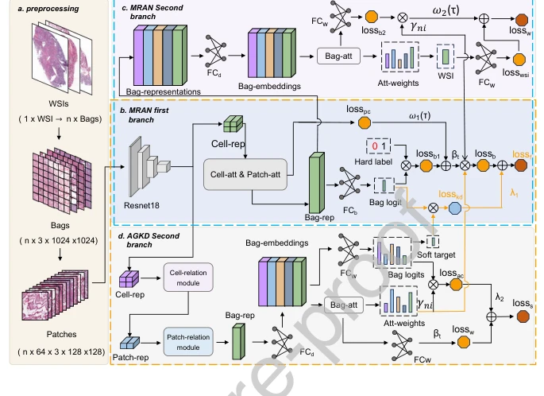
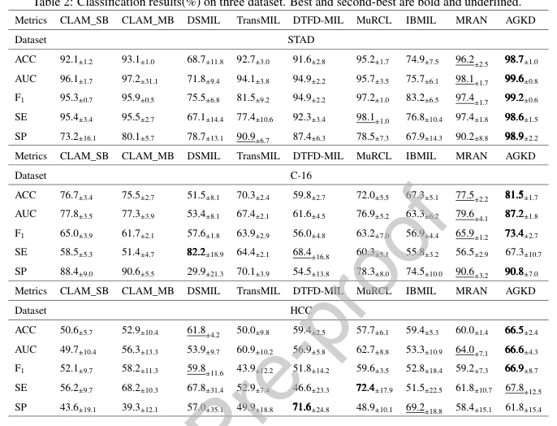

## Attention-Guided Knowledge Distillation based Deep Multiple Instance Learning for Gigapixel Whole Slide Image Analysis

> data: TCGA-STAD、CAMELYON16、内部 HCC
>
> Pattern Recognition 2026 · [论文](https://doi.org/10.1016/j.patcog.2026.113642) · [作者代码](https://github.com/zhouyike1313/AGKD)

#### 引言

以知识蒸馏降低包标签噪声，通过注意力语义一致性损失对齐注意力和预测，再结合细胞、patch 关系模块增强多尺度表征。

#### 方法

（1）软目标蒸馏：减轻直接使用噪声包标签的影响。

（2）语义一致性：使注意力分配与包预测方向相符。

（3）多层关系：通过细胞和 patch 关系模块增强教师，再指导学生。

原文Figure 1，PDF 第 15 页。

#### 实验

##### 实验设置

STAD 按受试者 60:20:20，C16 按切片 60:20:20，HCC 按切片 80:10:10 划分；以 MRAN 为基础比较。

##### 主要结果

主表比较胃癌、淋巴结转移和 HCC 早复发相关分类；三种数据的划分和预测对象不同。

原文Table 2，PDF 第 27 页。

##### 消融与讨论

分别检验软目标、注意力语义一致性损失和细胞/patch 关系模块，避免把所有增益笼统归因于知识蒸馏。

#### 参考文献

> Attention-Guided Knowledge Distillation based Deep Multiple Instance Learning for Gigapixel Whole Slide Image Analysis
>
> Pattern Recognition 2026 · [论文](https://doi.org/10.1016/j.patcog.2026.113642) · [作者代码](https://github.com/zhouyike1313/AGKD)
