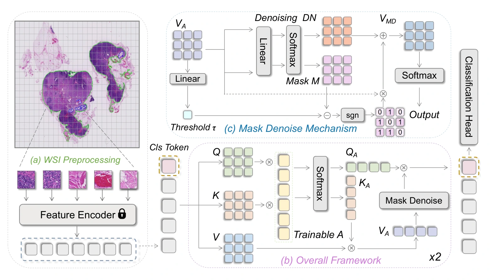

## Agent Aggregator with Mask Denoise Mechanism for Histopathology Whole Slide Image Analysis

> data: CAMELYON16、CAMELYON17、TCGA-LUNG、TCGA-KIDNEY
>
> ACM MM 2024 · [论文](https://doi.org/10.1145/3664647.3681425)

#### 引言

以 agent token 中介计算实例重要性，并用动态掩码和去噪矩阵调整特征，兼顾实例交互、计算开销与微小病灶定位。

#### 方法

（1）Agent 聚合：以少量可训练 agent 连接实例 query/key，降低全实例交互开销。

（2）动态掩码：由 agent 聚合值产生掩码，抑制低贡献特征。

（3）去噪重分配：清理被掩码表示中的噪声，使注意力重新覆盖有效病灶。

##### 模型结构图

图 2（PDF 第 3 页）

#### 实验

##### 实验设置

CAMELYON16 采用六折评估，并迁移到 CAMELYON17；TCGA 使用 65:10:25 划分及四折评估，报告 ACC、宏 F1、AUC。

##### 关键指标 { #key-results }

| 数据集 | ACC（%） | AUC（%） | 宏 F1（%） |
| --- | --- | --- | --- |
| CAMELYON16 | 92.9 ± 2.73 | 96.4 ± 2.89 | 92.7 ± 2.83 |
| CAMELYON17（外部） | 85.0 ± 1.32 | 85.3 ± 0.69 | 82.7 ± 1.24 |
| TCGA-LUNG | 90.5 ± 1.51 | 95.2 ± 0.70 | 90.5 ± 1.59 |
| TCGA-KIDNEY | 94.4 ± 1.13 | 97.3 ± 0.74 | 92.9 ± 1.01 |

数据来源为原文表 1，PDF 第 6 页。

##### 结果解读

CAMELYON17 的外部测试 AUC 低于 CAMELYON16 的域内评估。这个差距比单一域内分数更能说明模型跨中心使用时面对的分布变化。

##### 消融与讨论

消融 agent 聚合、掩码去噪和阈值选择，并展示不同 agent 的注意力分布。

#### 参考文献

> Agent Aggregator with Mask Denoise Mechanism for Histopathology Whole Slide Image Analysis
>
> ACM MM 2024 · [论文](https://doi.org/10.1145/3664647.3681425)
