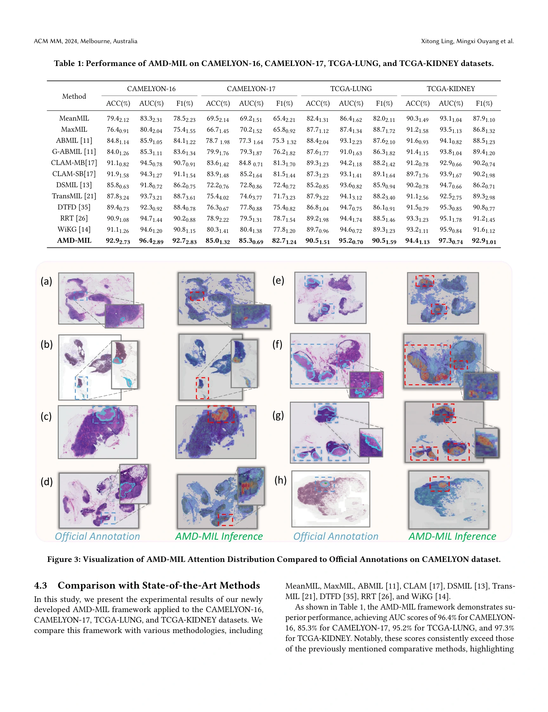
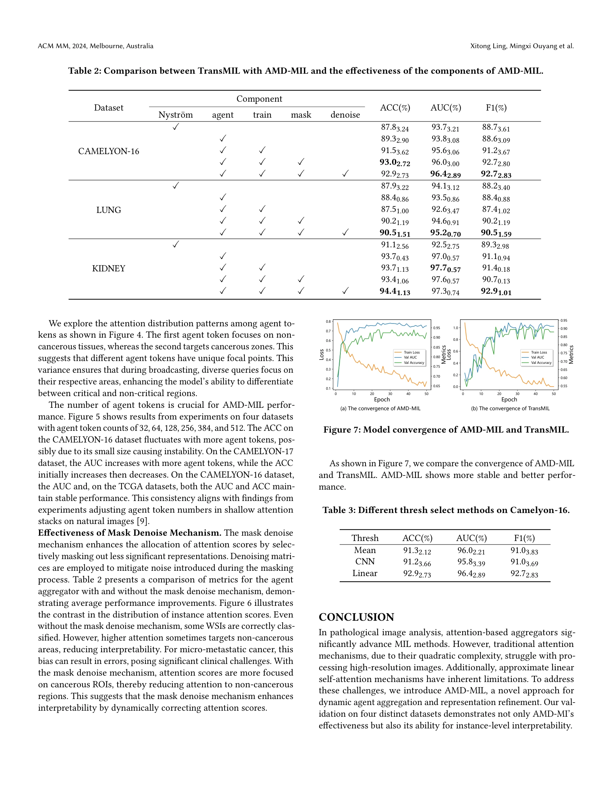

## Agent Aggregator with Mask Denoise Mechanism for Histopathology Whole Slide Image Analysis

> data: CAMELYON16、CAMELYON17、TCGA-LUNG、TCGA-KIDNEY
>
> ACM MM 2024 · [论文](https://doi.org/10.1145/3664647.3681425)

#### 引言

以 agent token 中介计算实例重要性，并用动态掩码和去噪矩阵调整特征，兼顾实例交互、计算开销与微小病灶定位。

#### 方法

（1）Agent 聚合：以少量可训练 agent 连接实例 query/key，降低全实例交互开销。

（2）动态掩码：由 agent 聚合值产生掩码，抑制低贡献特征。

（3）去噪重分配：清理被掩码表示中的噪声，使注意力重新覆盖有效病灶。

<!-- wsi-complete-model -->
##### 模型结构图

**图 2 · 模型结构**（PDF 第 3 页）

> 原文图注：Figure 2: Overall process: (a) the preprocess of WSI. (b) overall framework of AMD-MIL. (c) proposed mask denoise mechanism.

[查看原尺寸](assest/AMD-MIL/figure-2-complete.webp)

<!-- /wsi-complete-model -->

#### 实验

##### 实验设置

CAMELYON16 采用六折评估，并迁移到 CAMELYON17；TCGA 使用 65:10:25 划分及四折评估，报告 ACC、宏 F1、AUC。

##### 主要结果

作者报告四个数据集 AUC 分别为 96.4%、85.3%、95.2%、97.3%，需保留其外部验证与交叉验证设置的区别。

<!-- wsi-complete-results -->
##### 完整实验指标与对照

下列实验原页保留表头、全部行列、子图、误差说明和脚注，点击可查看原尺寸。比较时请对应相同的数据集、特征编码器和训练设置；`±`、置信区间、百分比和小数均保留原文的单位与统计口径。

| 原表/图中指标 | 读取方式 |
| --- | --- |
| ROC-AUC / AUROC | 越高越好；若原表明确为 PR-AUC，则按 PR 曲线面积读取 |
| ACC / Accuracy | 越高越好；平衡准确率、平均准确率以原表标注为准 |
| F1 | 越高越好；保留 macro / weighted / micro 等平均方式 |

| 原文页 | 阅读内容 | 图表及正文引用 |
| --- | --- | --- |
| PDF 第 6 页 | 实验结果 | Table 1 |
| PDF 第 8 页 | 消融与参数分析 | Table 2、Table 3 |

**实验原页 · PDF 第 6 页**（图表及正文引用：Table 1）

[查看原尺寸](assest/AMD-MIL/experiment-page-06.webp)

展开消融、参数、数据设置及效率原页

**实验原页 · PDF 第 8 页**（图表及正文引用：Table 2、Table 3）

[查看原尺寸](assest/AMD-MIL/experiment-page-08.webp)

<!-- /wsi-complete-results -->

##### 消融与讨论

消融 agent 聚合、掩码去噪和阈值选择，并展示不同 agent 的注意力分布。

#### 参考文献

> Agent Aggregator with Mask Denoise Mechanism for Histopathology Whole Slide Image Analysis
>
> ACM MM 2024 · [论文](https://doi.org/10.1145/3664647.3681425)
