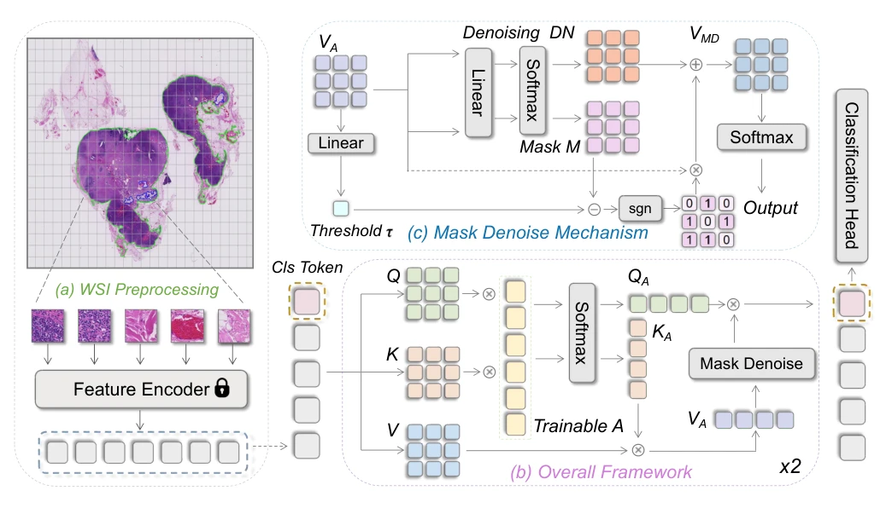
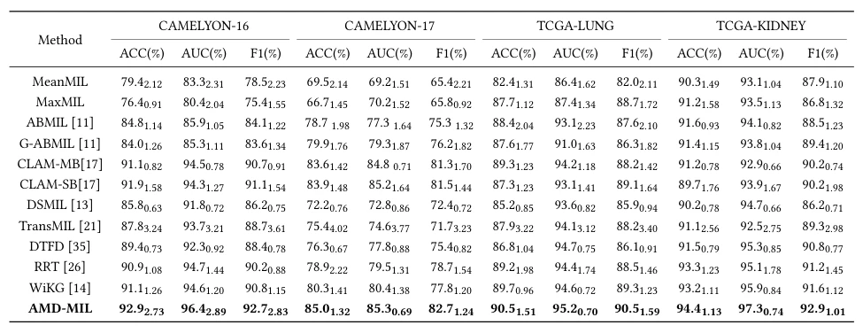

## Agent Aggregator with Mask Denoise Mechanism for Histopathology Whole Slide Image Analysis

> data: CAMELYON16、CAMELYON17、TCGA-LUNG、TCGA-KIDNEY
>
> ACM MM 2024 · [论文](https://doi.org/10.1145/3664647.3681425)

#### 引言

以 agent token 中介计算实例重要性，并用动态掩码和去噪矩阵调整特征，兼顾实例交互、计算开销与微小病灶定位。

#### 方法

（1）Agent 聚合：以少量可训练 agent 连接实例 query/key，降低全实例交互开销。

（2）动态掩码：由 agent 聚合值产生掩码，抑制低贡献特征。

（3）去噪重分配：清理被掩码表示中的噪声，使注意力重新覆盖有效病灶。

原文Figure 2，PDF 第 3 页。

#### 实验

##### 实验设置

CAMELYON16 采用六折评估，并迁移到 CAMELYON17；TCGA 使用 65:10:25 划分及四折评估，报告 ACC、宏 F1、AUC。

##### 主要结果

作者报告四个数据集 AUC 分别为 96.4%、85.3%、95.2%、97.3%，需保留其外部验证与交叉验证设置的区别。

原文Table 1，PDF 第 6 页。

##### 消融与讨论

消融 agent 聚合、掩码去噪和阈值选择，并展示不同 agent 的注意力分布。

#### 参考文献

> Agent Aggregator with Mask Denoise Mechanism for Histopathology Whole Slide Image Analysis
>
> ACM MM 2024 · [论文](https://doi.org/10.1145/3664647.3681425)
