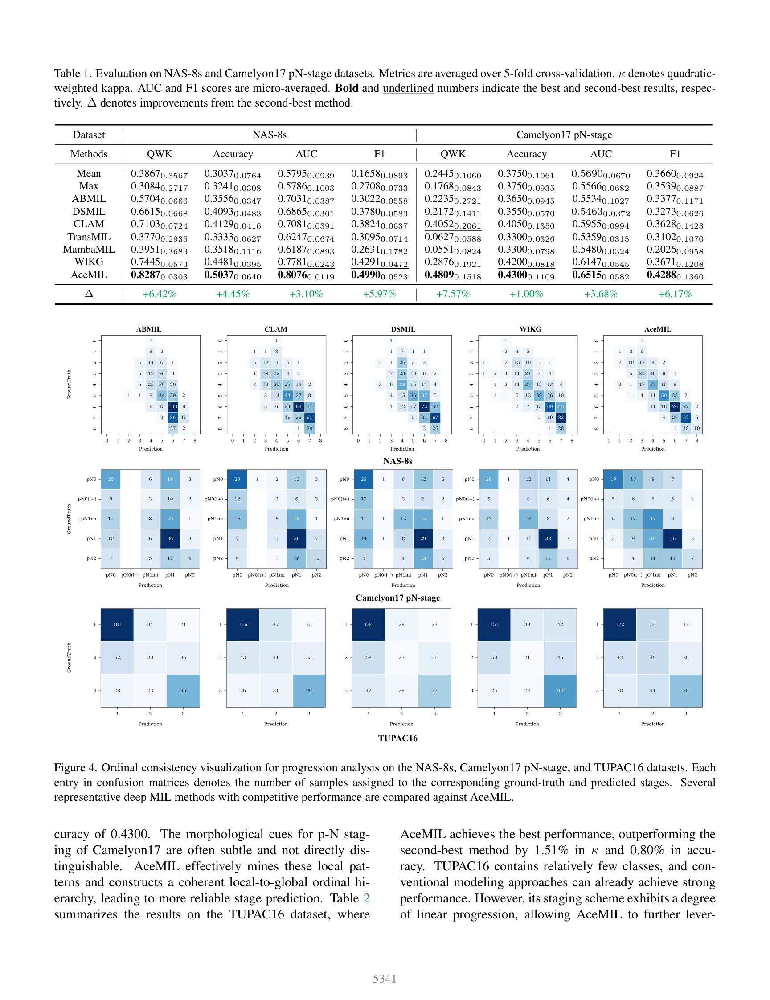
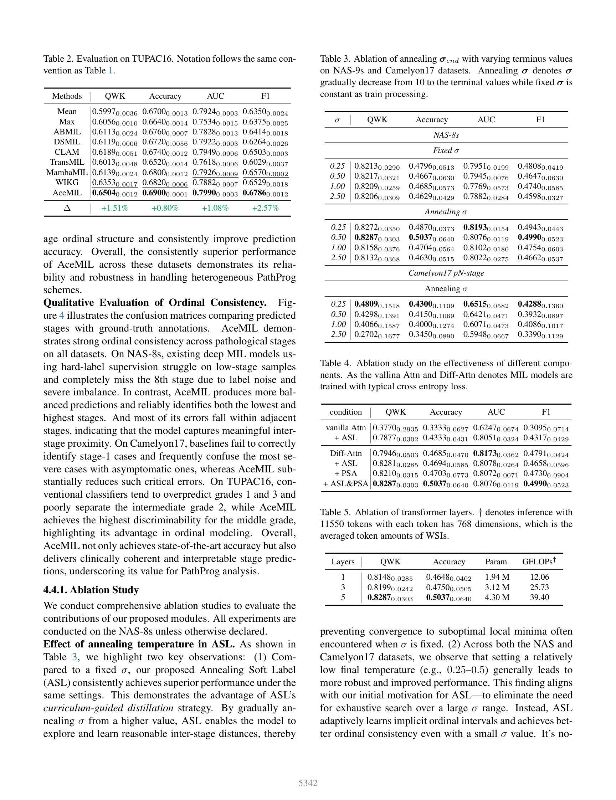
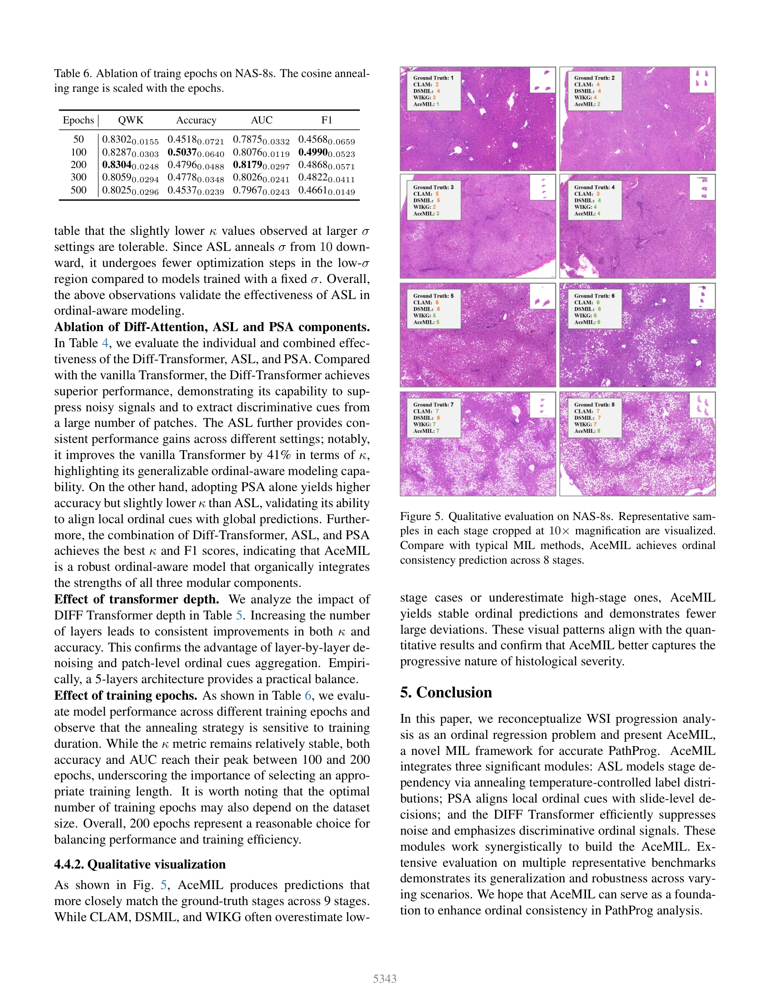

## AceMIL: Ordinal-Aware Multiple Instance Learning for Pathological Progression Analysis

> data: NAS-8s、CAMELYON17 pN-stage、TUPAC16
>
> CVPR 2026（会议目录收录；方法简介依据收藏 PDF） · [会议目录](https://media.eventhosts.cc/Conferences/CVPR2026/CVPR_main_conf_2026_15.pdf) · 原文依据本地 PDF；作者代码地址本次访问返回 404

#### 引言

将病理进展建模为有序回归，以退火软标签保留分期顺序，并结合差分 Transformer 和 patch 级阶段聚合减少严重程度错序。

#### 方法

（1）有序目标：用退火软标签表达分期之间的顺序。

（2）差分编码：突出与阶段差异有关的组织特征。

（3）局部阶段聚合：使 patch 证据与整片有序预测相协调。

<!-- wsi-complete-model -->
##### 模型结构图

**图 2 · 模型结构**（PDF 第 4 页）

> 原文图注：Figure 2. Framework of AceMIL. Three components are proposed to enhance pathological staging. The Differential Transformer [59] encode WSI features with noise-suppressed attention. PSA aggregates patch-level predictions using learned importance scores, and critical ASL provides temperature-controlled soft labels for ordinal-aware supervision.

[查看原尺寸](assest/AceMIL/figure-2-complete.webp)

<!-- /wsi-complete-model -->

#### 实验

##### 实验设置

五折评价有序病理分期，主要看加权 Kappa，同时保留分类指标。

##### 主要结果

摘要报告三个任务 Kappa 增益为 6.42、7.57、1.51 个百分点；需结合对应基线与方差读表。

<!-- wsi-complete-results -->
##### 完整实验指标与对照

下列实验原页保留表头、全部行列、子图、误差说明和脚注，点击可查看原尺寸。比较时请对应相同的数据集、特征编码器和训练设置；`±`、置信区间、百分比和小数均保留原文的单位与统计口径。

| 原表/图中指标 | 读取方式 |
| --- | --- |
| ROC-AUC / AUROC | 越高越好；若原表明确为 PR-AUC，则按 PR 曲线面积读取 |
| F1 | 越高越好；保留 macro / weighted / micro 等平均方式 |
| Kappa / QWK | 越高越好；加权方式与类别顺序以原表为准 |

| 原文页 | 阅读内容 | 图表及正文引用 |
| --- | --- | --- |
| PDF 第 6 页 | 实验结果 | Table 1、Figure 4 |
| PDF 第 7 页 | 实验结果 | Table 2、Table 3、Table 4、Table 5 |
| PDF 第 8 页 | 消融与参数分析 | Table 6 |

**实验原页 · PDF 第 6 页**（图表及正文引用：Table 1、Figure 4）

[查看原尺寸](assest/AceMIL/experiment-page-06.webp)

**实验原页 · PDF 第 7 页**（图表及正文引用：Table 2、Table 3、Table 4、Table 5）

[查看原尺寸](assest/AceMIL/experiment-page-07.webp)

展开消融、参数、数据设置及效率原页

**实验原页 · PDF 第 8 页**（图表及正文引用：Table 6）

[查看原尺寸](assest/AceMIL/experiment-page-08.webp)

<!-- /wsi-complete-results -->

##### 消融与讨论

比较退火软标签、差分 Transformer 和局部阶段聚合，检查是否减少跨级严重误判。

#### 参考文献

> AceMIL: Ordinal-Aware Multiple Instance Learning for Pathological Progression Analysis
>
> CVPR 2026（会议目录收录；方法简介依据收藏 PDF） · [会议目录](https://media.eventhosts.cc/Conferences/CVPR2026/CVPR_main_conf_2026_15.pdf) · 原文依据本地 PDF；作者代码地址本次访问返回 404
