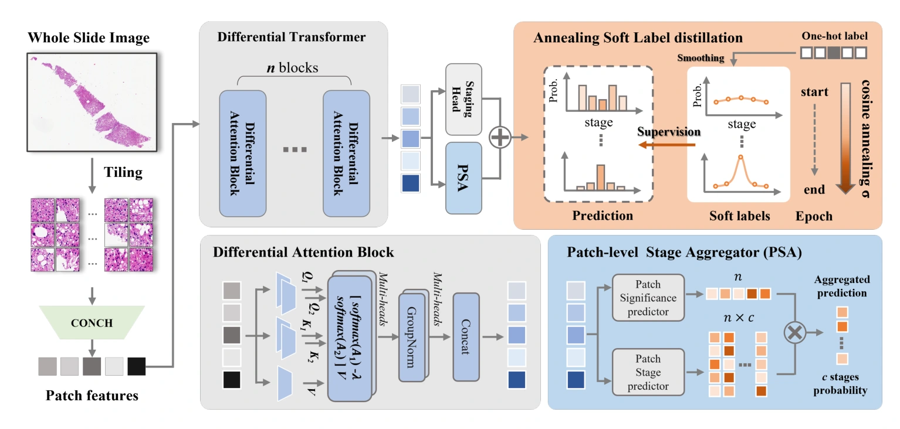

## AceMIL: Ordinal-Aware Multiple Instance Learning for Pathological Progression Analysis

> data: NAS-8s、CAMELYON17 pN-stage、TUPAC16
>
> CVPR 2026（会议目录收录；方法简介依据收藏 PDF） · [会议目录](https://media.eventhosts.cc/Conferences/CVPR2026/CVPR_main_conf_2026_15.pdf) · 原文依据本地 PDF；作者代码地址本次访问返回 404

#### 引言

将病理进展建模为有序回归，以退火软标签保留分期顺序，并结合差分 Transformer 和 patch 级阶段聚合减少严重程度错序。

#### 方法

（1）有序目标：用退火软标签表达分期之间的顺序。

（2）差分编码：突出与阶段差异有关的组织特征。

（3）局部阶段聚合：使 patch 证据与整片有序预测相协调。

##### 模型结构图

图 2（PDF 第 4 页）

#### 实验

##### 实验设置

五折评价有序病理分期，主要看加权 Kappa，同时保留分类指标。

##### 关键指标 { #key-results }

| 任务 | QWK | 微平均 AUC |
| --- | --- | --- |
| NAS-8s | 0.8287 ± 0.0303 | 0.8076 ± 0.0119 |
| CAMELYON17 pN 分期 | 0.4809 ± 0.1518 | 0.6515 ± 0.0582 |
| TUPAC16 | 0.6504 ± 0.0012 | 0.7990 ± 0.0003 |

数据来源为原文表 1–2，PDF 第 6–7 页。

##### 结果解读

相邻等级之间的混淆比跨多级的误判更常见。CAMELYON17 pN 分期的 QWK 波动较大，需结合少数等级的样本量和混淆矩阵解读。

##### 消融与讨论

比较退火软标签、差分 Transformer 和局部阶段聚合，检查是否减少跨级严重误判。

#### 参考文献

> AceMIL: Ordinal-Aware Multiple Instance Learning for Pathological Progression Analysis
>
> CVPR 2026（会议目录收录；方法简介依据收藏 PDF） · [会议目录](https://media.eventhosts.cc/Conferences/CVPR2026/CVPR_main_conf_2026_15.pdf) · 原文依据本地 PDF；作者代码地址本次访问返回 404
