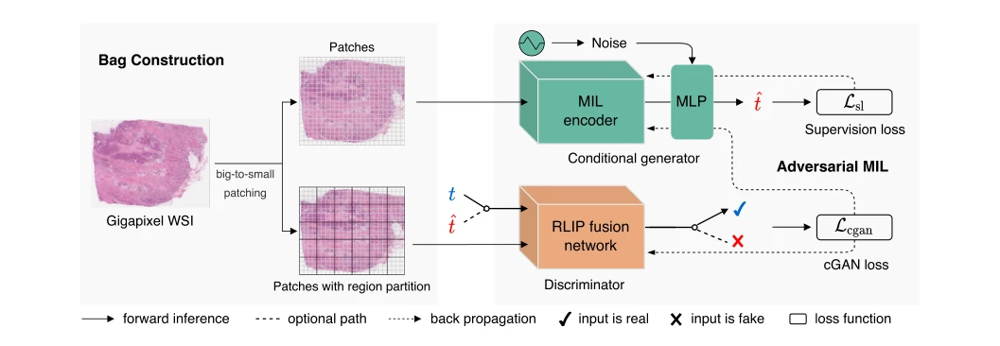
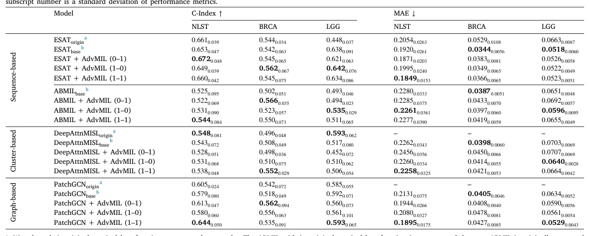

## AdvMIL: Adversarial multiple instance learning for the survival analysis on whole-slide images

> data: NLST、TCGA-BRCA、TCGA-LGG；共 3,101 张切片、1,911 位患者
>
> Medical Image Analysis 2024 · [论文](https://doi.org/10.1016/j.media.2023.103020) · [作者代码](https://github.com/liupei101/AdvMIL)

#### 引言

以对抗式事件时间建模扩展 WSI 生存分析，使 MIL 可估计生存分布，并利用无标签切片开展半监督学习。

#### 方法

（1）条件生成：由 WSI 表示与随机输入生成事件时间估计。

（2）对抗判别：比较真实切片-结局与生成切片-结局配对。

（3）半监督学习：无标签切片可参与对抗训练，有标签切片提供真实结局约束。

原文Fig. 3，PDF 第 4 页。

#### 实验

##### 实验设置

把 AdvMIL 接入 ABMIL、DeepAttnMISL、PatchGCN、ESAT，并比较全监督和半监督配置。

##### 主要结果

收益包括事件时间分布估计及利用无标签切片；无标签样本只参与对应的对抗目标，而非凭空获得真实生存标签。

原文Table 3，PDF 第 7 页。

##### 消融与讨论

分析无标签比例、patch 遮挡与图像噪声；必须保留删失处理和生存评估的任务边界。

#### 参考文献

> AdvMIL: Adversarial multiple instance learning for the survival analysis on whole-slide images
>
> Medical Image Analysis 2024 · [论文](https://doi.org/10.1016/j.media.2023.103020) · [作者代码](https://github.com/liupei101/AdvMIL)
