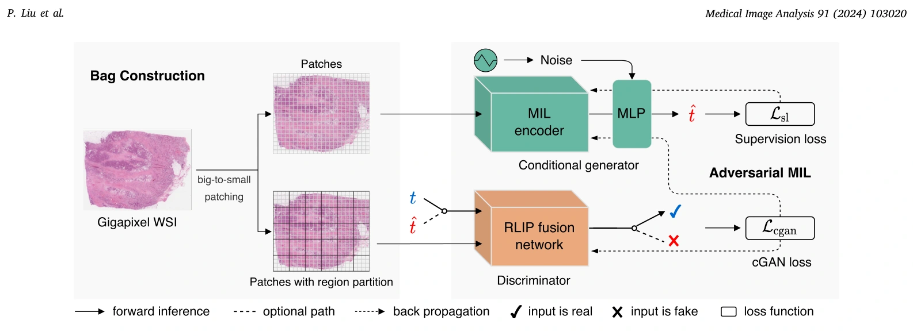
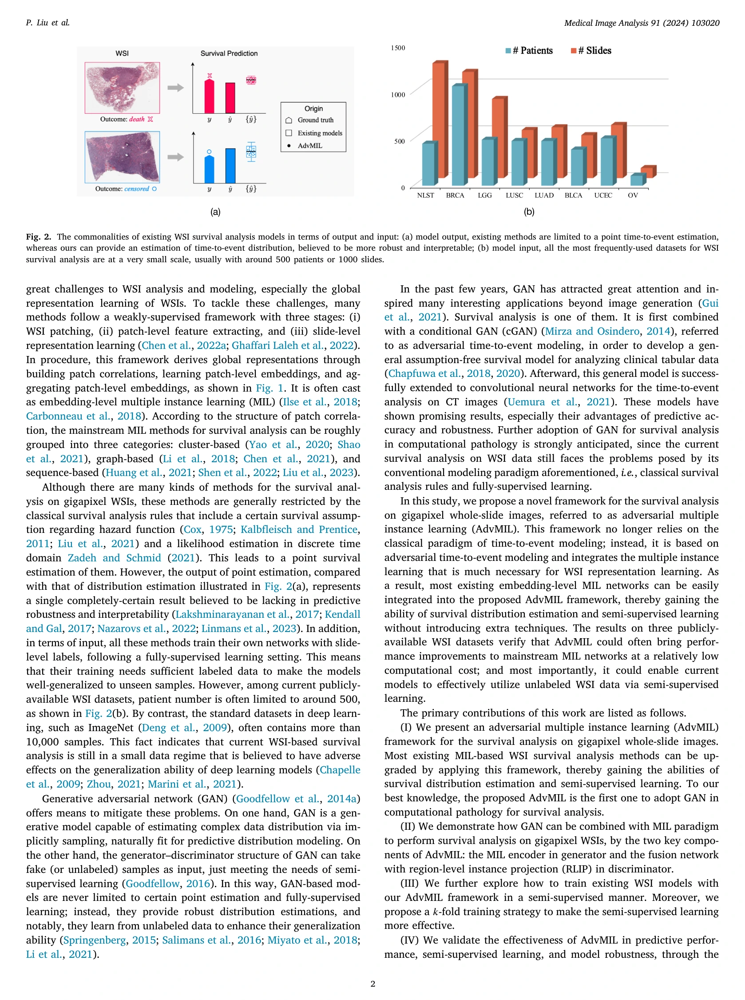
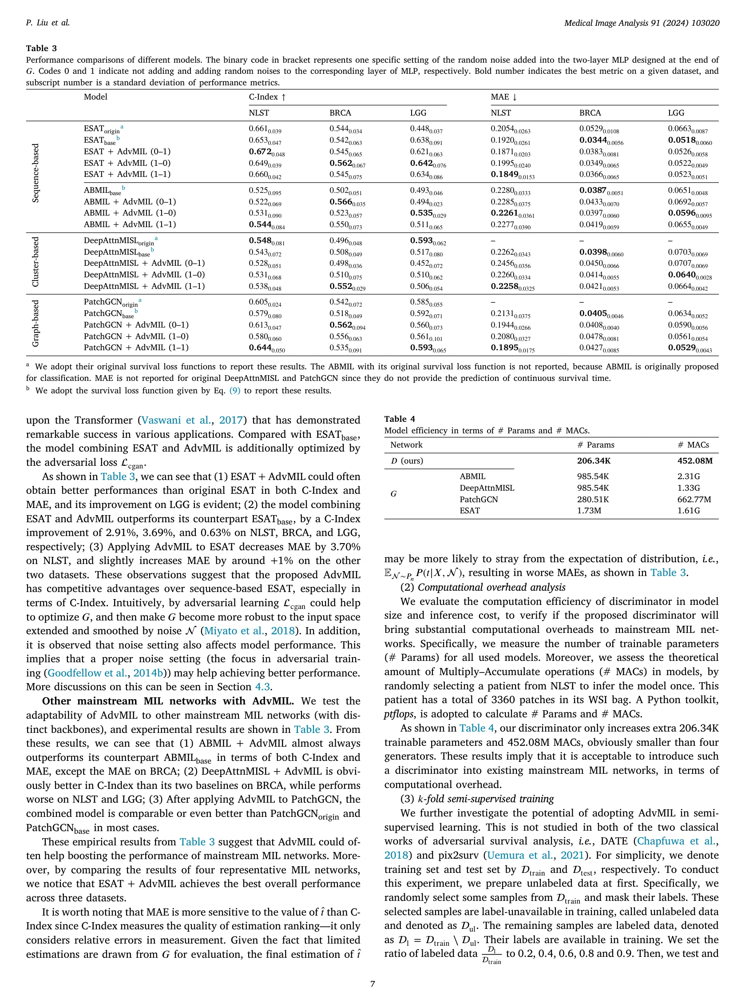
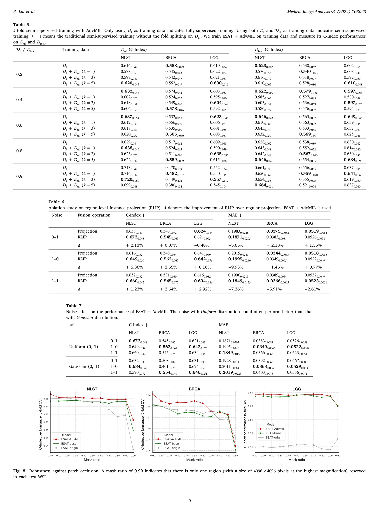
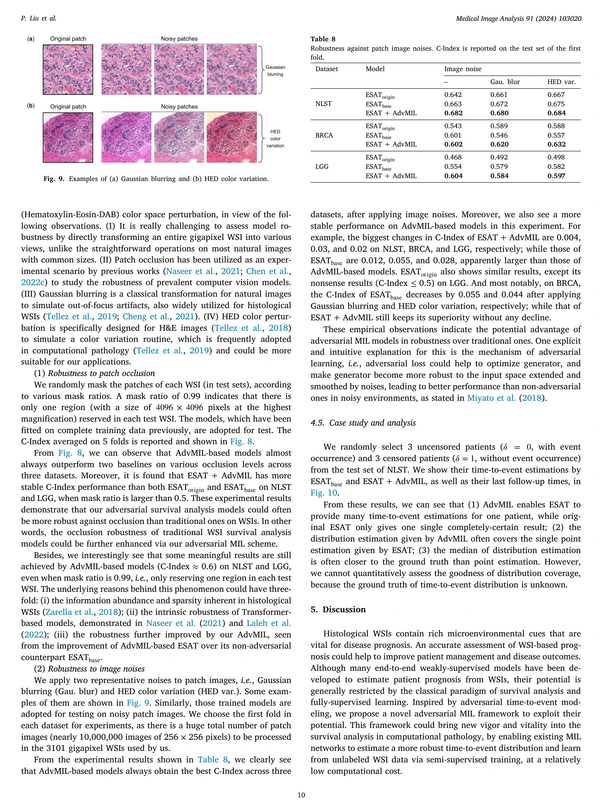
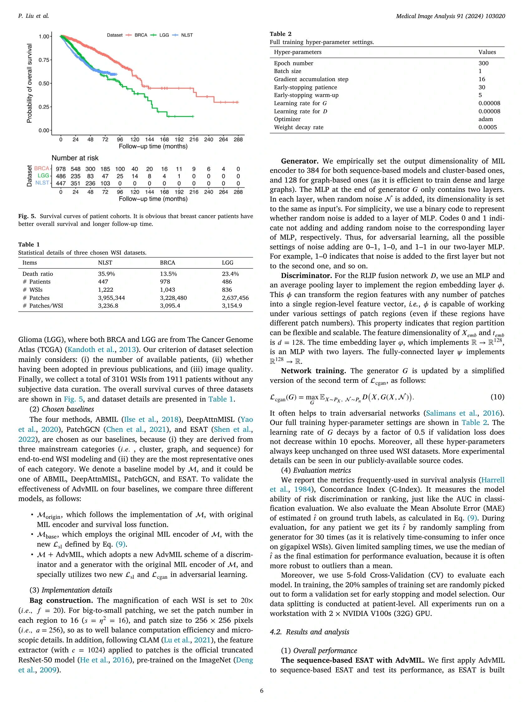

## AdvMIL: Adversarial multiple instance learning for the survival analysis on whole-slide images

> data: NLST、TCGA-BRCA、TCGA-LGG；共 3,101 张切片、1,911 位患者
>
> Medical Image Analysis 2024 · [论文](https://doi.org/10.1016/j.media.2023.103020) · [作者代码](https://github.com/liupei101/AdvMIL)

#### 引言

以对抗式事件时间建模扩展 WSI 生存分析，使 MIL 可估计生存分布，并利用无标签切片开展半监督学习。

#### 方法

（1）条件生成：由 WSI 表示与随机输入生成事件时间估计。

（2）对抗判别：比较真实切片-结局与生成切片-结局配对。

（3）半监督学习：无标签切片可参与对抗训练，有标签切片提供真实结局约束。

<!-- wsi-complete-model -->
##### 模型结构图

**图 3 · 模型结构**（PDF 第 4 页）

> 原文图注：Fig. 3. AdvMIL overview. A gigapixel WSI is transformed into individual patches and the patches with equal region partition by big-to-small patching. A general MIL encoder is adopted as the backbone of conditional generator. An RLIP (region-level instance projection) fusion network is proposed to implement discriminator, elaborated in Fig. 4. Conditional generator is optimized by both cgan and sl. Noise is given by a high-dimensional vector with certain distribution.

[查看原尺寸](assest/AdvMIL/figure-3-complete.webp)

<!-- /wsi-complete-model -->

#### 实验

##### 实验设置

把 AdvMIL 接入 ABMIL、DeepAttnMISL、PatchGCN、ESAT，并比较全监督和半监督配置。

##### 主要结果

收益包括事件时间分布估计及利用无标签切片；无标签样本只参与对应的对抗目标，而非凭空获得真实生存标签。

<!-- wsi-complete-results -->
##### 完整实验指标与对照

下列实验原页保留表头、全部行列、子图、误差说明和脚注，点击可查看原尺寸。比较时请对应相同的数据集、特征编码器和训练设置；`±`、置信区间、百分比和小数均保留原文的单位与统计口径。

| 原表/图中指标 | 读取方式 |
| --- | --- |
| C-index | 越高越好；用于生存预测，需保留终点及删失设置 |

| 原文页 | 阅读内容 | 图表及正文引用 |
| --- | --- | --- |
| PDF 第 2 页 | 实验结果 | Figure 2 |
| PDF 第 6 页 | 数据与实验设置 | Figure 5、Table 1、Table 2 |
| PDF 第 7 页 | 实验结果 | Table 3、Table 4 |
| PDF 第 9 页 | 实验结果 | Table 5、Table 6、Table 7 |
| PDF 第 10 页 | 实验结果 | Table 8、Figure 10 |

**实验原页 · PDF 第 2 页**（图表及正文引用：Figure 2）

[查看原尺寸](assest/AdvMIL/experiment-page-02.webp)

**实验原页 · PDF 第 7 页**（图表及正文引用：Table 3、Table 4）

[查看原尺寸](assest/AdvMIL/experiment-page-07.webp)

**实验原页 · PDF 第 9 页**（图表及正文引用：Table 5、Table 6、Table 7）

[查看原尺寸](assest/AdvMIL/experiment-page-09.webp)

**实验原页 · PDF 第 10 页**（图表及正文引用：Table 8、Figure 10）

[查看原尺寸](assest/AdvMIL/experiment-page-10.webp)

展开消融、参数、数据设置及效率原页

**实验原页 · PDF 第 6 页**（图表及正文引用：Figure 5、Table 1、Table 2）

[查看原尺寸](assest/AdvMIL/experiment-page-06.webp)

<!-- /wsi-complete-results -->

##### 消融与讨论

分析无标签比例、patch 遮挡与图像噪声；必须保留删失处理和生存评估的任务边界。

#### 参考文献

> AdvMIL: Adversarial multiple instance learning for the survival analysis on whole-slide images
>
> Medical Image Analysis 2024 · [论文](https://doi.org/10.1016/j.media.2023.103020) · [作者代码](https://github.com/liupei101/AdvMIL)
