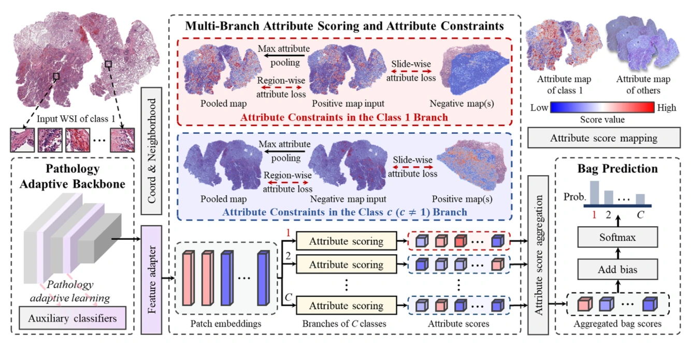
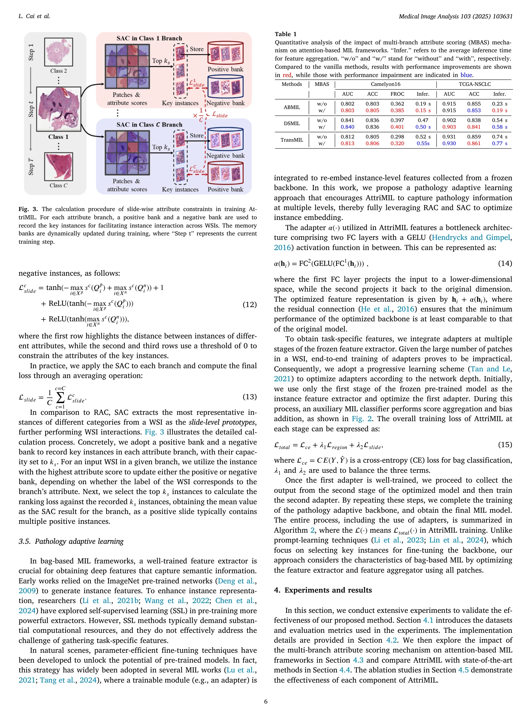
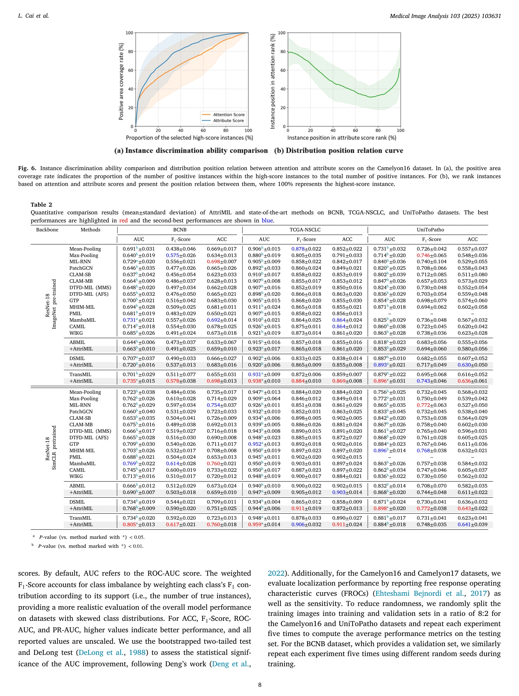
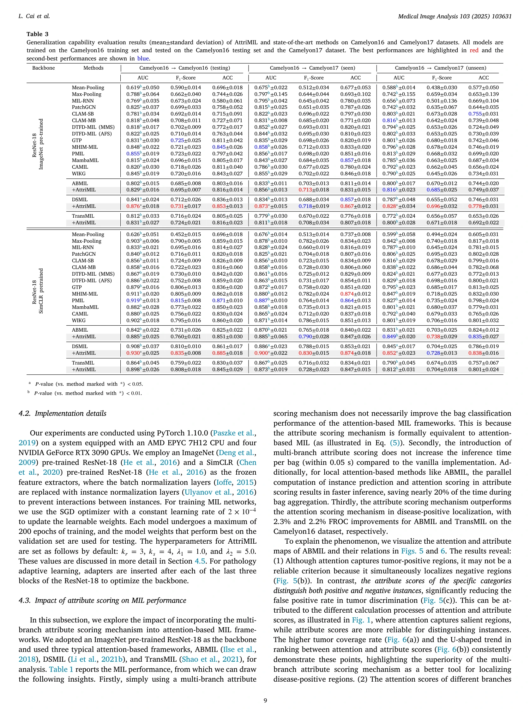
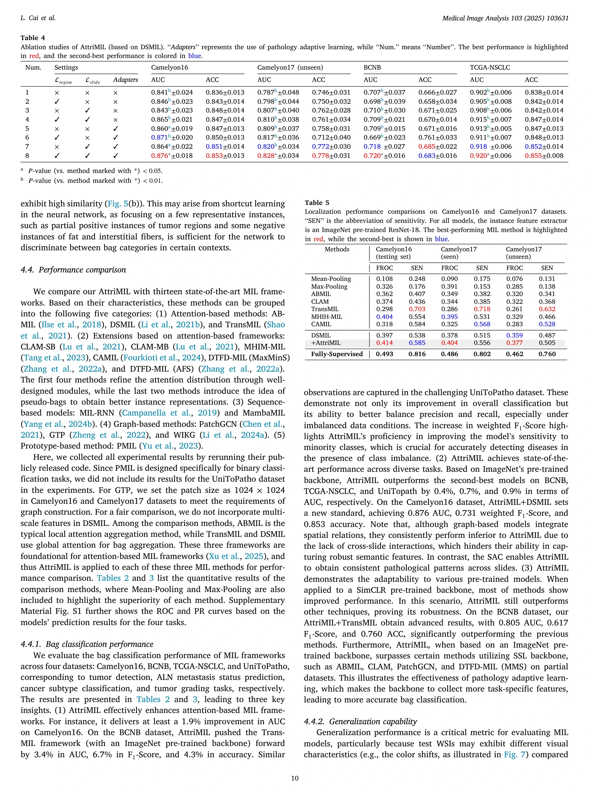
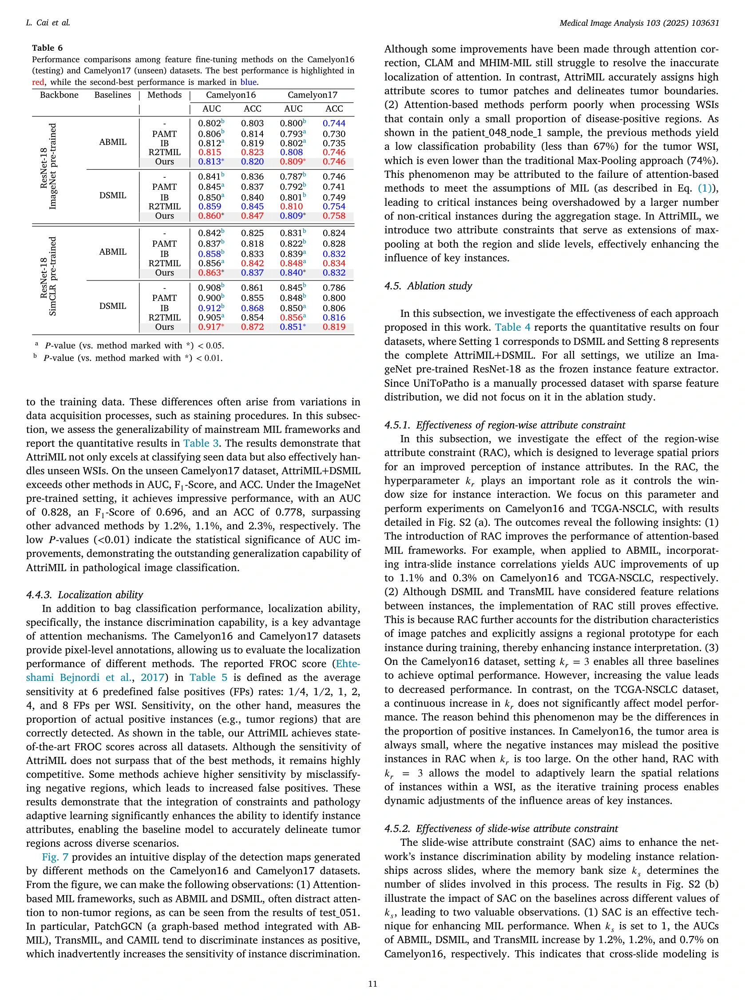
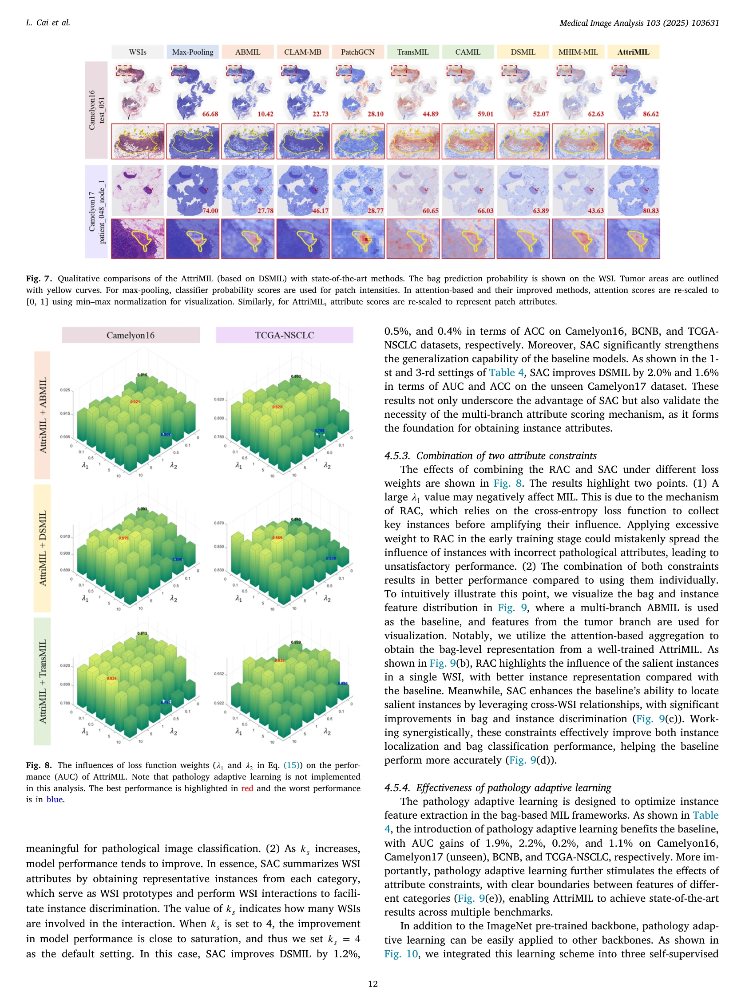
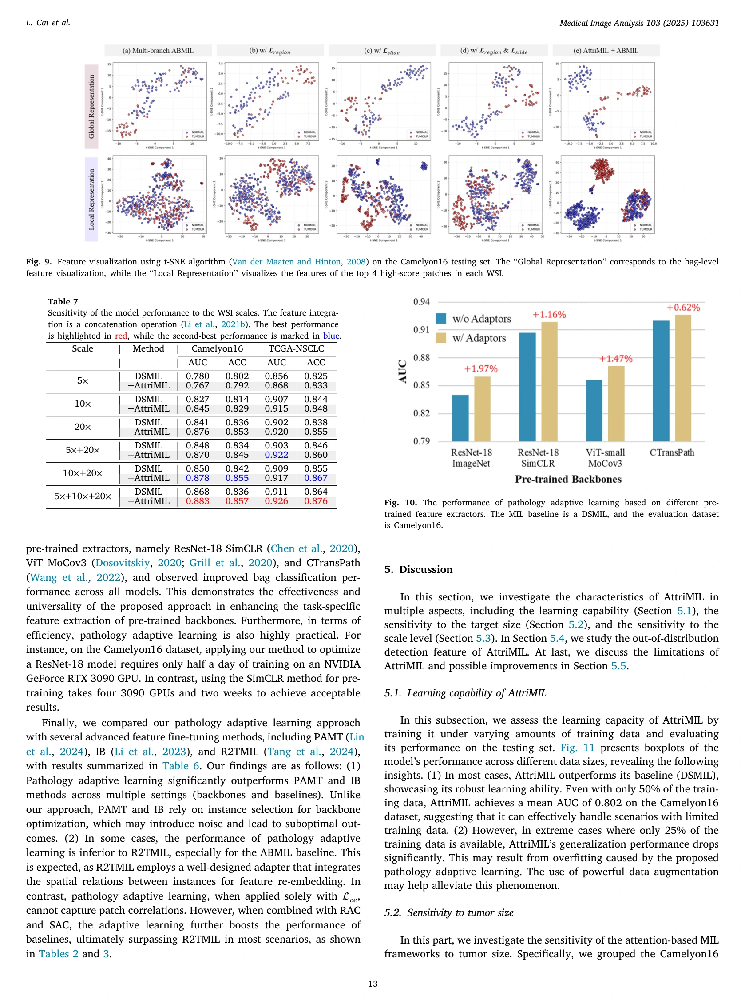
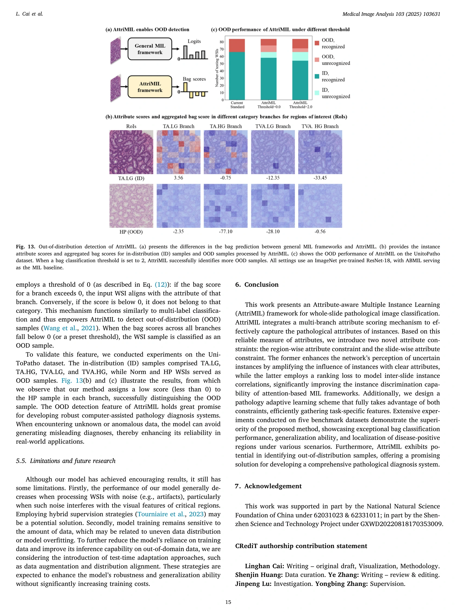

## AttriMIL: Revisiting attention-based multiple instance learning for whole-slide pathological image classification from a perspective of instance attributes

> data:
>
> Camelyon16（[Ehteshami Bejnordi 等，2017](https://www.sciencedirect.com/science/article/pii/S1361841525001781#b17)）
>
> Camelyon17（[Bandi 等，2018](https://www.sciencedirect.com/science/article/pii/S1361841525001781#b2)）
>
> BCNB（[Xu 等，2021](https://www.sciencedirect.com/science/article/pii/S1361841525001781#b69)）
>
> TCGA-NSCLC, [2](https://www.sciencedirect.com/science/article/pii/S1361841525001781#fn2)
>
>  UniToPatho（[Barbano 等，2021 ）。](https://www.sciencedirect.com/science/article/pii/S1361841525001781#b3)
>
> code: [Github](https://github.com/MedCAI/AttriMIL)

#### 引言

##### 问题:

首先，注意力分数并不总是实例属性的可靠指标。基于注意力机制的 MIL 的输出由注意力机制和包分类头共同决定。因此，仅仅依靠注意力权重进行实例区分是一种不完整且可能产生误导的解决方案。

其次，实例独立的假设限制了 MIL 框架对实例之间内在相关性进行建模的能力。些相关性可分为载玻片内相关性和载玻片间相关性。

#### 相关工作

##### 基于实例的 MIL 

基于实例的 MIL 的核心思想是训练实例分类器，然后聚合实例预测以进行包分类。

##### 基于包的 MIL

#### 方法

（1）多分支属性评分

（2）区域属性约束

（3）滑动属性约束

#### 结果

> 参考文献
>
> Cai, Linghan et al. “Rethinking Attention-Based Multiple Instance Learning for Whole-Slide Pathological Image Classification: An Instance Attribute Viewpoint.” *ArXiv* abs/2404.00351 (2024): n. pag.
<!-- wsi-archive-enrichment -->

#### 论文信息与实验补充

> data: CAMELYON16、CAMELYON17、BCNB、TCGA-NSCLC、UniToPatho
>
> Medical Image Analysis 2025 · [论文](https://doi.org/10.1016/j.media.2025.103631) · [作者代码](https://github.com/MedCAI/AttriMIL)

##### 方法补充

（1）属性评分：结合注意力与分类分支，估计实例对包预测的实际贡献。

（2）片内/片间约束：分别利用空间邻近与跨片语义相似性。

（3）特征适配：用病理任务信号进一步调整预训练编码器。

<!-- wsi-complete-model -->
##### 模型结构图

**图 2 · 模型结构**（PDF 第 4 页）

> 原文图注：Fig. 2. Overview of the proposed AttriMIL. Given an input WSI, AttriMIL crops it into patches and utilizes a pathology adaptive backbone to obtain optimized instance embeddings. Next, it generates instance attribute scores for each category using a multi-branch attribute scoring mechanism. For a specific branch, WSIs of the same category are treated as positive, while WSIs of other categories are considered negative. During the training phase, attribute constraints are applied to enhance the network’s perception of instances’ pathological attributes. Finally, AttriMIL performs score aggregation to obtain 𝐶 bag scores, which are then used to generate bag prediction probabilities (Prob.) for final results.

[查看原尺寸](assest/AttriMIL/figure-2-complete.webp)

<!-- /wsi-complete-model -->

##### 实验设置

覆盖肿瘤检测、腋窝淋巴结转移预测、肺癌亚型、肿瘤分级及外部泛化。

##### 主要结果补充

BCNB 中增强 TransMIL 后，AUC/F1/ACC 增益分别为 3.4/6.7/4.3 个百分点；需保留预训练 backbone 条件。

<!-- wsi-complete-results -->
##### 完整实验指标与对照

下列实验原页保留表头、全部行列、子图、误差说明和脚注，点击可查看原尺寸。比较时请对应相同的数据集、特征编码器和训练设置；`±`、置信区间、百分比和小数均保留原文的单位与统计口径。

| 原表/图中指标 | 读取方式 |
| --- | --- |
| ROC-AUC / AUROC | 越高越好；若原表明确为 PR-AUC，则按 PR 曲线面积读取 |
| ACC / Accuracy | 越高越好；平衡准确率、平均准确率以原表标注为准 |
| F1 | 越高越好；保留 macro / weighted / micro 等平均方式 |
| Recall / Sensitivity | 越高越好；与固定敏感度下的特异度区别读取 |
| 时间 / FLOPs / 参数量 | 结合硬件、包长度和计时范围比较；小模型不一定推理更快 |

| 原文页 | 阅读内容 | 图表及正文引用 |
| --- | --- | --- |
| PDF 第 6 页 | 实验结果 | Figure 3、Table 1 |
| PDF 第 8 页 | 实验结果 | Table 2 |
| PDF 第 9 页 | 实验结果 | Table 3 |
| PDF 第 10 页 | 实验结果 | Table 4、Table 5 |
| PDF 第 11 页 | 实验结果 | Table 6 |
| PDF 第 12 页 | 实验结果 | Figure 8 |
| PDF 第 13 页 | 实验结果 | Table 7、Figure 10 |
| PDF 第 15 页 | 实验结果 | Figure 13 |

**实验原页 · PDF 第 6 页**（图表及正文引用：Figure 3、Table 1）

[查看原尺寸](assest/AttriMIL/experiment-page-06.webp)

**实验原页 · PDF 第 8 页**（图表及正文引用：Table 2）

[查看原尺寸](assest/AttriMIL/experiment-page-08.webp)

**实验原页 · PDF 第 9 页**（图表及正文引用：Table 3）

[查看原尺寸](assest/AttriMIL/experiment-page-09.webp)

**实验原页 · PDF 第 10 页**（图表及正文引用：Table 4、Table 5）

[查看原尺寸](assest/AttriMIL/experiment-page-10.webp)

**实验原页 · PDF 第 11 页**（图表及正文引用：Table 6）

[查看原尺寸](assest/AttriMIL/experiment-page-11.webp)

**实验原页 · PDF 第 12 页**（图表及正文引用：Figure 8）

[查看原尺寸](assest/AttriMIL/experiment-page-12.webp)

**实验原页 · PDF 第 13 页**（图表及正文引用：Table 7、Figure 10）

[查看原尺寸](assest/AttriMIL/experiment-page-13.webp)

**实验原页 · PDF 第 15 页**（图表及正文引用：Figure 13）

[查看原尺寸](assest/AttriMIL/experiment-page-15.webp)

<!-- /wsi-complete-results -->

##### 消融与讨论

分别考察多分支属性评分、区域约束、切片约束与病理自适应学习，区分切片分类和病灶定位证据。
