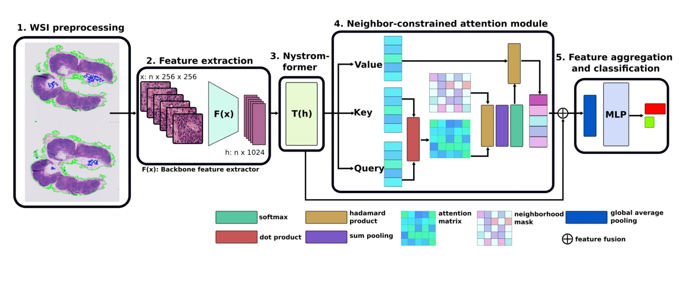
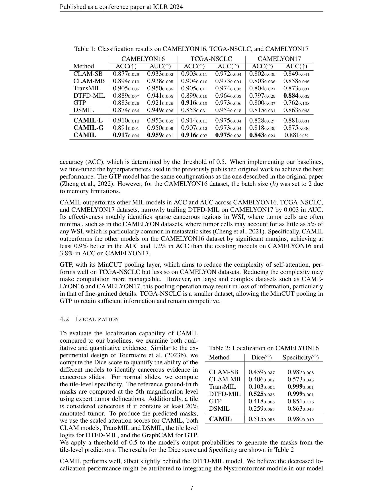
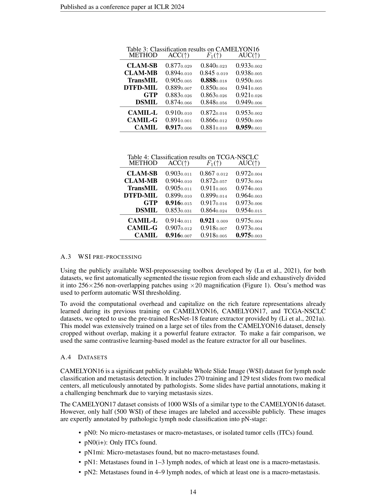
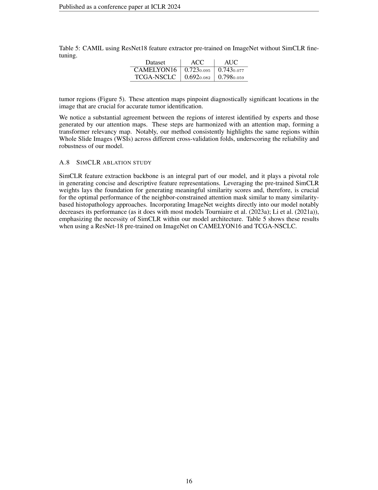

## CAMIL: Context-Aware Multiple Instance Learning for Cancer Detection and Subtyping in Whole Slide Images

> data: CAMELYON16、CAMELYON17、TCGA-NSCLC
>
> ICLR 2024 · [论文](https://arxiv.org/abs/2305.05314) · [作者代码](https://github.com/olgarithmics/ICLR_CAMIL)

#### 引言

以邻域约束注意力编码 patch 间的上下文关系，将组织邻域先验融入切片分类，关注癌症检测、亚型识别及定位解释。

#### 方法

（1）邻域建模：让每个 tile 的表示受到相邻组织上下文约束。

（2）上下文注意力：将邻域依赖作为先验，而非仅计算孤立实例分数。

（3）实例聚合：汇总更新后的特征进行检测和亚型分类。

<!-- wsi-complete-model -->
##### 模型结构图

**图 1 · 模型结构**（PDF 第 3 页）

> 原文图注：Figure 1: An overview of the CAMIL model architecture. First, WSIs are preprocessed to separate tissue

[查看原尺寸](assest/CAMIL-Context/figure-1-complete.webp)

<!-- /wsi-complete-model -->

#### 实验

##### 实验设置

同时评价切片分类与定位；定位使用 Dice 和阴性切片 tile-level specificity。

##### 主要结果

摘要所报 TCGA-NSCLC、CAMELYON16、CAMELYON17 AUC 分别为 97.5%、95.9%、88.1%。

<!-- wsi-complete-results -->
##### 完整实验指标与对照

下列实验原页保留表头、全部行列、子图、误差说明和脚注，点击可查看原尺寸。比较时请对应相同的数据集、特征编码器和训练设置；`±`、置信区间、百分比和小数均保留原文的单位与统计口径。

| 原表/图中指标 | 读取方式 |
| --- | --- |
| ROC-AUC / AUROC | 越高越好；若原表明确为 PR-AUC，则按 PR 曲线面积读取 |
| ACC / Accuracy | 越高越好；平衡准确率、平均准确率以原表标注为准 |
| Specificity | 越高越好；若固定敏感度，须保留对应工作点 |
| Dice / IoU | 越高越好；区分像素/实例分割与切片分类 |

| 原文页 | 阅读内容 | 图表及正文引用 |
| --- | --- | --- |
| PDF 第 7 页 | 实验结果 | Table 1、Table 2 |
| PDF 第 14 页 | 实验结果 | Table 3、Table 4 |
| PDF 第 16 页 | 实验结果 | Table 5 |

**实验原页 · PDF 第 7 页**（图表及正文引用：Table 1、Table 2）

[查看原尺寸](assest/CAMIL-Context/experiment-page-07.webp)

**实验原页 · PDF 第 14 页**（图表及正文引用：Table 3、Table 4）

[查看原尺寸](assest/CAMIL-Context/experiment-page-14.webp)

**实验原页 · PDF 第 16 页**（图表及正文引用：Table 5）

[查看原尺寸](assest/CAMIL-Context/experiment-page-16.webp)

<!-- /wsi-complete-results -->

##### 消融与讨论

病灶参考掩码由专家标注生成，tile 肿瘤占比至少 20% 时记为阳性；定位阈值与切片分类指标需分开理解。

#### 参考文献

> CAMIL: Context-Aware Multiple Instance Learning for Cancer Detection and Subtyping in Whole Slide Images
>
> ICLR 2024 · [论文](https://arxiv.org/abs/2305.05314) · [作者代码](https://github.com/olgarithmics/ICLR_CAMIL)
