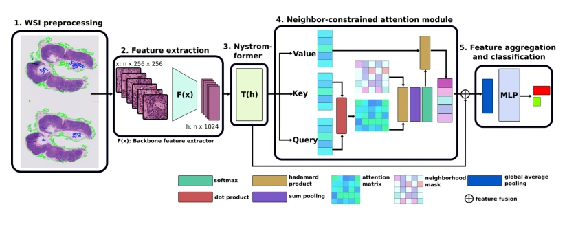
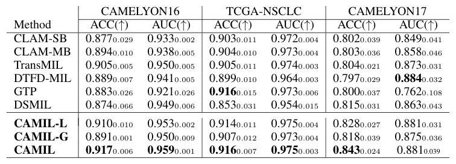

## CAMIL: Context-Aware Multiple Instance Learning for Cancer Detection and Subtyping in Whole Slide Images

> data: CAMELYON16、CAMELYON17、TCGA-NSCLC
>
> ICLR 2024 · [论文](https://arxiv.org/abs/2305.05314) · [作者代码](https://github.com/olgarithmics/ICLR_CAMIL)

#### 引言

以邻域约束注意力编码 patch 间的上下文关系，将组织邻域先验融入切片分类，关注癌症检测、亚型识别及定位解释。

#### 方法

（1）邻域建模：让每个 tile 的表示受到相邻组织上下文约束。

（2）上下文注意力：将邻域依赖作为先验，而非仅计算孤立实例分数。

（3）实例聚合：汇总更新后的特征进行检测和亚型分类。

原文Figure 1，PDF 第 3 页。

#### 实验

##### 实验设置

同时评价切片分类与定位；定位使用 Dice 和阴性切片 tile-level specificity。

##### 主要结果

摘要所报 TCGA-NSCLC、CAMELYON16、CAMELYON17 AUC 分别为 97.5%、95.9%、88.1%。

原文Table 1，PDF 第 7 页。

##### 消融与讨论

病灶参考掩码由专家标注生成，tile 肿瘤占比至少 20% 时记为阳性；定位阈值与切片分类指标需分开理解。

#### 参考文献

> CAMIL: Context-Aware Multiple Instance Learning for Cancer Detection and Subtyping in Whole Slide Images
>
> ICLR 2024 · [论文](https://arxiv.org/abs/2305.05314) · [作者代码](https://github.com/olgarithmics/ICLR_CAMIL)
