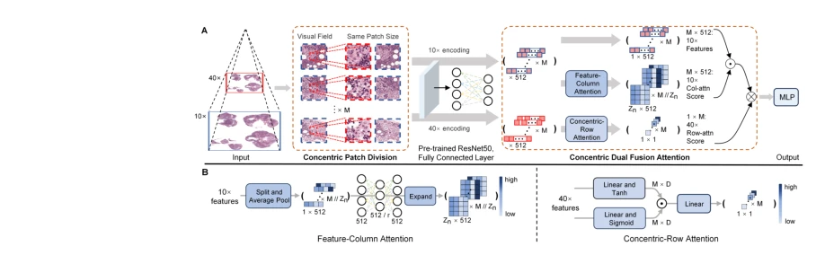
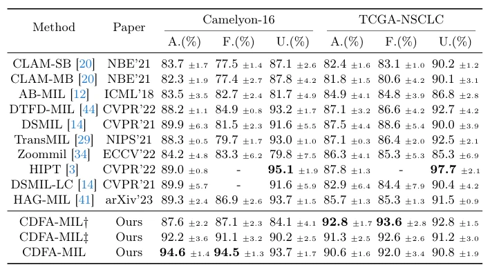

## Towards Efficient Information Fusion: Concentric Dual Fusion Attention Based Multiple Instance Learning for Whole Slide Images

> data: CAMELYON16、TCGA-NSCLC
>
> arXiv 2024 · [论文](https://arxiv.org/abs/2403.14346)

#### 引言

在多倍率同心 patch 间设计点到区域和点到点的双重注意力融合，显式利用跨倍率空间对应关系，增强切片表征。

#### 方法

（1）同心取样：使不同倍率 patch 保持明确的空间对应关系。

（2）列注意力：从点到区域进行特征融合，吸收相关上下文。

（3）行注意力：在同心对应位置间进行点对点交互，再形成切片表示。

原文Fig. 2，PDF 第 6 页。

#### 实验

##### 实验设置

比较单倍率与跨倍率融合，并在 AB-MIL 等聚合器中逐步加入两类注意力。

##### 主要结果

主结果表同时报告 ACC、F1、AUC；摘要汇总两个数据集平均 ACC/F1 为 93.7%/94.1%，不等于任一数据集的单独结果。

原文Table 1，PDF 第 11 页。

##### 消融与讨论

分别消融 feature-column attention 与 concentric-row attention，检查同心 patch 对齐是否带来有效跨倍率信息。

#### 参考文献

> Towards Efficient Information Fusion: Concentric Dual Fusion Attention Based Multiple Instance Learning for Whole Slide Images
>
> arXiv 2024 · [论文](https://arxiv.org/abs/2403.14346)
