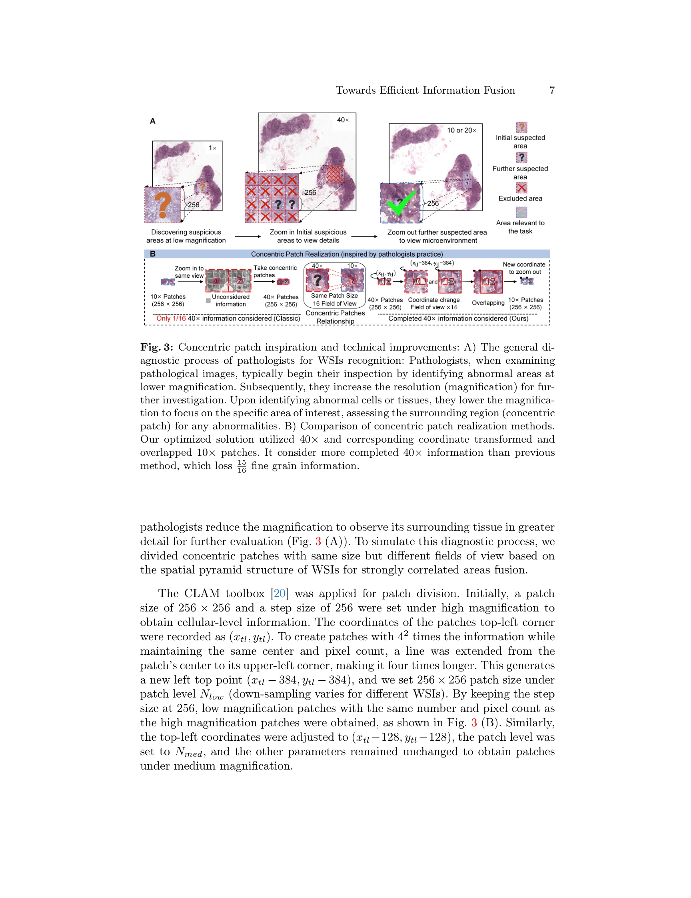
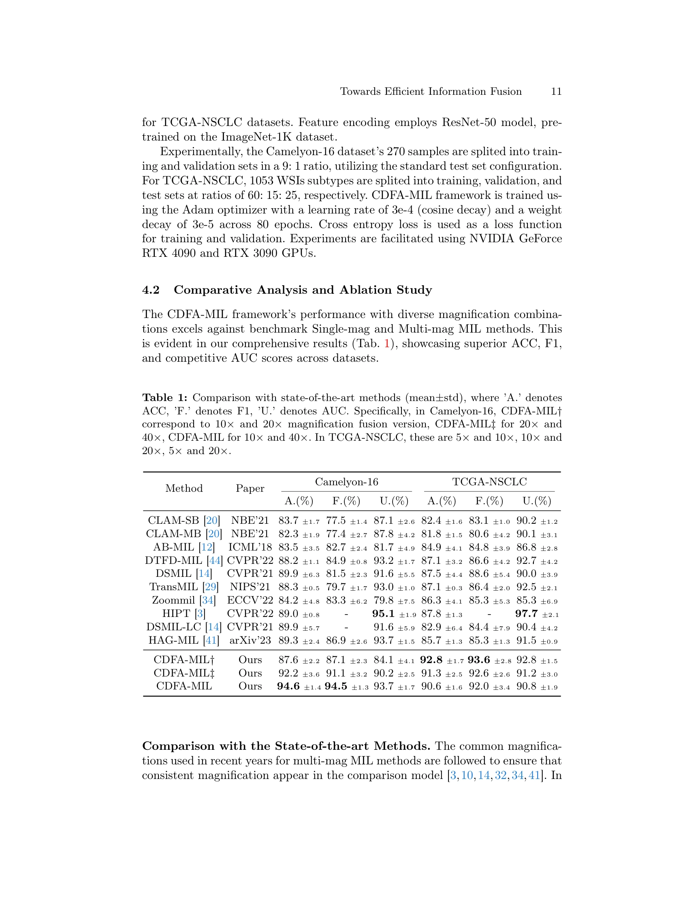
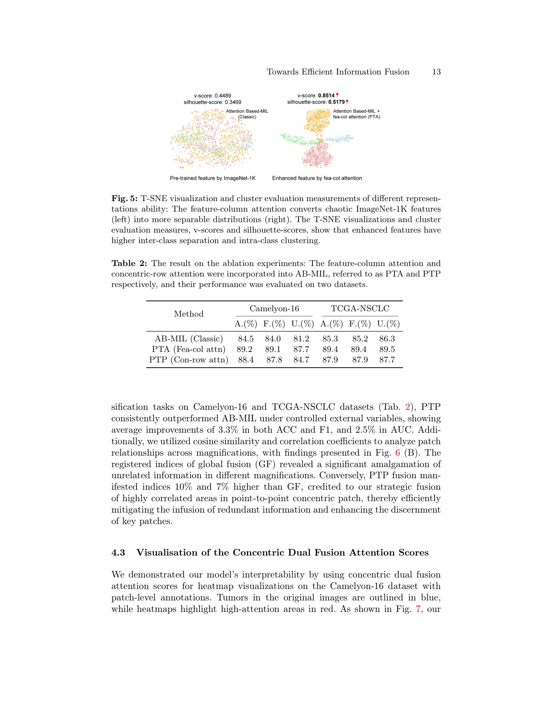

## Towards Efficient Information Fusion: Concentric Dual Fusion Attention Based Multiple Instance Learning for Whole Slide Images

> data: CAMELYON16、TCGA-NSCLC
>
> arXiv 2024 · [论文](https://arxiv.org/abs/2403.14346)

#### 引言

在多倍率同心 patch 间设计点到区域和点到点的双重注意力融合，显式利用跨倍率空间对应关系，增强切片表征。

#### 方法

（1）同心取样：使不同倍率 patch 保持明确的空间对应关系。

（2）列注意力：从点到区域进行特征融合，吸收相关上下文。

（3）行注意力：在同心对应位置间进行点对点交互，再形成切片表示。

<!-- wsi-complete-model -->
##### 模型结构图

**图 2 · 模型结构**（PDF 第 6 页）

> 原文图注：Fig. 2: Workflow of the CDFA-MIL framework: A) High-magnification (40×) patches are scaled to lower magnifications (10×) for feature extraction using pre-trained ResNet-50 [8]. CDFA-MIL utilizes dual fusion attention, combining feature-column and concentric-row attentions, to merge features across magnifications for MLP classi- fication. B) The dual fusion attention mechanism intricately combines feature-column and concentric-row attentions.

[查看原尺寸](assest/CDFA-MIL/figure-2-complete.webp)

<!-- /wsi-complete-model -->

#### 实验

##### 实验设置

比较单倍率与跨倍率融合，并在 AB-MIL 等聚合器中逐步加入两类注意力。

##### 主要结果

主结果表同时报告 ACC、F1、AUC；摘要汇总两个数据集平均 ACC/F1 为 93.7%/94.1%，不等于任一数据集的单独结果。

<!-- wsi-complete-results -->
##### 完整实验指标与对照

下列实验原页保留表头、全部行列、子图、误差说明和脚注，点击可查看原尺寸。比较时请对应相同的数据集、特征编码器和训练设置；`±`、置信区间、百分比和小数均保留原文的单位与统计口径。

| 原表/图中指标 | 读取方式 |
| --- | --- |
| ROC-AUC / AUROC | 越高越好；若原表明确为 PR-AUC，则按 PR 曲线面积读取 |
| ACC / Accuracy | 越高越好；平衡准确率、平均准确率以原表标注为准 |
| F1 | 越高越好；保留 macro / weighted / micro 等平均方式 |

| 原文页 | 阅读内容 | 图表及正文引用 |
| --- | --- | --- |
| PDF 第 7 页 | 实验结果 | Figure 3 |
| PDF 第 11 页 | 实验结果 | Table 1 |
| PDF 第 13 页 | 消融与参数分析 | Table 2 |

**实验原页 · PDF 第 7 页**（图表及正文引用：Figure 3）

[查看原尺寸](assest/CDFA-MIL/experiment-page-07.webp)

**实验原页 · PDF 第 11 页**（图表及正文引用：Table 1）

[查看原尺寸](assest/CDFA-MIL/experiment-page-11.webp)

展开消融、参数、数据设置及效率原页

**实验原页 · PDF 第 13 页**（图表及正文引用：Table 2）

[查看原尺寸](assest/CDFA-MIL/experiment-page-13.webp)

<!-- /wsi-complete-results -->

##### 消融与讨论

分别消融 feature-column attention 与 concentric-row attention，检查同心 patch 对齐是否带来有效跨倍率信息。

#### 参考文献

> Towards Efficient Information Fusion: Concentric Dual Fusion Attention Based Multiple Instance Learning for Whole Slide Images
>
> arXiv 2024 · [论文](https://arxiv.org/abs/2403.14346)
