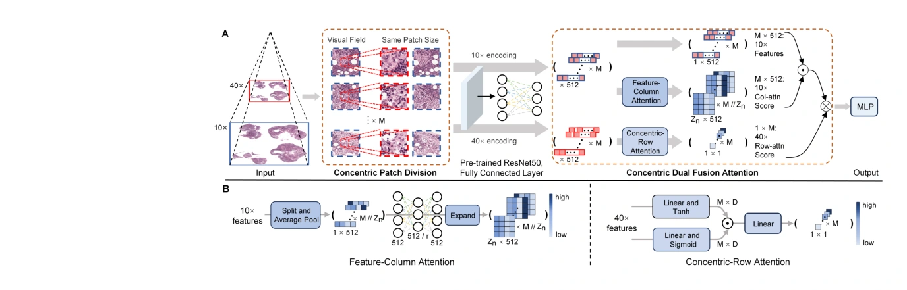

## Towards Efficient Information Fusion: Concentric Dual Fusion Attention Based Multiple Instance Learning for Whole Slide Images

> data: CAMELYON16、TCGA-NSCLC
>
> arXiv 2024 · [论文](https://arxiv.org/abs/2403.14346)

#### 引言

在多倍率同心 patch 间设计点到区域和点到点的双重注意力融合，显式利用跨倍率空间对应关系，增强切片表征。

#### 方法

（1）同心取样：使不同倍率 patch 保持明确的空间对应关系。

（2）列注意力：从点到区域进行特征融合，吸收相关上下文。

（3）行注意力：在同心对应位置间进行点对点交互，再形成切片表示。

##### 模型结构图

图 2（PDF 第 6 页）

#### 实验

##### 实验设置

比较单倍率与跨倍率融合，并在 AB-MIL 等聚合器中逐步加入两类注意力。

##### 关键指标 { #key-results }

| 数据集与倍率 | ACC（%） | F1（%） | AUC（%） |
| --- | --- | --- | --- |
| CAMELYON16，10× + 40× | 94.6 ± 1.4 | 94.5 ± 1.3 | 93.7 ± 1.7 |
| TCGA-NSCLC，5× + 10× | 92.8 ± 1.7 | 93.6 ± 2.8 | 92.8 ± 1.5 |

数据来源为原文表 1，PDF 第 11 页。

##### 结果解读

同心 patch 的最佳倍率组合随数据集变化。表中选取两个任务各自的代表性配置，摘要中的平均 ACC 和 F1 汇总了两个数据集。

##### 消融与讨论

分别消融 feature-column attention 与 concentric-row attention，检查同心 patch 对齐是否带来有效跨倍率信息。

#### 参考文献

> Towards Efficient Information Fusion: Concentric Dual Fusion Attention Based Multiple Instance Learning for Whole Slide Images
>
> arXiv 2024 · [论文](https://arxiv.org/abs/2403.14346)
