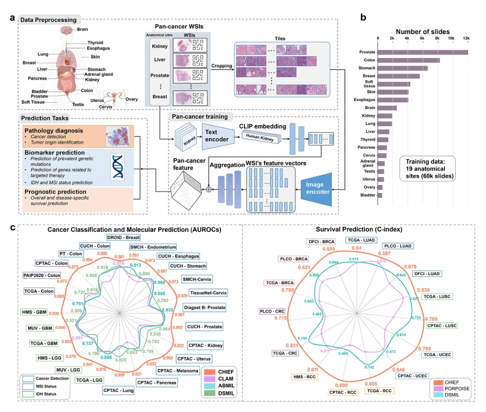

## A Pathology Foundation Model for Cancer Diagnosis and Prognosis Prediction

> data: 19 个解剖部位预训练数据；32 个独立测试集，覆盖 24 家医院/队列
>
> Nature 2024 · [论文](https://doi.org/10.1038/s41586-024-07894-z) · [作者代码](https://github.com/hms-dbmi/CHIEF)

#### 引言

结合 tile 级无监督预训练和切片级弱监督预训练，学习跨任务病理表征，覆盖癌细胞检测、肿瘤来源、分子特征与预后预测。

#### 方法

（1）Tile 预训练：无监督编码细胞形态和局部组织特征。

（2）切片预训练：以弱监督学习器官与整体组织模式。

（3）跨任务迁移：用共享病理表征适配检测、来源、分子和预后任务。

原文Fig. 1，PDF 第 30 页。

#### 实验

##### 实验设置

预训练使用 60,530 张 WSI，外部验证使用 19,491 张；覆盖癌检测、来源、分子及预后任务。

##### 主要结果

预后评估中作者报告平均 C-index 为 0.74，比较 PORPOISE 的 0.62 和 DSMIL 的 0.67；该数字属于对应评估集。

##### 消融与讨论

同时阅读跨癌种外部验证与生存分层，不把预训练规模和下游样本规模相加。

#### 参考文献

> A Pathology Foundation Model for Cancer Diagnosis and Prognosis Prediction
>
> Nature 2024 · [论文](https://doi.org/10.1038/s41586-024-07894-z) · [作者代码](https://github.com/hms-dbmi/CHIEF)
