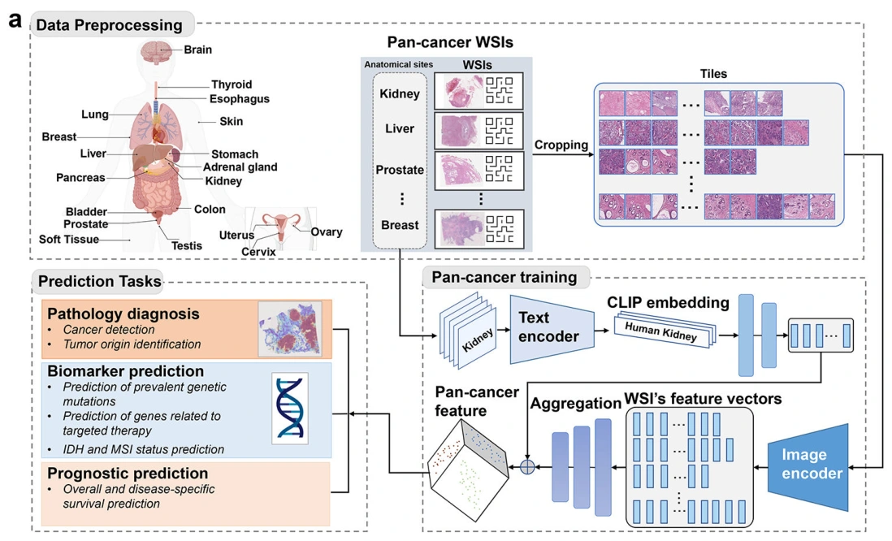
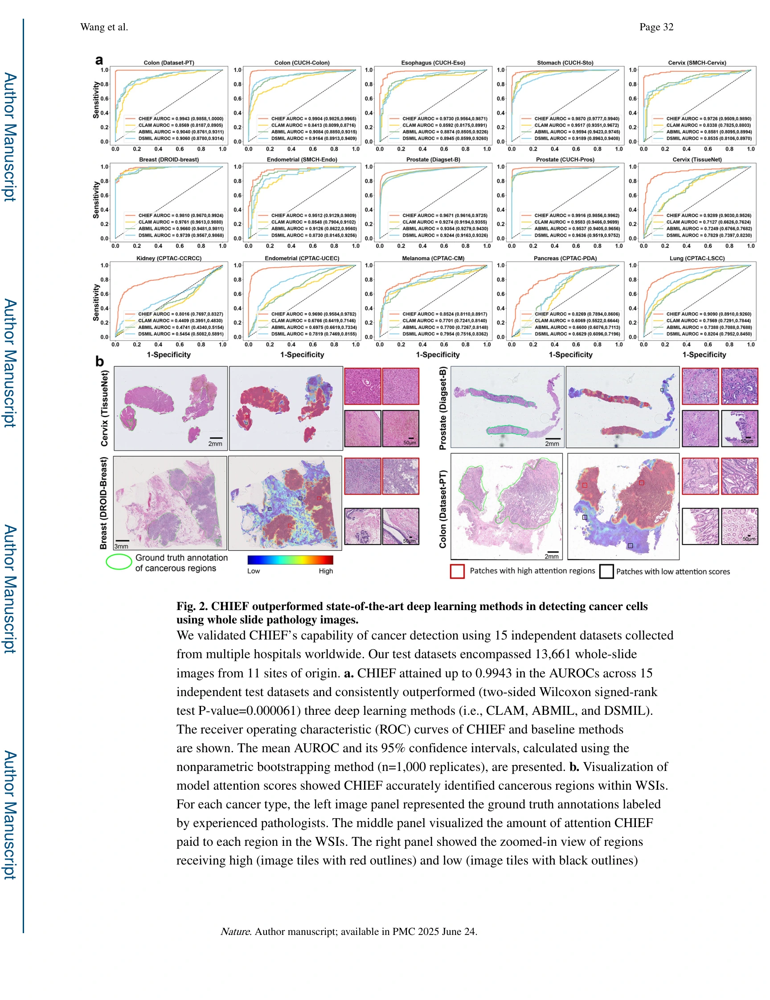
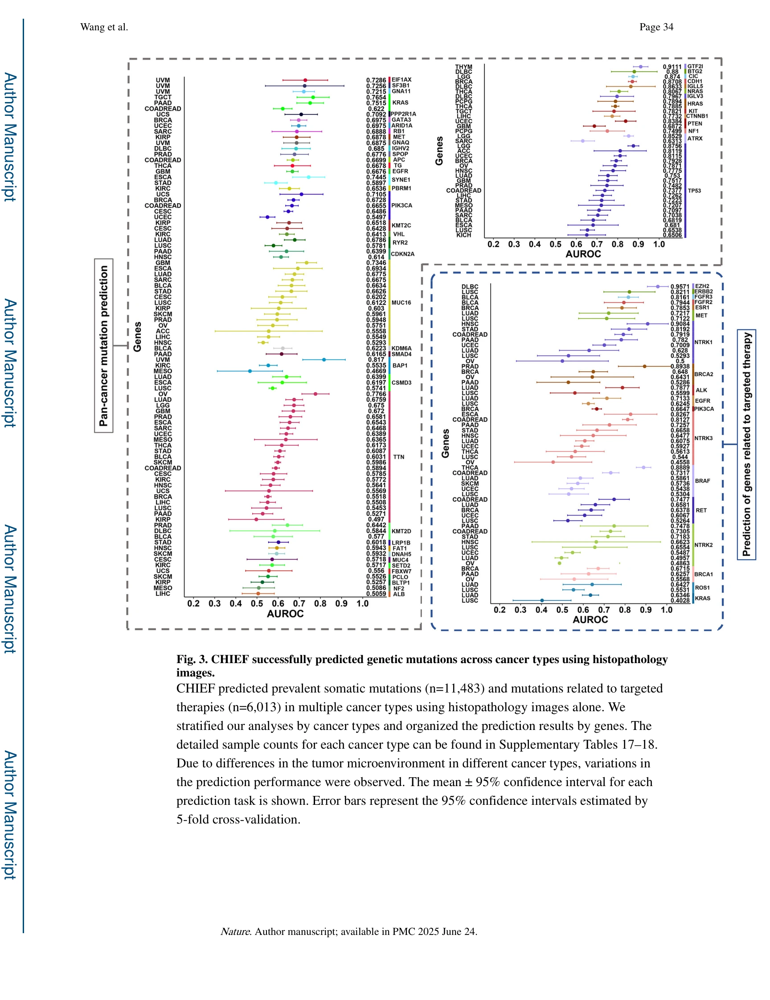
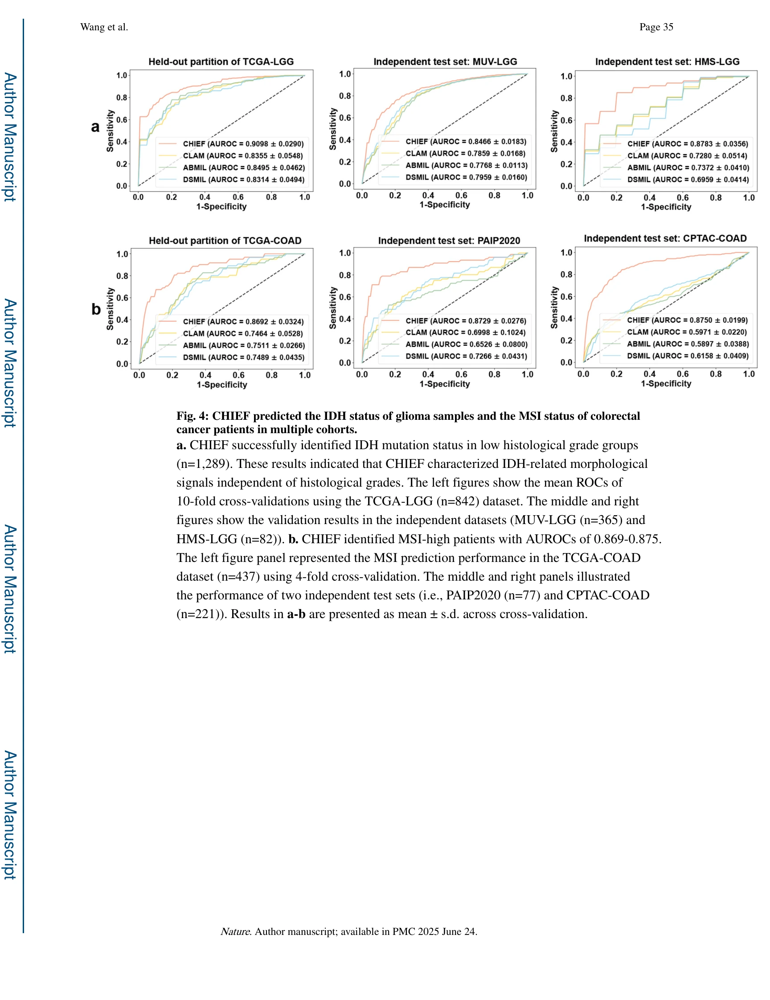
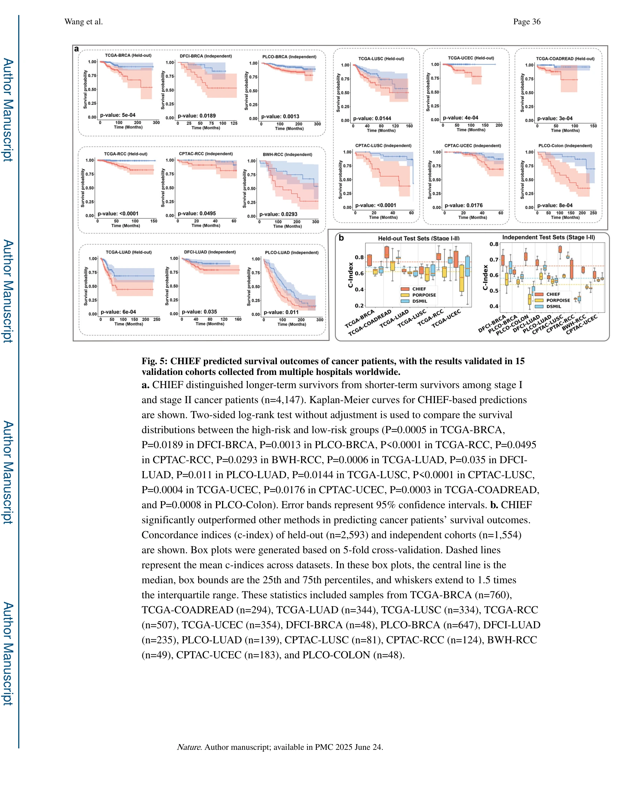

## A Pathology Foundation Model for Cancer Diagnosis and Prognosis Prediction

> data: 19 个解剖部位预训练数据；32 个独立测试集，覆盖 24 家医院/队列
>
> Nature 2024 · [论文](https://doi.org/10.1038/s41586-024-07894-z) · [作者代码](https://github.com/hms-dbmi/CHIEF)

#### 引言

结合 tile 级无监督预训练和切片级弱监督预训练，学习跨任务病理表征，覆盖癌细胞检测、肿瘤来源、分子特征与预后预测。

#### 方法

（1）Tile 预训练：无监督编码细胞形态和局部组织特征。

（2）切片预训练：以弱监督学习器官与整体组织模式。

（3）跨任务迁移：用共享病理表征适配检测、来源、分子和预后任务。

<!-- wsi-complete-model -->
##### 模型结构图

**图 1 · 模型结构**（PDF 第 30 页）

> 原文图注：Fig. 1. An overview of the Clinical Histopathology Imaging Evaluation Foundation (CHIEF) model. a. CHIEF is a generalizable machine learning framework for weakly supervised

[查看原尺寸](assest/CHIEF/figure-1-complete.webp)

<!-- /wsi-complete-model -->

#### 实验

##### 实验设置

预训练使用 60,530 张 WSI，外部验证使用 19,491 张；覆盖癌检测、来源、分子及预后任务。

##### 主要结果

预后评估中作者报告平均 C-index 为 0.74，比较 PORPOISE 的 0.62 和 DSMIL 的 0.67；该数字属于对应评估集。

<!-- wsi-complete-results -->
##### 完整实验指标与对照

下列实验原页保留表头、全部行列、子图、误差说明和脚注，点击可查看原尺寸。比较时请对应相同的数据集、特征编码器和训练设置；`±`、置信区间、百分比和小数均保留原文的单位与统计口径。

| 原表/图中指标 | 读取方式 |
| --- | --- |
| C-index | 越高越好；用于生存预测，需保留终点及删失设置 |

| 原文页 | 阅读内容 | 图表及正文引用 |
| --- | --- | --- |
| PDF 第 32 页 | 实验结果 | Figure 2 |
| PDF 第 34 页 | 实验结果 | Figure 3 |
| PDF 第 35 页 | 实验结果 | Figure 4 |
| PDF 第 36 页 | 实验结果 | Figure 5 |

**实验原页 · PDF 第 32 页**（图表及正文引用：Figure 2）

[查看原尺寸](assest/CHIEF/experiment-page-32.webp)

**实验原页 · PDF 第 34 页**（图表及正文引用：Figure 3）

[查看原尺寸](assest/CHIEF/experiment-page-34.webp)

**实验原页 · PDF 第 35 页**（图表及正文引用：Figure 4）

[查看原尺寸](assest/CHIEF/experiment-page-35.webp)

**实验原页 · PDF 第 36 页**（图表及正文引用：Figure 5）

[查看原尺寸](assest/CHIEF/experiment-page-36.webp)

<!-- /wsi-complete-results -->

##### 消融与讨论

同时阅读跨癌种外部验证与生存分层，不把预训练规模和下游样本规模相加。

#### 参考文献

> A Pathology Foundation Model for Cancer Diagnosis and Prognosis Prediction
>
> Nature 2024 · [论文](https://doi.org/10.1038/s41586-024-07894-z) · [作者代码](https://github.com/hms-dbmi/CHIEF)
