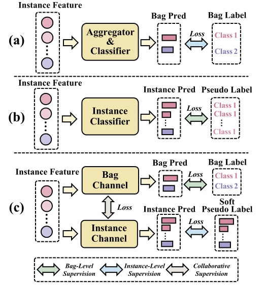

## Collaborative instance-level and bag-level multiple instance learning with label disambiguation for whole slide image analysis

> data: 三个公开、两个内部 WSI 数据集；另有 EGFR IHC 对照
>
> Medical Image Analysis 2026 · [论文](https://doi.org/10.1016/j.media.2026.104192) · [作者代码](https://github.com/TencentAILabHealthcare/CIB-MIL)

#### 引言

在实例级通道进行伪标签消歧，再让实例伪监督与包级注意力互相传递信息，联合优化细粒度预测和切片聚合。

#### 方法

（1）实例通道：以噪声标签学习修正实例伪标签。

（2）包级通道：注意力聚合提供切片监督。

（3）协同更新：原型和置信库与注意力互相校正，减少两通道各自偏差。

原文Fig. 1，PDF 第 2 页。

#### 实验

##### 实验设置

比较实例/包监督与标签消歧，另用两位盲评病理专家评分的 IHC 图检验热图。

##### 主要结果

加入标签消歧的 AUC 增益范围为 0.91–5.63 个百分点；IHC 对照是另外的定位/生物学证据。

##### 消融与讨论

消融标签消歧与 Transformer backbone，检查原型、置信库的动量更新与直接继承包标签的区别。

#### 参考文献

> Collaborative instance-level and bag-level multiple instance learning with label disambiguation for whole slide image analysis
>
> Medical Image Analysis 2026 · [论文](https://doi.org/10.1016/j.media.2026.104192) · [作者代码](https://github.com/TencentAILabHealthcare/CIB-MIL)
