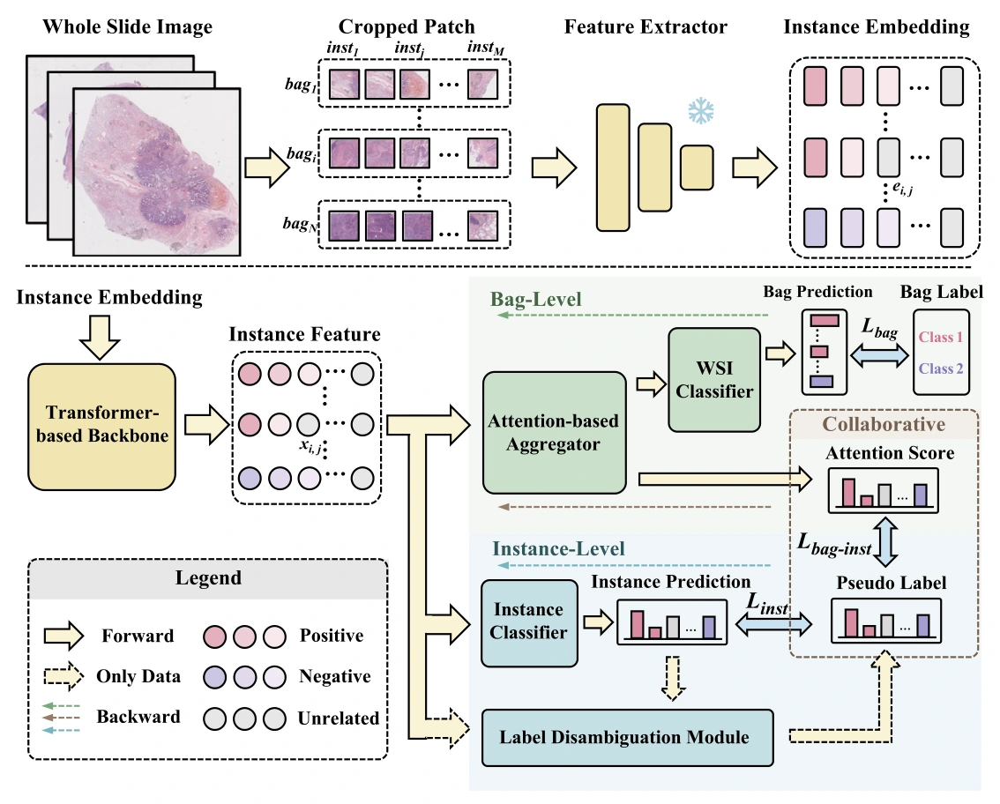
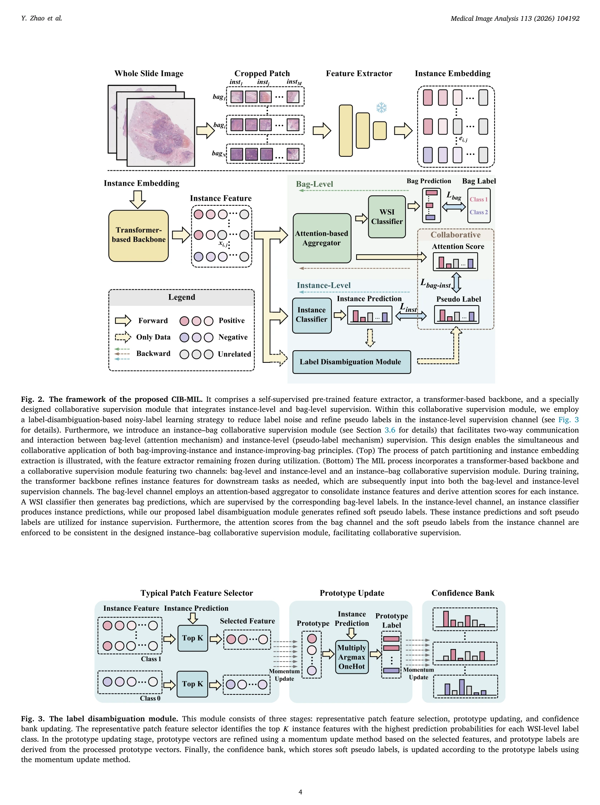
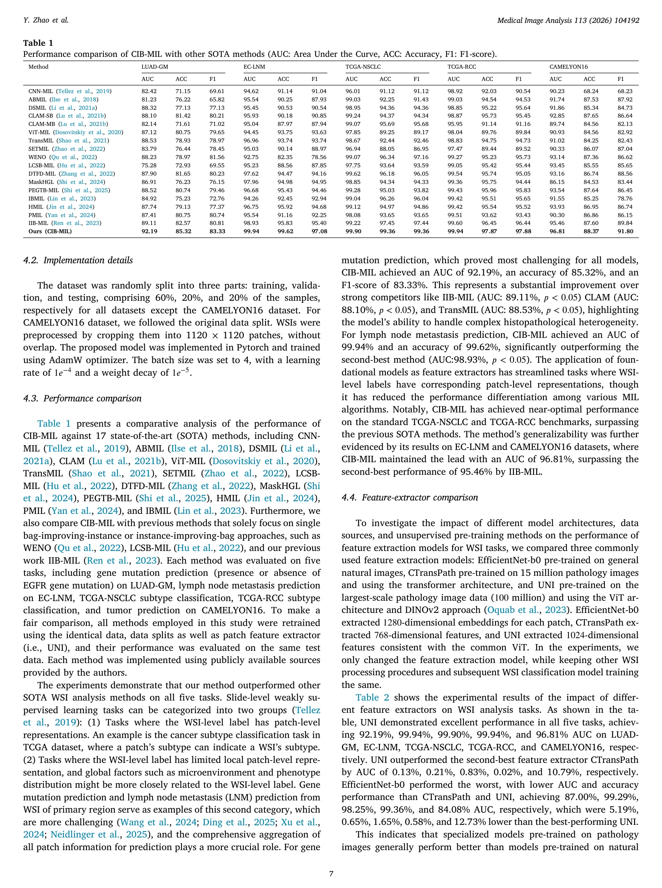
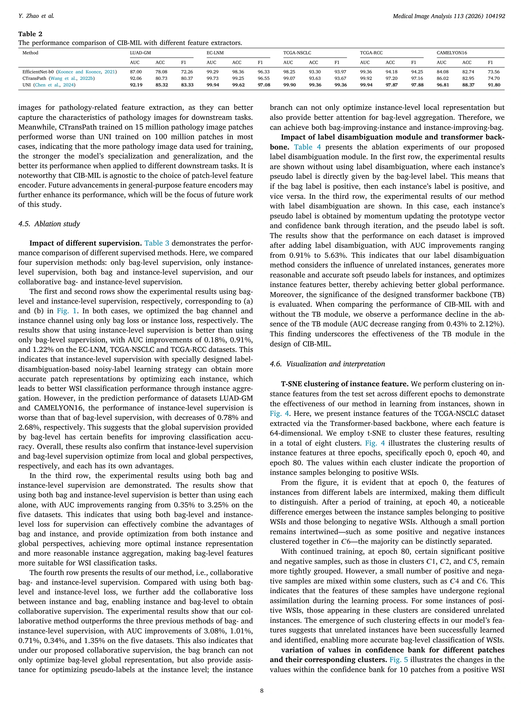
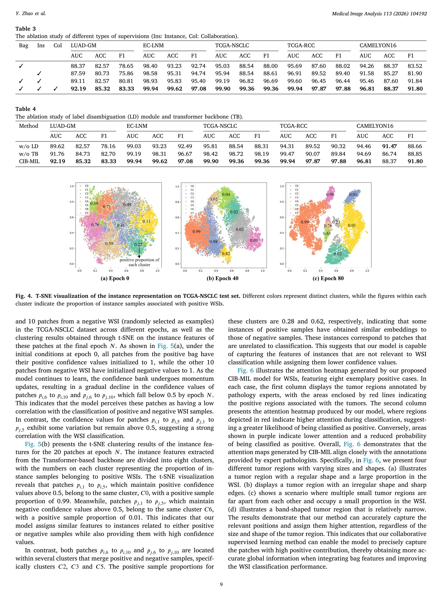

## Collaborative instance-level and bag-level multiple instance learning with label disambiguation for whole slide image analysis

> data: 三个公开、两个内部 WSI 数据集；另有 EGFR IHC 对照
>
> Medical Image Analysis 2026 · [论文](https://doi.org/10.1016/j.media.2026.104192) · [作者代码](https://github.com/TencentAILabHealthcare/CIB-MIL)

#### 引言

在实例级通道进行伪标签消歧，再让实例伪监督与包级注意力互相传递信息，联合优化细粒度预测和切片聚合。

#### 方法

（1）实例通道：以噪声标签学习修正实例伪标签。

（2）包级通道：注意力聚合提供切片监督。

（3）协同更新：原型和置信库与注意力互相校正，减少两通道各自偏差。

<!-- wsi-complete-model -->
##### 模型结构图

**图 2 · 模型结构**（PDF 第 4 页）

> 原文图注：Fig. 2. The framework of the proposed CIB-MIL. It comprises a self-supervised pre-trained feature extractor, a transformer-based backbone, and a specially designed collaborative supervision module that integrates instance-level and bag-level supervision. Within this collaborative supervision module, we employ a label-disambiguation-based noisy-label learning strategy to reduce label noise and refine pseudo labels in the instance-level supervision channel (see Fig. 3 for details). Furthermore, we introduce an instance–bag collaborative supervision module (see Section 3.6 for details) that facilitates two-way communication and interaction between bag-level (attention mechanism) and instance-level (pseudo-label mechanism) supervision. This design enables the simultaneous and collaborative application of both bag-improving-instance and instance-improving-bag principles. (Top) The process of patch partitioning and instance embedding extraction is illustrated, with the feature extractor remaining frozen during utilization. (Bottom) The MIL process incorporates a transformer-based backbone and a collaborative supervision module featuring two channels: bag-level and instance-level and an instance–bag collaborative supervision module. During training, the transformer backbone refines instance features for downstream tasks as needed, which are subsequently input into both the bag-level and instance-level supervision channels. The bag-level channel employs an attention-based aggregator to consolidate instance features and derive attention scores for each instance. A WSI classifier then generates bag predictions, which are supervised by the corresponding bag-level labels. In the instance-level channel, an instance classifier produces instance predictions, while our proposed label disambiguation module generates refined soft pseudo labels. These instance predictions and soft pseudo labels are utilized for instance supervision. Furthermore, the attention scores from the bag channel and the soft pseudo labels from the instance channel are enforced to be consistent in the designed instance–bag collaborative supervision module, facilitating collaborative supervision.

[查看原尺寸](assest/CIB-MIL/figure-2-complete.webp)

<!-- /wsi-complete-model -->

#### 实验

##### 实验设置

比较实例/包监督与标签消歧，另用两位盲评病理专家评分的 IHC 图检验热图。

##### 主要结果

加入标签消歧的 AUC 增益范围为 0.91–5.63 个百分点；IHC 对照是另外的定位/生物学证据。

<!-- wsi-complete-results -->
##### 完整实验指标与对照

下列实验原页保留表头、全部行列、子图、误差说明和脚注，点击可查看原尺寸。比较时请对应相同的数据集、特征编码器和训练设置；`±`、置信区间、百分比和小数均保留原文的单位与统计口径。

| 原表/图中指标 | 读取方式 |
| --- | --- |
| ROC-AUC / AUROC | 越高越好；若原表明确为 PR-AUC，则按 PR 曲线面积读取 |
| ACC / Accuracy | 越高越好；平衡准确率、平均准确率以原表标注为准 |
| F1 | 越高越好；保留 macro / weighted / micro 等平均方式 |

| 原文页 | 阅读内容 | 图表及正文引用 |
| --- | --- | --- |
| PDF 第 4 页 | 实验结果 | Figure 3 |
| PDF 第 7 页 | 实验结果 | Table 1 |
| PDF 第 8 页 | 实验结果 | Table 2 |
| PDF 第 9 页 | 消融与参数分析 | Table 3、Table 4 |

**实验原页 · PDF 第 4 页**（图表及正文引用：Figure 3）

[查看原尺寸](assest/CIB-MIL/experiment-page-04.webp)

**实验原页 · PDF 第 7 页**（图表及正文引用：Table 1）

[查看原尺寸](assest/CIB-MIL/experiment-page-07.webp)

**实验原页 · PDF 第 8 页**（图表及正文引用：Table 2）

[查看原尺寸](assest/CIB-MIL/experiment-page-08.webp)

展开消融、参数、数据设置及效率原页

**实验原页 · PDF 第 9 页**（图表及正文引用：Table 3、Table 4）

[查看原尺寸](assest/CIB-MIL/experiment-page-09.webp)

<!-- /wsi-complete-results -->

##### 消融与讨论

消融标签消歧与 Transformer backbone，检查原型、置信库的动量更新与直接继承包标签的区别。

#### 参考文献

> Collaborative instance-level and bag-level multiple instance learning with label disambiguation for whole slide image analysis
>
> Medical Image Analysis 2026 · [论文](https://doi.org/10.1016/j.media.2026.104192) · [作者代码](https://github.com/TencentAILabHealthcare/CIB-MIL)
