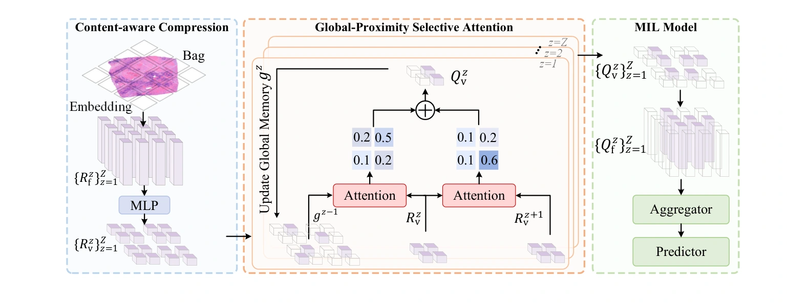
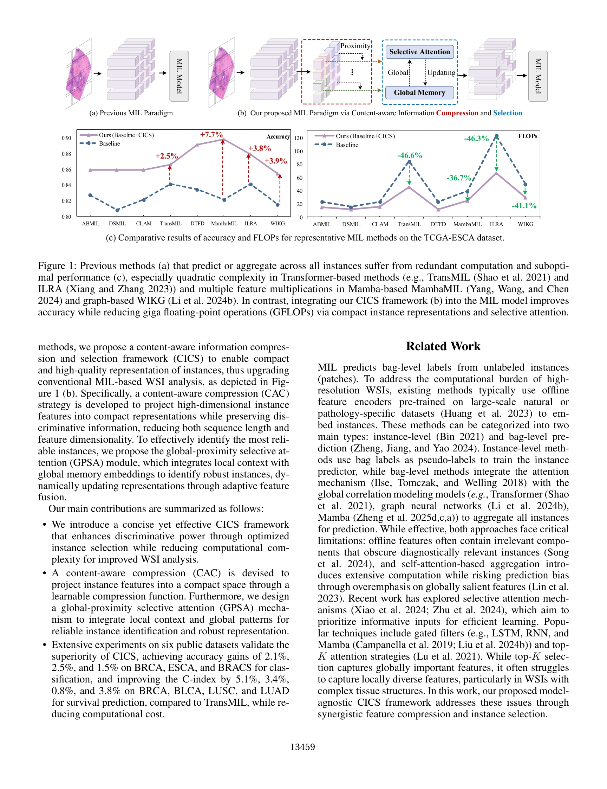
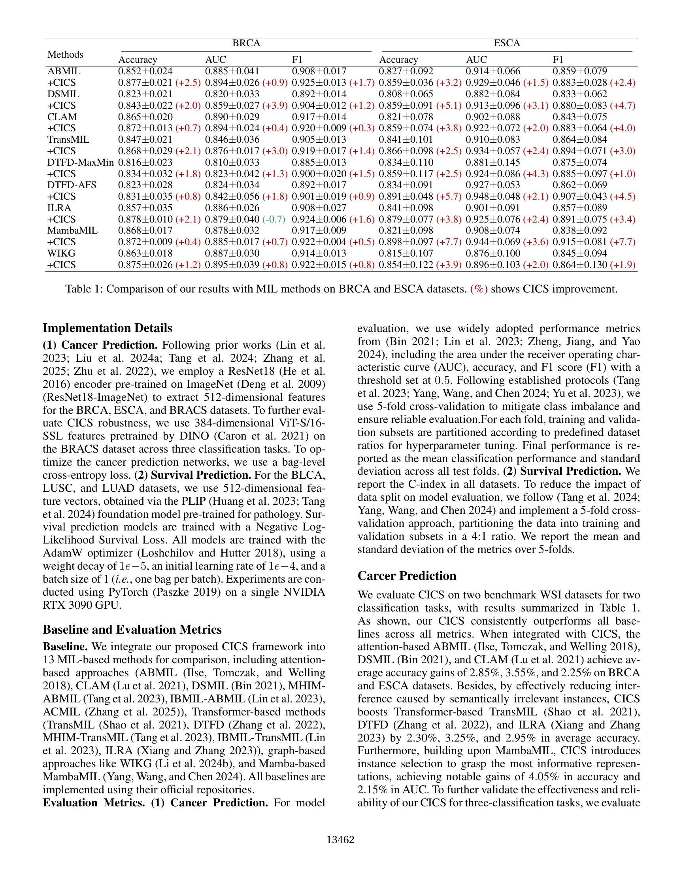
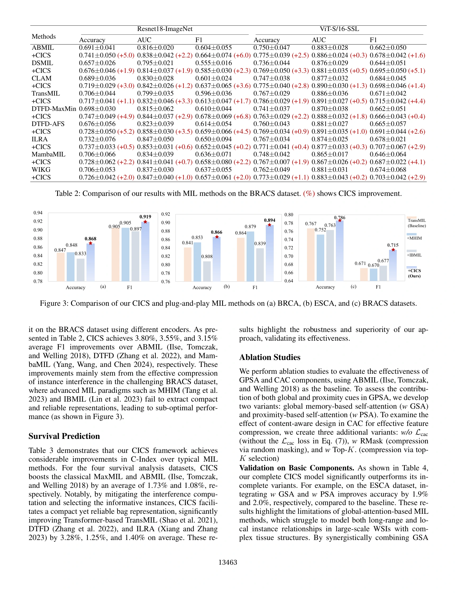
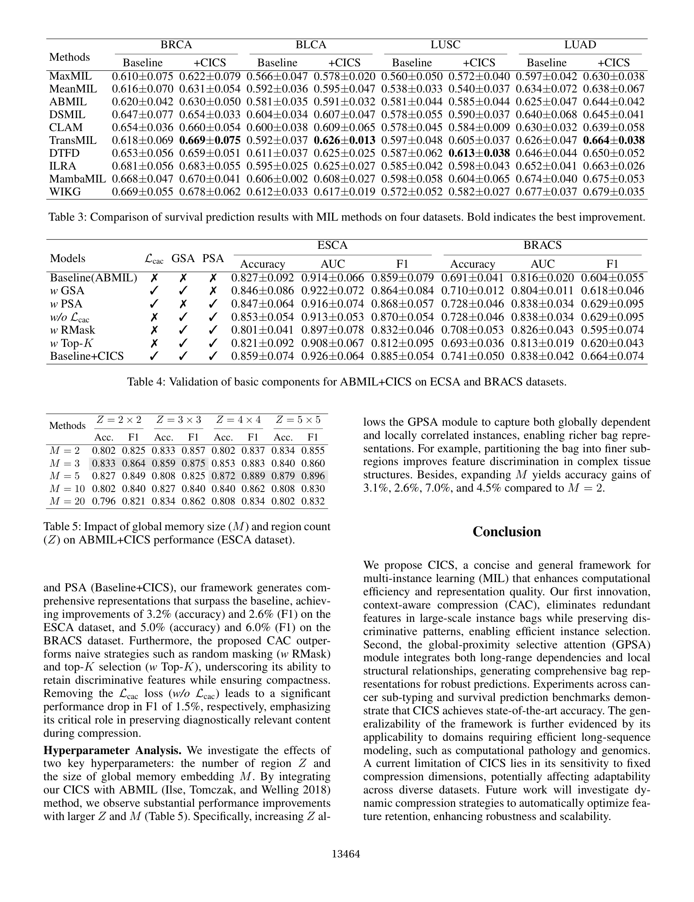

## Content-aware Information Compression and Selection for Whole Slide Image Analysis

> data: BRCA、ESCA、BRACS 分类；BLCA、LUSC、LUAD 生存
>
> AAAI 2026 · [论文](https://doi.org/10.1609/aaai.v40i16.38350)

#### 引言

先进行上下文感知压缩，再用全局邻近选择注意力保留有效信息，以紧凑实例表示减少 WSI 分类和生存预测的冗余计算。

#### 方法

（1）CAC：按上下文分区压缩实例表示。

（2）GPSA：结合全局信息与邻近关系选择重要成分。

（3）即插即用：将紧凑信息供既有 MIL 分类或生存预测器使用。

<!-- wsi-complete-model -->
##### 模型结构图

**图 2 · 模型结构**（PDF 第 3 页）

> 原文图注：Figure 2: The architecture of our proposed CICS framework features a content-aware compression (CAC) module and a global- proximity selective attention (GPSA) mechanism.

[查看原尺寸](assest/CICS/figure-2-complete.webp)

<!-- /wsi-complete-model -->

#### 实验

##### 实验设置

分类比较 ResNet18 和 ViT-S/16 特征，生存采用 PLIP；分类用 ACC/AUC/F1，生存用 C-index。

##### 主要结果

CICS 在多种注意力/Transformer/Mamba 基线上带来改进；模块收益应在同一 backbone 前后比较。

<!-- wsi-complete-results -->
##### 完整实验指标与对照

下列实验原页保留表头、全部行列、子图、误差说明和脚注，点击可查看原尺寸。比较时请对应相同的数据集、特征编码器和训练设置；`±`、置信区间、百分比和小数均保留原文的单位与统计口径。

| 原表/图中指标 | 读取方式 |
| --- | --- |
| ROC-AUC / AUROC | 越高越好；若原表明确为 PR-AUC，则按 PR 曲线面积读取 |
| ACC / Accuracy | 越高越好；平衡准确率、平均准确率以原表标注为准 |
| F1 | 越高越好；保留 macro / weighted / micro 等平均方式 |
| C-index | 越高越好；用于生存预测，需保留终点及删失设置 |
| 时间 / FLOPs / 参数量 | 结合硬件、包长度和计时范围比较；小模型不一定推理更快 |

| 原文页 | 阅读内容 | 图表及正文引用 |
| --- | --- | --- |
| PDF 第 2 页 | 实验结果 | Figure 1 |
| PDF 第 5 页 | 实验结果 | Table 1 |
| PDF 第 6 页 | 实验结果 | Table 2 |
| PDF 第 7 页 | 实验结果 | Table 3、Table 4、Table 5 |

**实验原页 · PDF 第 2 页**（图表及正文引用：Figure 1）

[查看原尺寸](assest/CICS/experiment-page-02.webp)

**实验原页 · PDF 第 5 页**（图表及正文引用：Table 1）

[查看原尺寸](assest/CICS/experiment-page-05.webp)

**实验原页 · PDF 第 6 页**（图表及正文引用：Table 2）

[查看原尺寸](assest/CICS/experiment-page-06.webp)

**实验原页 · PDF 第 7 页**（图表及正文引用：Table 3、Table 4、Table 5）

[查看原尺寸](assest/CICS/experiment-page-07.webp)

<!-- /wsi-complete-results -->

##### 消融与讨论

分别消融上下文压缩和全局邻近选择，报告性能与 GFLOPs，避免把压缩率等同于推理加速倍数。

#### 参考文献

> Content-aware Information Compression and Selection for Whole Slide Image Analysis
>
> AAAI 2026 · [论文](https://doi.org/10.1609/aaai.v40i16.38350)
