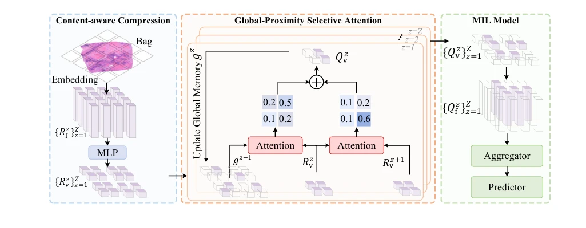
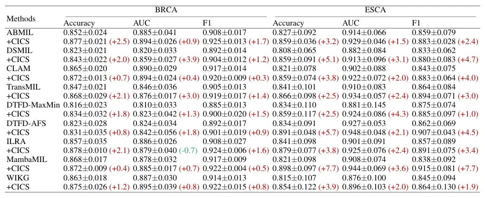

## Content-aware Information Compression and Selection for Whole Slide Image Analysis

> data: BRCA、ESCA、BRACS 分类；BLCA、LUSC、LUAD 生存
>
> AAAI 2026 · [论文](https://doi.org/10.1609/aaai.v40i16.38350)

#### 引言

先进行上下文感知压缩，再用全局邻近选择注意力保留有效信息，以紧凑实例表示减少 WSI 分类和生存预测的冗余计算。

#### 方法

（1）CAC：按上下文分区压缩实例表示。

（2）GPSA：结合全局信息与邻近关系选择重要成分。

（3）即插即用：将紧凑信息供既有 MIL 分类或生存预测器使用。

原文Figure 2，PDF 第 3 页。

#### 实验

##### 实验设置

分类比较 ResNet18 和 ViT-S/16 特征，生存采用 PLIP；分类用 ACC/AUC/F1，生存用 C-index。

##### 主要结果

CICS 在多种注意力/Transformer/Mamba 基线上带来改进；模块收益应在同一 backbone 前后比较。

原文Table 1，PDF 第 5 页。

##### 消融与讨论

分别消融上下文压缩和全局邻近选择，报告性能与 GFLOPs，避免把压缩率等同于推理加速倍数。

#### 参考文献

> Content-aware Information Compression and Selection for Whole Slide Image Analysis
>
> AAAI 2026 · [论文](https://doi.org/10.1609/aaai.v40i16.38350)
