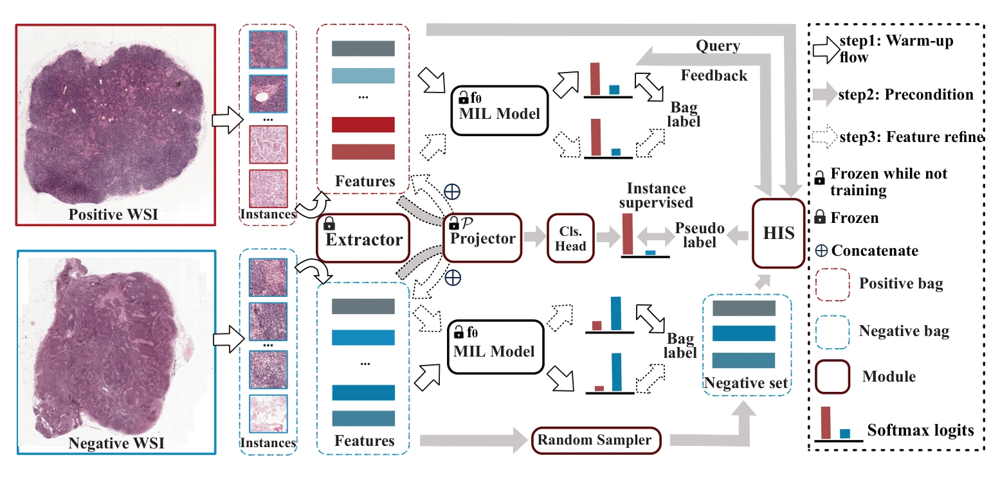
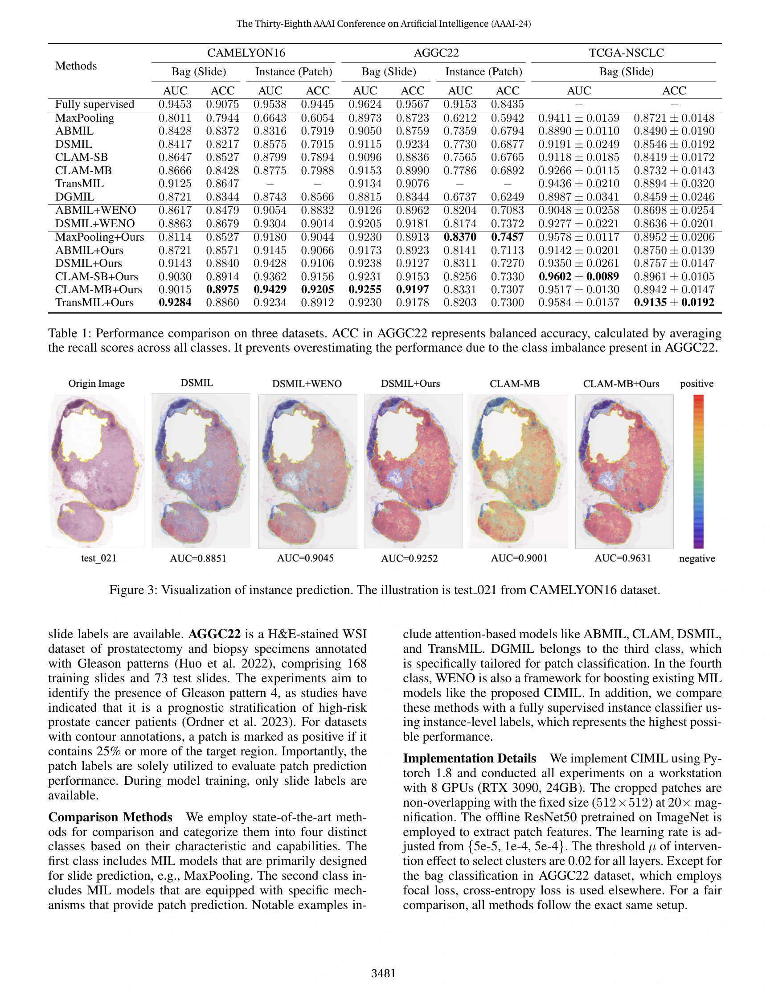
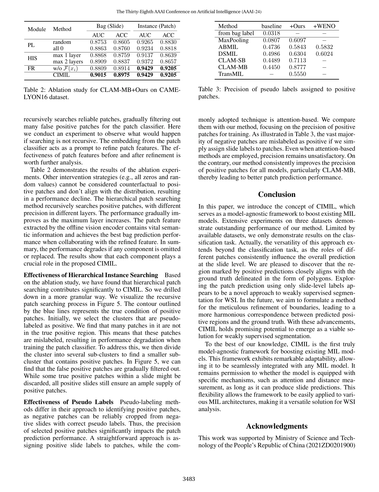

## Boosting Multiple Instance Learning Models for Whole Slide Image Classification: A Model-Agnostic Framework Based on Counterfactual Inference

> data: CAMELYON16、TCGA-NSCLC、AGGC22
>
> AAAI 2024 · [论文](https://doi.org/10.1609/aaai.v38i4.28135) · [作者代码](https://github.com/centurion-crawler/CIMIL)

#### 引言

利用反事实子包评估和分层实例搜索产生更可靠的伪标签，再以实例分类器的嵌入增强包预测，同时关注切片分类和病灶定位。

#### 方法

（1）反事实评估：比较子包存在与变化对包预测的影响，搜索与标签有关的实例。

（2）分层搜索：逐层缩小候选范围，获得更可靠的正负实例伪标签。

（3）双层反馈：训练实例分类器，并把实例嵌入作为提示反馈给包分类。

<!-- wsi-complete-model -->
##### 模型结构图

**图 1 · 模型结构**（PDF 第 3 页）

> 原文图注：Figure 1: Overview of the proposed CIMIL framework. HIS is the abbreviation of hierarchical instance searching module. Step 2, precondition flow, is the training process of the instance classifier (Projector and Cls. Head).

[查看原尺寸](assest/CIMIL/figure-1-complete.webp)

<!-- /wsi-complete-model -->

#### 实验

##### 实验设置

同时评估切片级和 patch 级 ACC/AUC；AGGC22 的 ACC 为平衡准确率，而非普通准确率。

##### 主要结果

CIMIL 能增强多种基线的实例预测，包括原本主要用于包分类的 MaxPooling；不能只看切片 AUC 评价其贡献。

<!-- wsi-complete-results -->
##### 完整实验指标与对照

下列实验原页保留表头、全部行列、子图、误差说明和脚注，点击可查看原尺寸。比较时请对应相同的数据集、特征编码器和训练设置；`±`、置信区间、百分比和小数均保留原文的单位与统计口径。

| 原表/图中指标 | 读取方式 |
| --- | --- |
| ROC-AUC / AUROC | 越高越好；若原表明确为 PR-AUC，则按 PR 曲线面积读取 |
| ACC / Accuracy | 越高越好；平衡准确率、平均准确率以原表标注为准 |
| Precision | 越高越好；需结合 Recall 及分类阈值 |
| Recall / Sensitivity | 越高越好；与固定敏感度下的特异度区别读取 |

| 原文页 | 阅读内容 | 图表及正文引用 |
| --- | --- | --- |
| PDF 第 5 页 | 实验结果 | Table 1 |
| PDF 第 7 页 | 消融与参数分析 | Table 2、Table 3 |

**实验原页 · PDF 第 5 页**（图表及正文引用：Table 1）

[查看原尺寸](assest/CIMIL/experiment-page-05.webp)

展开消融、参数、数据设置及效率原页

**实验原页 · PDF 第 7 页**（图表及正文引用：Table 2、Table 3）

[查看原尺寸](assest/CIMIL/experiment-page-07.webp)

<!-- /wsi-complete-results -->

##### 消融与讨论

消融包括反事实评估、分层搜索及实例提示；另比较阳性 patch 伪标签精度和困难区域定位。

#### 参考文献

> Boosting Multiple Instance Learning Models for Whole Slide Image Classification: A Model-Agnostic Framework Based on Counterfactual Inference
>
> AAAI 2024 · [论文](https://doi.org/10.1609/aaai.v38i4.28135) · [作者代码](https://github.com/centurion-crawler/CIMIL)
