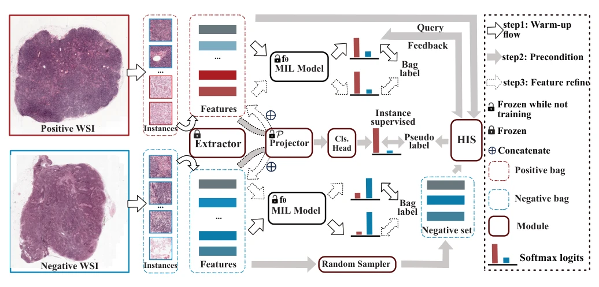
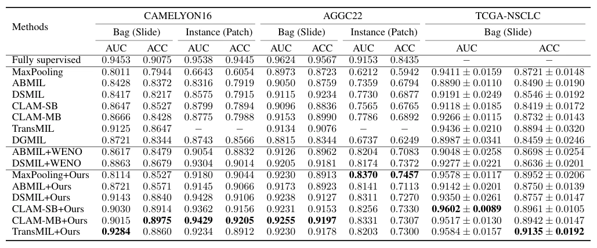

## Boosting Multiple Instance Learning Models for Whole Slide Image Classification: A Model-Agnostic Framework Based on Counterfactual Inference

> data: CAMELYON16、TCGA-NSCLC、AGGC22
>
> AAAI 2024 · [论文](https://doi.org/10.1609/aaai.v38i4.28135) · [作者代码](https://github.com/centurion-crawler/CIMIL)

#### 引言

利用反事实子包评估和分层实例搜索产生更可靠的伪标签，再以实例分类器的嵌入增强包预测，同时关注切片分类和病灶定位。

#### 方法

（1）反事实评估：比较子包存在与变化对包预测的影响，搜索与标签有关的实例。

（2）分层搜索：逐层缩小候选范围，获得更可靠的正负实例伪标签。

（3）双层反馈：训练实例分类器，并把实例嵌入作为提示反馈给包分类。

原文Figure 1，PDF 第 3 页。

#### 实验

##### 实验设置

同时评估切片级和 patch 级 ACC/AUC；AGGC22 的 ACC 为平衡准确率，而非普通准确率。

##### 主要结果

CIMIL 能增强多种基线的实例预测，包括原本主要用于包分类的 MaxPooling；不能只看切片 AUC 评价其贡献。

原文Table 1，PDF 第 5 页。

##### 消融与讨论

消融包括反事实评估、分层搜索及实例提示；另比较阳性 patch 伪标签精度和困难区域定位。

#### 参考文献

> Boosting Multiple Instance Learning Models for Whole Slide Image Classification: A Model-Agnostic Framework Based on Counterfactual Inference
>
> AAAI 2024 · [论文](https://doi.org/10.1609/aaai.v38i4.28135) · [作者代码](https://github.com/centurion-crawler/CIMIL)
