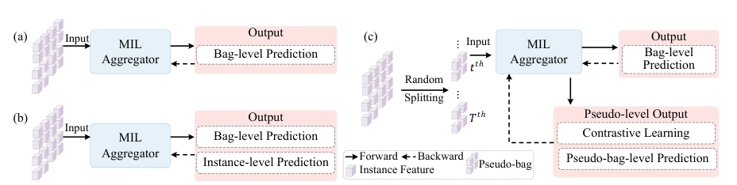
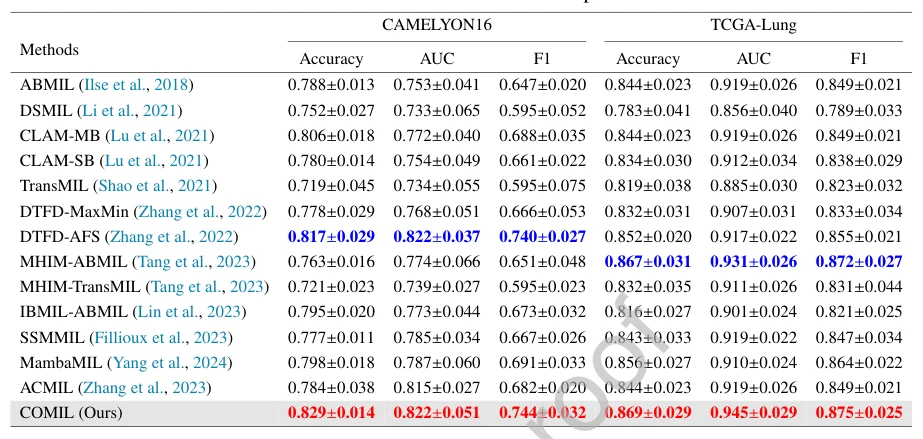

## Collaborative Optimization for Whole Slide Image Classification

> data: CAMELYON16、TCGA-Lung、TCGA-BRCA、TCGA-ESCA
>
> Knowledge-Based Systems 2026 · [论文](https://doi.org/10.1016/j.knosys.2025.114936)

#### 引言

让实例融合、邻域对比学习和 Transformer 包预测协同优化，通过跨伪包信息交互同时增强实例表示与切片决策。

#### 方法

（1）实例融合：结合历史和当前伪包信息增强表示。

（2）邻域对比：把相关伪包拉近，抑制不可靠的局部变化。

（3）协同优化：与 Transformer 包预测器联合训练，双向改进表征与决策。

原文Fig. 1，PDF 第 5 页。

#### 实验

##### 实验设置

四个分类基准，比较伪包和包级 MIL，并开展协同表示/预测消融。

##### 主要结果

摘要报告相对 DTFD、ACMIL 的增益随数据集与基线变化；主表用于判断各任务的完整表现。

原文Table 1，PDF 第 18 页。

##### 消融与讨论

检查跨伪包融合、邻域对比学习和 Transformer 聚合，关注协同训练是否优于单向优化。

#### 参考文献

> Collaborative Optimization for Whole Slide Image Classification
>
> Knowledge-Based Systems 2026 · [论文](https://doi.org/10.1016/j.knosys.2025.114936)
