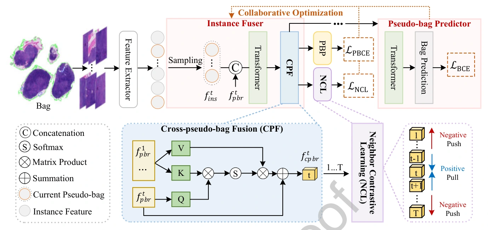
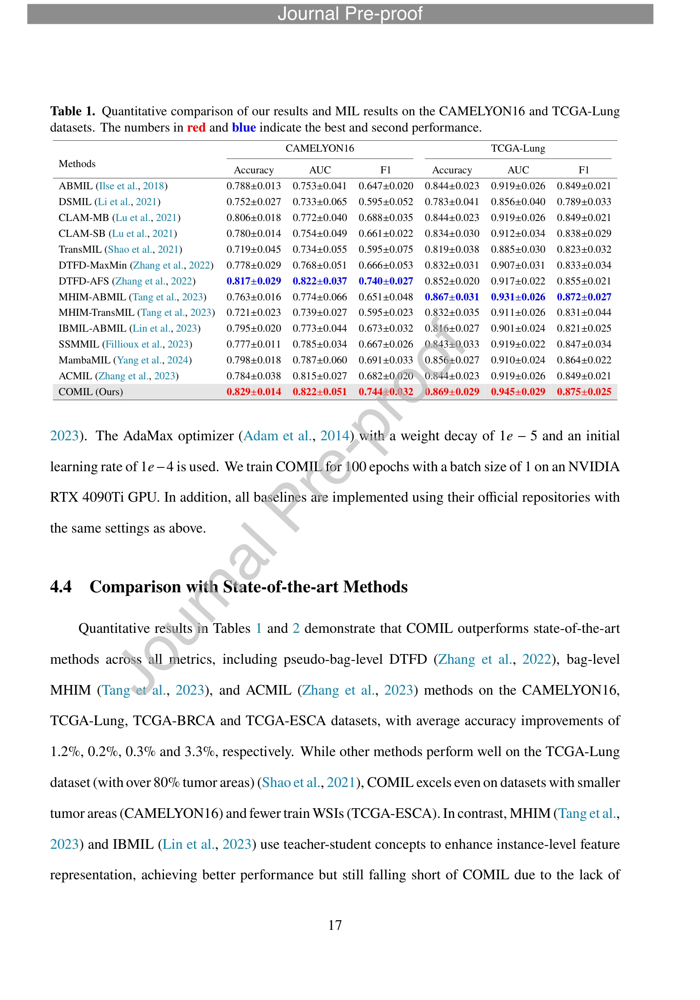
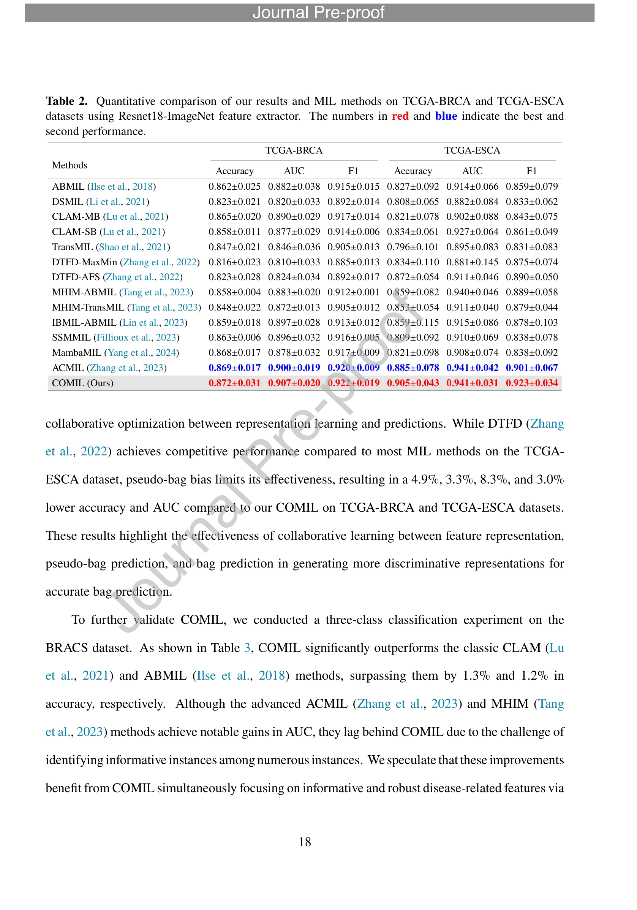
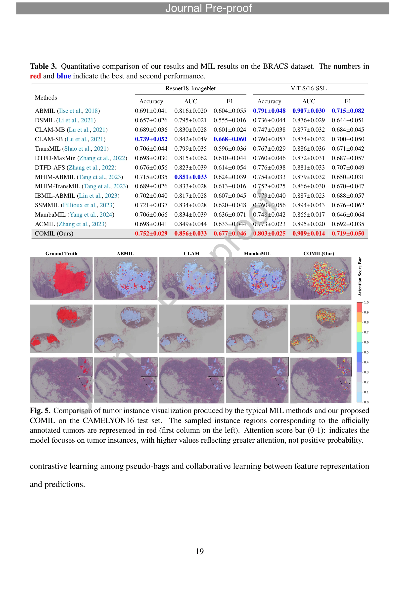
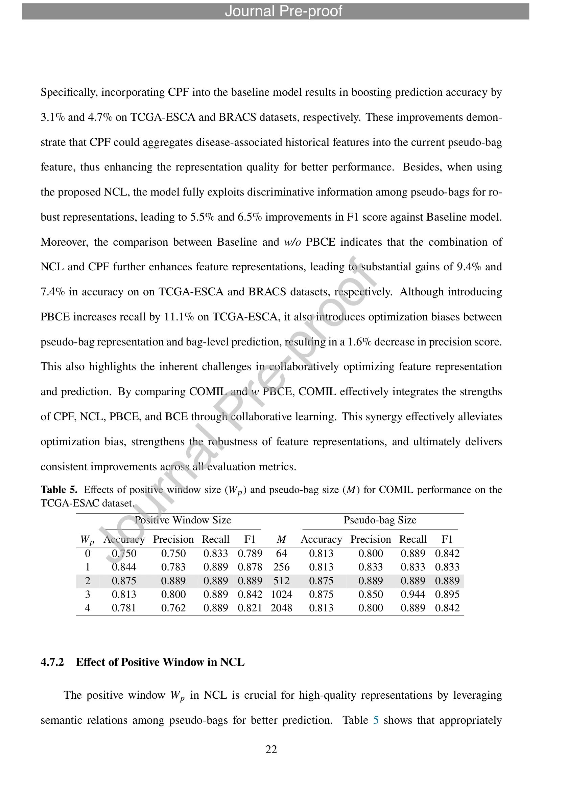
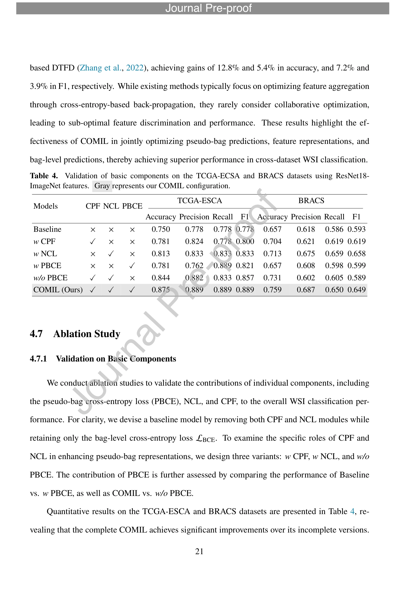

## Collaborative Optimization for Whole Slide Image Classification

> data: CAMELYON16、TCGA-Lung、TCGA-BRCA、TCGA-ESCA
>
> Knowledge-Based Systems 2026 · [论文](https://doi.org/10.1016/j.knosys.2025.114936)

#### 引言

让实例融合、邻域对比学习和 Transformer 包预测协同优化，通过跨伪包信息交互同时增强实例表示与切片决策。

#### 方法

（1）实例融合：结合历史和当前伪包信息增强表示。

（2）邻域对比：把相关伪包拉近，抑制不可靠的局部变化。

（3）协同优化：与 Transformer 包预测器联合训练，双向改进表征与决策。

<!-- wsi-complete-model -->
##### 模型结构图

**图 2 · 模型结构**（PDF 第 10 页）

> 原文图注：Fig. 2. Architecture of the proposed COMIL framework. It integrates instance features into pseudo-bag representations, employs contrastive learning among pseudo-bags, and uses a transformer-based aggregator to produce robust bag-level predictions. COMIL collaboratively optimizes instance aggregation, pseudo-bag prediction (PBP), and bag-level prediction for improved feature representation and classification performance.

[查看原尺寸](assest/COMIL/figure-2-complete.webp)

<!-- /wsi-complete-model -->

#### 实验

##### 实验设置

四个分类基准，比较伪包和包级 MIL，并开展协同表示/预测消融。

##### 主要结果

摘要报告相对 DTFD、ACMIL 的增益随数据集与基线变化；主表用于判断各任务的完整表现。

<!-- wsi-complete-results -->
##### 完整实验指标与对照

下列实验原页保留表头、全部行列、子图、误差说明和脚注，点击可查看原尺寸。比较时请对应相同的数据集、特征编码器和训练设置；`±`、置信区间、百分比和小数均保留原文的单位与统计口径。

| 原文页 | 阅读内容 | 图表及正文引用 |
| --- | --- | --- |
| PDF 第 18 页 | 实验结果 | Table 1 |
| PDF 第 19 页 | 实验结果 | Table 2 |
| PDF 第 20 页 | 实验结果 | Table 3 |
| PDF 第 22 页 | 消融与参数分析 | Table 4 |
| PDF 第 23 页 | 实验结果 | Table 5 |

**实验原页 · PDF 第 18 页**（图表及正文引用：Table 1）

[查看原尺寸](assest/COMIL/experiment-page-18.webp)

**实验原页 · PDF 第 19 页**（图表及正文引用：Table 2）

[查看原尺寸](assest/COMIL/experiment-page-19.webp)

**实验原页 · PDF 第 20 页**（图表及正文引用：Table 3）

[查看原尺寸](assest/COMIL/experiment-page-20.webp)

**实验原页 · PDF 第 23 页**（图表及正文引用：Table 5）

[查看原尺寸](assest/COMIL/experiment-page-23.webp)

展开消融、参数、数据设置及效率原页

**实验原页 · PDF 第 22 页**（图表及正文引用：Table 4）

[查看原尺寸](assest/COMIL/experiment-page-22.webp)

<!-- /wsi-complete-results -->

##### 消融与讨论

检查跨伪包融合、邻域对比学习和 Transformer 聚合，关注协同训练是否优于单向优化。

#### 参考文献

> Collaborative Optimization for Whole Slide Image Classification
>
> Knowledge-Based Systems 2026 · [论文](https://doi.org/10.1016/j.knosys.2025.114936)
