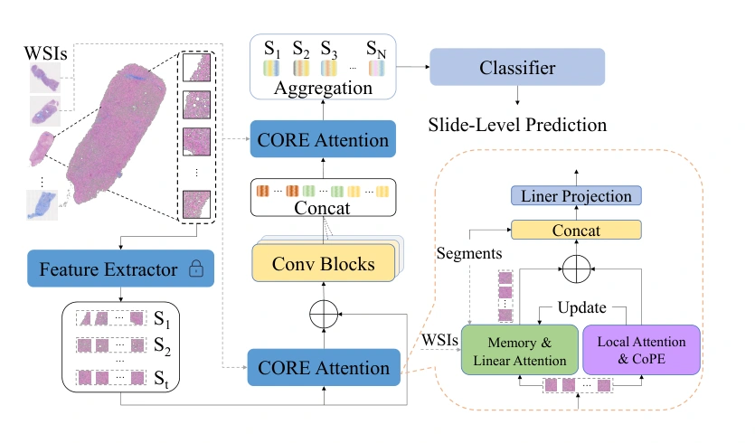
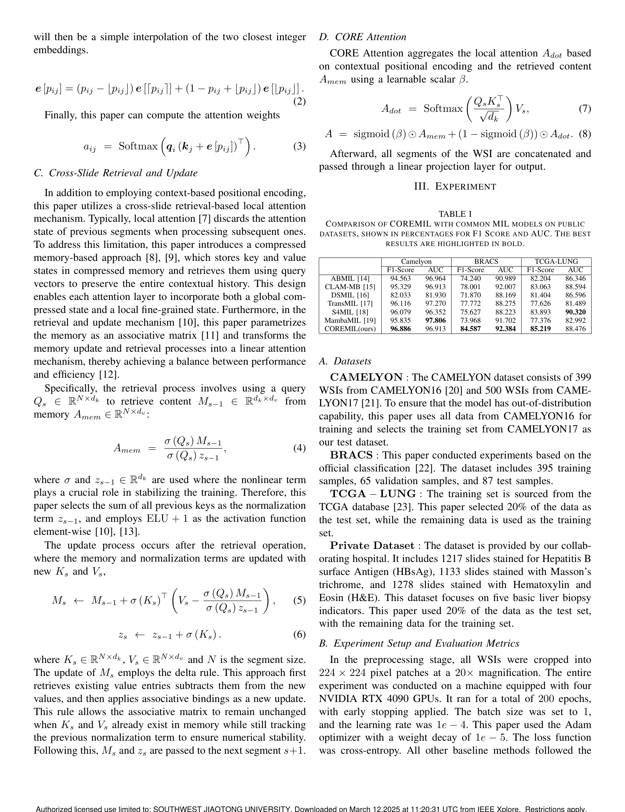
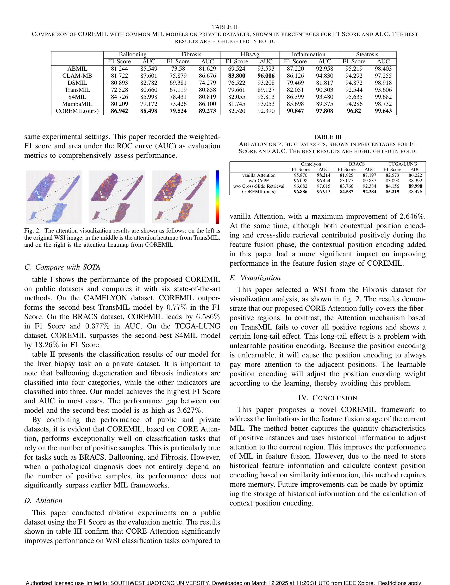

## COREMIL: Contextual Position Encoding-based Retrievable Multiple Instance Learning for Slide-level Classification

> data: CAMELYON16→CAMELYON17、BRACS、TCGA-LUNG、内部肝活检数据
>
> ICASSP 2025 · [论文](https://doi.org/10.1109/ICASSP49660.2025.10889091)

#### 引言

以情境位置编码保留实例数量和语义信息，再借助跨切片检索微调注意力，利用历史样本辅助当前切片聚合。

#### 方法

（1）情境位置编码：让聚合器感知实例数量及上下文关系。

（2）跨片检索：从历史切片表示中寻找可用信息。

（3）注意力修正：用检索结果微调当前聚合，减少单张切片决策的局限。

<!-- wsi-complete-model -->
##### 模型结构图

**图 1 · 模型结构**（PDF 第 2 页）

> 原文图注：Fig. 1. Overview of COREMIL. Given a series of patches extracted from the foreground of WSI, this paper first uses a feature extractor to serialize them into a series of features. These features are then fed into the CORE Attention module for modeling. In the CORE Attention module, the input features are split into segments. Attention correction is applied by retrieving related segments from the historical WSI and previous segments of the current WSI. Afterward, all segments of this WSI are concatenated. These features are then passed through convolutional layers at different scales and concatenated with the original features. This allows us to capture information from different spatial dimensions. Finally, the CORE Attention module models the features containing both positional and spatial information. The features from different segments are aggregated and passed through a linear layer to output the classification result.

[查看原尺寸](assest/COREMIL/figure-1-complete.webp)

<!-- /wsi-complete-model -->

#### 实验

##### 实验设置

外测采用 CAMELYON17 训练部分；BRACS 保留官方划分，TCGA 以 20% 为测试集。

##### 主要结果

主表报告公共任务与肝活检分级；作者指出不同肝组织指标的类别数不同，应按指标分别比较。

<!-- wsi-complete-results -->
##### 完整实验指标与对照

下列实验原页保留表头、全部行列、子图、误差说明和脚注，点击可查看原尺寸。比较时请对应相同的数据集、特征编码器和训练设置；`±`、置信区间、百分比和小数均保留原文的单位与统计口径。

| 原表/图中指标 | 读取方式 |
| --- | --- |
| ROC-AUC / AUROC | 越高越好；若原表明确为 PR-AUC，则按 PR 曲线面积读取 |
| F1 | 越高越好；保留 macro / weighted / micro 等平均方式 |

| 原文页 | 阅读内容 | 图表及正文引用 |
| --- | --- | --- |
| PDF 第 3 页 | 实验结果 | Table I |
| PDF 第 4 页 | 实验结果 | Table II、Table III |

**实验原页 · PDF 第 3 页**（图表及正文引用：Table I）

[查看原尺寸](assest/COREMIL/experiment-page-03.webp)

**实验原页 · PDF 第 4 页**（图表及正文引用：Table II、Table III）

[查看原尺寸](assest/COREMIL/experiment-page-04.webp)

<!-- /wsi-complete-results -->

##### 消融与讨论

消融情境位置编码和跨切片检索注意力；历史检索样本的构建与普通空间位置编码是不同信息来源。

#### 参考文献

> COREMIL: Contextual Position Encoding-based Retrievable Multiple Instance Learning for Slide-level Classification
>
> ICASSP 2025 · [论文](https://doi.org/10.1109/ICASSP49660.2025.10889091)
