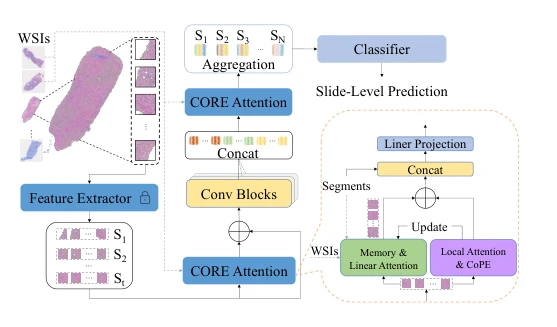
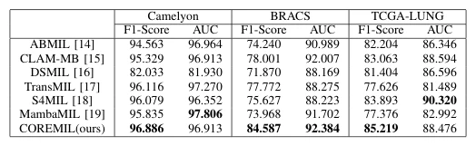

## COREMIL: Contextual Position Encoding-based Retrievable Multiple Instance Learning for Slide-level Classification

> data: CAMELYON16→CAMELYON17、BRACS、TCGA-LUNG、内部肝活检数据
>
> ICASSP 2025 · [论文](https://doi.org/10.1109/ICASSP49660.2025.10889091)

#### 引言

以情境位置编码保留实例数量和语义信息，再借助跨切片检索微调注意力，利用历史样本辅助当前切片聚合。

#### 方法

（1）情境位置编码：让聚合器感知实例数量及上下文关系。

（2）跨片检索：从历史切片表示中寻找可用信息。

（3）注意力修正：用检索结果微调当前聚合，减少单张切片决策的局限。

原文Fig. 1，PDF 第 2 页。

#### 实验

##### 实验设置

外测采用 CAMELYON17 训练部分；BRACS 保留官方划分，TCGA 以 20% 为测试集。

##### 主要结果

主表报告公共任务与肝活检分级；作者指出不同肝组织指标的类别数不同，应按指标分别比较。

原文TABLE I，PDF 第 3 页。

##### 消融与讨论

消融情境位置编码和跨切片检索注意力；历史检索样本的构建与普通空间位置编码是不同信息来源。

#### 参考文献

> COREMIL: Contextual Position Encoding-based Retrievable Multiple Instance Learning for Slide-level Classification
>
> ICASSP 2025 · [论文](https://doi.org/10.1109/ICASSP49660.2025.10889091)
