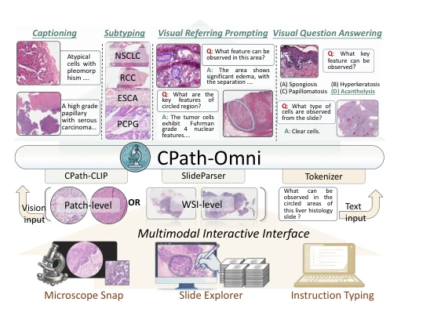

## CPath-Omni: A Unified Multimodal Foundation Model for Patch and Whole Slide Image Analysis in Computational Pathology

> data: PathMMU、30 个分类数据集及论文中的 WSI 问答/描述等任务
>
> 收藏标记 CVPR 2025；所附链接为 arXiv 版本 · [论文](https://arxiv.org/abs/2412.12077)

#### 引言

统一 patch 级与 WSI 级多模态分析，覆盖分类、问答、图像描述和视觉指代，并以 CPath-CLIP 提供病理视觉语言表征。

#### 方法

（1）统一视觉处理：以 CPath-CLIP 连接多种视觉模型与文本表示。

（2）双层表示：在单一多模态模型中处理 patch 和完整切片任务。

（3）统一指令：通过不同任务指令开展分类、问答、描述与视觉指代。

原文Figure 1，PDF 第 1 页。

#### 实验

##### 实验设置

区分训练分布内和 14 个域外分类数据；比较通用多模态模型、病理模型及任务专用视觉模型。

##### 主要结果

PathMMU 中相对 PathGen-LLaVA 的增益为 13.8 个百分点；该基准结论不等价于全面超过临床医生。

##### 消融与讨论

分别分析 CPath-CLIP 与 CPath-Omni，区分 patch 和 WSI 两级任务及训练数据重合关系。

#### 参考文献

> CPath-Omni: A Unified Multimodal Foundation Model for Patch and Whole Slide Image Analysis in Computational Pathology
>
> 收藏标记 CVPR 2025；所附链接为 arXiv 版本 · [论文](https://arxiv.org/abs/2412.12077)
