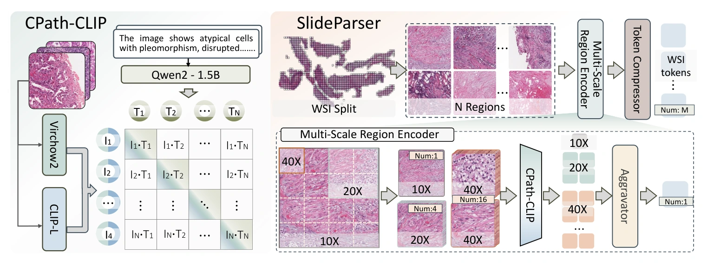
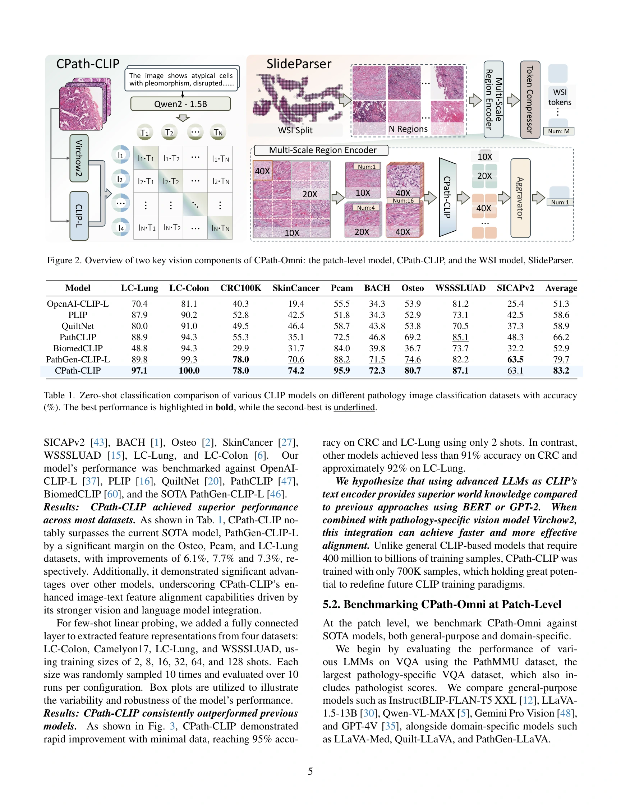
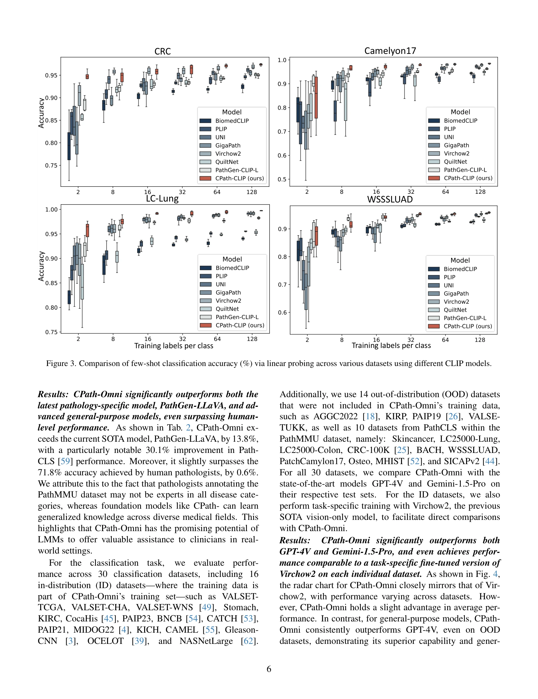
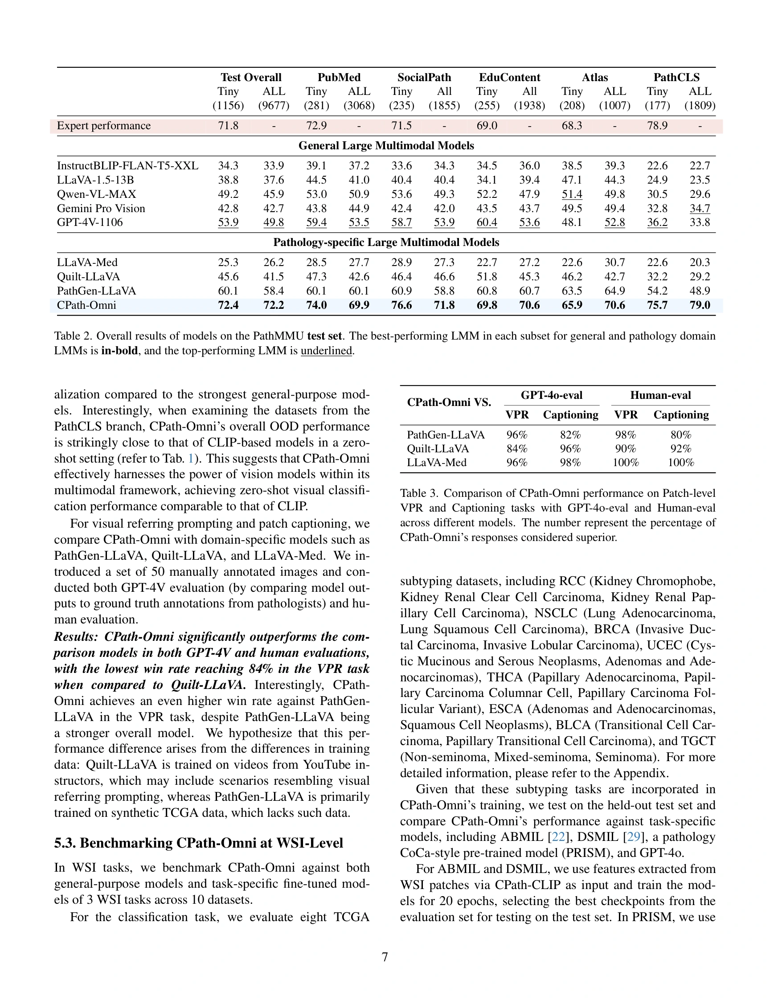
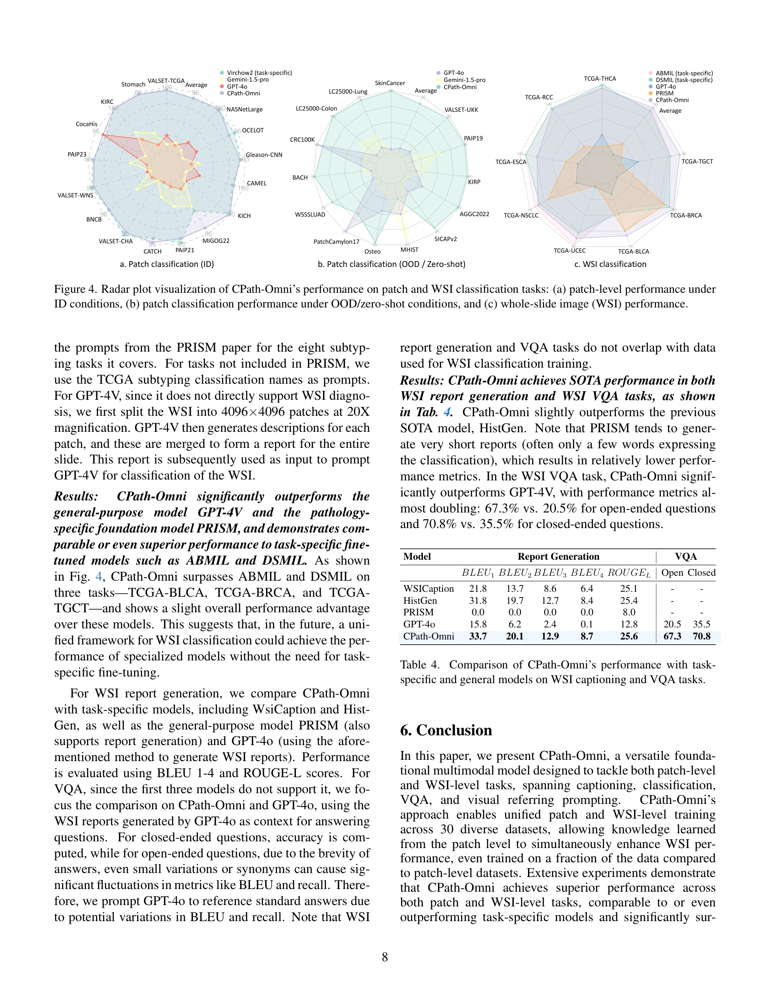

## CPath-Omni: A Unified Multimodal Foundation Model for Patch and Whole Slide Image Analysis in Computational Pathology

> data: PathMMU、30 个分类数据集及论文中的 WSI 问答/描述等任务
>
> 收藏标记 CVPR 2025；所附链接为 arXiv 版本 · [论文](https://arxiv.org/abs/2412.12077)

#### 引言

统一 patch 级与 WSI 级多模态分析，覆盖分类、问答、图像描述和视觉指代，并以 CPath-CLIP 提供病理视觉语言表征。

#### 方法

（1）统一视觉处理：以 CPath-CLIP 连接多种视觉模型与文本表示。

（2）双层表示：在单一多模态模型中处理 patch 和完整切片任务。

（3）统一指令：通过不同任务指令开展分类、问答、描述与视觉指代。

<!-- wsi-complete-model -->
##### 模型结构图

**图 2 · 模型结构**（PDF 第 5 页）

> 原文图注：Figure 2. Overview of two key vision components of CPath-Omni: the patch-level model, CPath-CLIP, and the WSI model, SlideParser.

[查看原尺寸](assest/CPath-Omni/figure-2-complete.webp)

<!-- /wsi-complete-model -->

#### 实验

##### 实验设置

区分训练分布内和 14 个域外分类数据；比较通用多模态模型、病理模型及任务专用视觉模型。

##### 主要结果

PathMMU 中相对 PathGen-LLaVA 的增益为 13.8 个百分点；该基准结论不等价于全面超过临床医生。

<!-- wsi-complete-results -->
##### 完整实验指标与对照

下列实验原页保留表头、全部行列、子图、误差说明和脚注，点击可查看原尺寸。比较时请对应相同的数据集、特征编码器和训练设置；`±`、置信区间、百分比和小数均保留原文的单位与统计口径。

| 原表/图中指标 | 读取方式 |
| --- | --- |
| ACC / Accuracy | 越高越好；平衡准确率、平均准确率以原表标注为准 |

| 原文页 | 阅读内容 | 图表及正文引用 |
| --- | --- | --- |
| PDF 第 5 页 | 实验结果 | Table 1 |
| PDF 第 6 页 | 实验结果 | Figure 3 |
| PDF 第 7 页 | 实验结果 | Table 2、Table 3 |
| PDF 第 8 页 | 实验结果 | Figure 4、Table 4 |

**实验原页 · PDF 第 5 页**（图表及正文引用：Table 1）

[查看原尺寸](assest/CPath-Omni/experiment-page-05.webp)

**实验原页 · PDF 第 6 页**（图表及正文引用：Figure 3）

[查看原尺寸](assest/CPath-Omni/experiment-page-06.webp)

**实验原页 · PDF 第 7 页**（图表及正文引用：Table 2、Table 3）

[查看原尺寸](assest/CPath-Omni/experiment-page-07.webp)

**实验原页 · PDF 第 8 页**（图表及正文引用：Figure 4、Table 4）

[查看原尺寸](assest/CPath-Omni/experiment-page-08.webp)

<!-- /wsi-complete-results -->

##### 消融与讨论

分别分析 CPath-CLIP 与 CPath-Omni，区分 patch 和 WSI 两级任务及训练数据重合关系。

#### 参考文献

> CPath-Omni: A Unified Multimodal Foundation Model for Patch and Whole Slide Image Analysis in Computational Pathology
>
> 收藏标记 CVPR 2025；所附链接为 arXiv 版本 · [论文](https://arxiv.org/abs/2412.12077)
