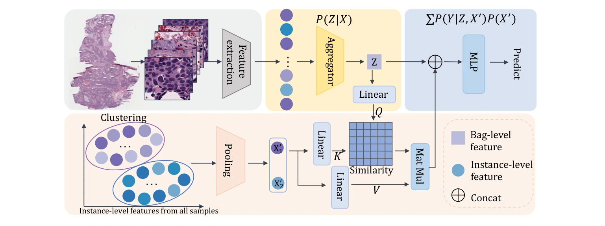

## CaMIL: Causal Multiple Instance Learning for Whole Slide Image Classification

> data: CAMELYON16、TCGA-NSCLC
>
> AAAI 2024 · [论文](https://doi.org/10.1609/aaai.v38i2.27873)

#### 引言

通过前门调整估计干预后的切片预测，减少颜色等混杂因素带来的伪相关；框架可接入不同特征提取器与聚合器。

#### 方法

（1）因果建模：将可能的混杂因素与实例、包标签之间的关系写为因果图。

（2）前门调整：以聚合后的实例特征作为中介，近似计算干预后的包预测。

（3）历史分布：利用实例缓冲与聚类近似整体特征分布，可接入不同聚合器。

##### 模型结构图

图 2（PDF 第 3 页）

#### 实验

##### 实验设置

在 ResNet18、ViT-small 特征与不同聚合器上验证；TCGA 划分为 7:1:2，训练 100 epochs，batch size 为 1。

##### 关键指标 { #key-results }

| 设置 | ACC（%） | F1（%） | AUC（%） |
| --- | --- | --- | --- |
| DTFD | 80.62 | 80.18 | 78.79 |
| DTFD + CaMIL | 86.05 | 85.60 | 85.63 |

数据来源为原文表 1，PDF 第 5 页，CAMELYON16，ResNet18 特征。

##### 结果解读

在 CAMELYON16 的 DTFD + ResNet18 设置中，因果模块将 AUC 提高 6.84 个百分点。用 ViT-small 时增益较小，部分基线的个别指标还有下降。

##### 消融与讨论

考察聚类数、缓冲区与不同聚合器，比较 CaMIL 和 IBMIL；前门调整的效果以实验和建模假设共同理解。

#### 参考文献

> CaMIL: Causal Multiple Instance Learning for Whole Slide Image Classification
>
> AAAI 2024 · [论文](https://doi.org/10.1609/aaai.v38i2.27873)
