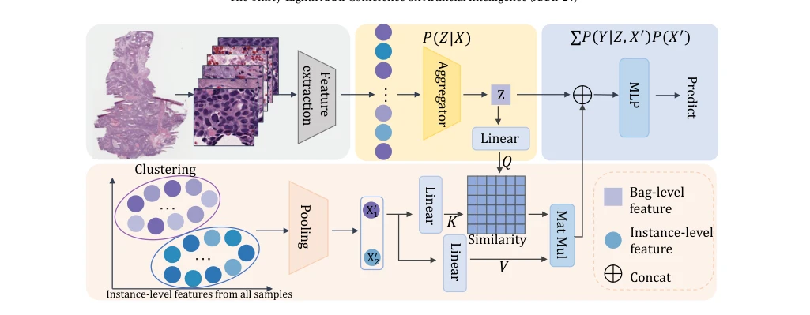

## CaMIL: Causal Multiple Instance Learning for Whole Slide Image Classification

> data: CAMELYON16、TCGA-NSCLC
>
> AAAI 2024 · [论文](https://doi.org/10.1609/aaai.v38i2.27873)

#### 引言

通过前门调整估计干预后的切片预测，减少颜色等混杂因素带来的伪相关；框架可接入不同特征提取器与聚合器。

#### 方法

（1）因果建模：将可能的混杂因素与实例、包标签之间的关系写为因果图。

（2）前门调整：以聚合后的实例特征作为中介，近似计算干预后的包预测。

（3）历史分布：利用实例缓冲与聚类近似整体特征分布，可接入不同聚合器。

原文Figure 2，PDF 第 3 页。

#### 实验

##### 实验设置

在 ResNet18、ViT-small 特征与不同聚合器上验证；TCGA 划分为 7:1:2，训练 100 epochs，batch size 为 1。

##### 主要结果

接入因果模块后多种 MIL 基线的 Precision、ACC、F1、AUC 改善；ResNet18 下 DTFD 的增益更明显。

##### 消融与讨论

考察聚类数、缓冲区与不同聚合器，比较 CaMIL 和 IBMIL；前门调整的效果以实验和建模假设共同理解。

#### 参考文献

> CaMIL: Causal Multiple Instance Learning for Whole Slide Image Classification
>
> AAAI 2024 · [论文](https://doi.org/10.1609/aaai.v38i2.27873)
