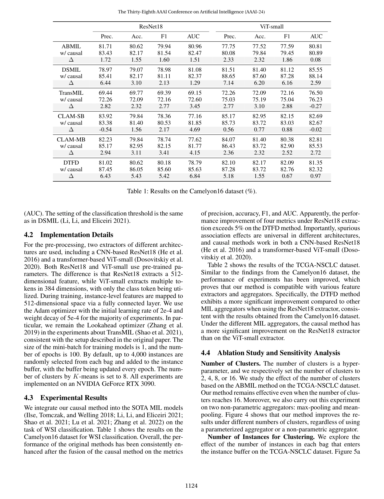
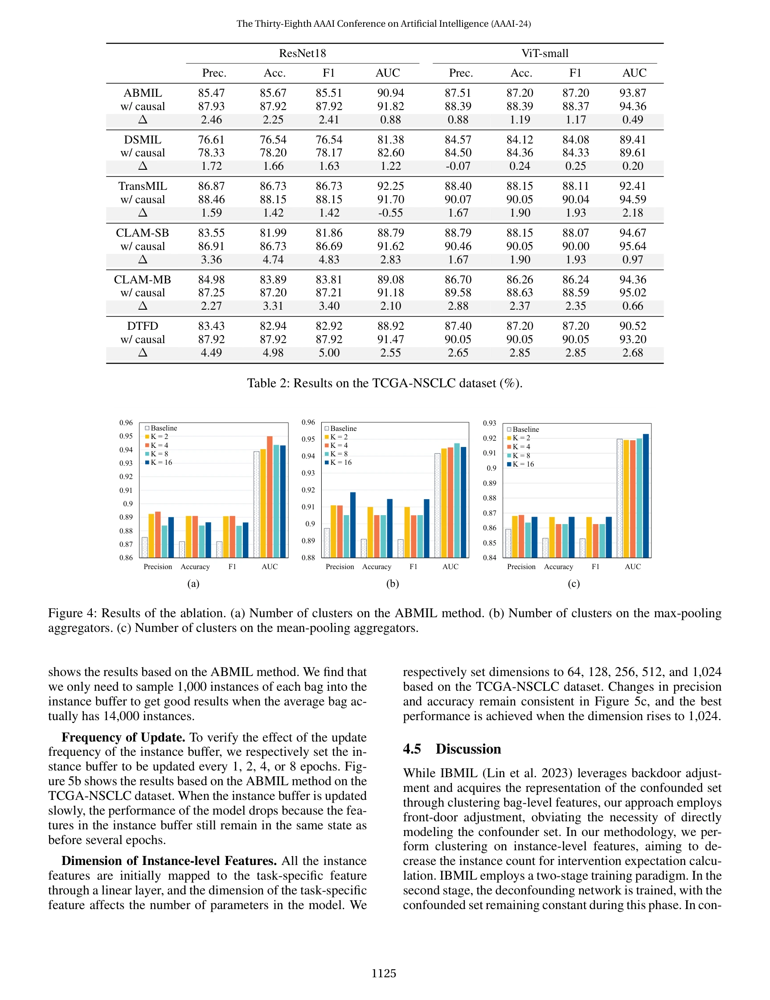
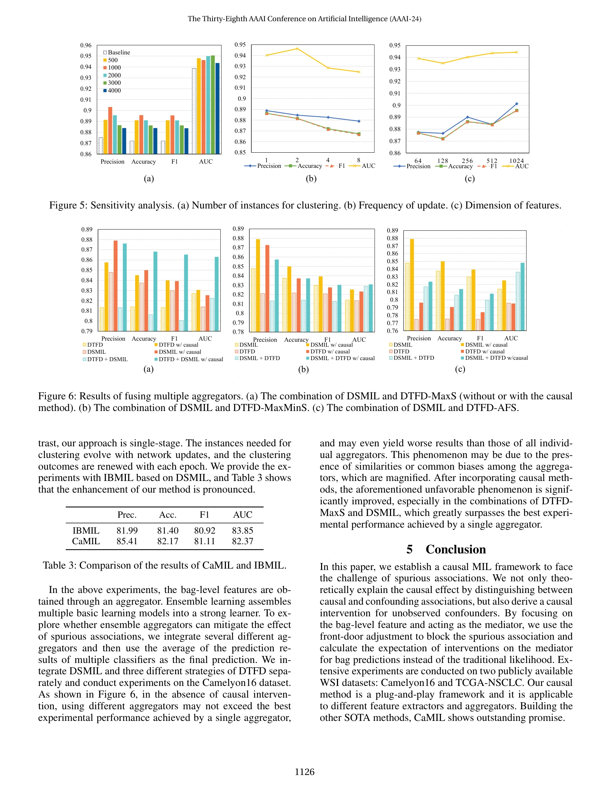

## CaMIL: Causal Multiple Instance Learning for Whole Slide Image Classification

> data: CAMELYON16、TCGA-NSCLC
>
> AAAI 2024 · [论文](https://doi.org/10.1609/aaai.v38i2.27873)

#### 引言

通过前门调整估计干预后的切片预测，减少颜色等混杂因素带来的伪相关；框架可接入不同特征提取器与聚合器。

#### 方法

（1）因果建模：将可能的混杂因素与实例、包标签之间的关系写为因果图。

（2）前门调整：以聚合后的实例特征作为中介，近似计算干预后的包预测。

（3）历史分布：利用实例缓冲与聚类近似整体特征分布，可接入不同聚合器。

<!-- wsi-complete-model -->
##### 模型结构图

**图 2 · 模型结构**（PDF 第 3 页）

> 原文图注：Figure 2: Overall architecture of our proposed causal multiple instance learning (CaMIL). The top part represents conventional MIL, and the lower part illustrates the key of CaMIL. Instances within all bags are grouped into clusters, and then the pooling features of each cluster are obtained. Subsequently, a cross-attention mechanism is employed to fuse these features with the variable Z, enabling better feature representation and causal modeling for improved bag-level predictions. The instance-level features used for clustering are continuously updated.

[查看原尺寸](assest/CaMIL-Causal/figure-2-complete.webp)

<!-- /wsi-complete-model -->

#### 实验

##### 实验设置

在 ResNet18、ViT-small 特征与不同聚合器上验证；TCGA 划分为 7:1:2，训练 100 epochs，batch size 为 1。

##### 主要结果

接入因果模块后多种 MIL 基线的 Precision、ACC、F1、AUC 改善；ResNet18 下 DTFD 的增益更明显。

<!-- wsi-complete-results -->
##### 完整实验指标与对照

下列实验原页保留表头、全部行列、子图、误差说明和脚注，点击可查看原尺寸。比较时请对应相同的数据集、特征编码器和训练设置；`±`、置信区间、百分比和小数均保留原文的单位与统计口径。

| 原表/图中指标 | 读取方式 |
| --- | --- |
| ROC-AUC / AUROC | 越高越好；若原表明确为 PR-AUC，则按 PR 曲线面积读取 |
| ACC / Accuracy | 越高越好；平衡准确率、平均准确率以原表标注为准 |
| F1 | 越高越好；保留 macro / weighted / micro 等平均方式 |
| Precision | 越高越好；需结合 Recall 及分类阈值 |

| 原文页 | 阅读内容 | 图表及正文引用 |
| --- | --- | --- |
| PDF 第 5 页 | 实验结果 | Table 1 |
| PDF 第 6 页 | 实验结果 | Table 2、Figure 4 |
| PDF 第 7 页 | 实验结果 | Table 3 |

**实验原页 · PDF 第 5 页**（图表及正文引用：Table 1）

[查看原尺寸](assest/CaMIL-Causal/experiment-page-05.webp)

**实验原页 · PDF 第 6 页**（图表及正文引用：Table 2、Figure 4）

[查看原尺寸](assest/CaMIL-Causal/experiment-page-06.webp)

**实验原页 · PDF 第 7 页**（图表及正文引用：Table 3）

[查看原尺寸](assest/CaMIL-Causal/experiment-page-07.webp)

<!-- /wsi-complete-results -->

##### 消融与讨论

考察聚类数、缓冲区与不同聚合器，比较 CaMIL 和 IBMIL；前门调整的效果以实验和建模假设共同理解。

#### 参考文献

> CaMIL: Causal Multiple Instance Learning for Whole Slide Image Classification
>
> AAAI 2024 · [论文](https://doi.org/10.1609/aaai.v38i2.27873)
