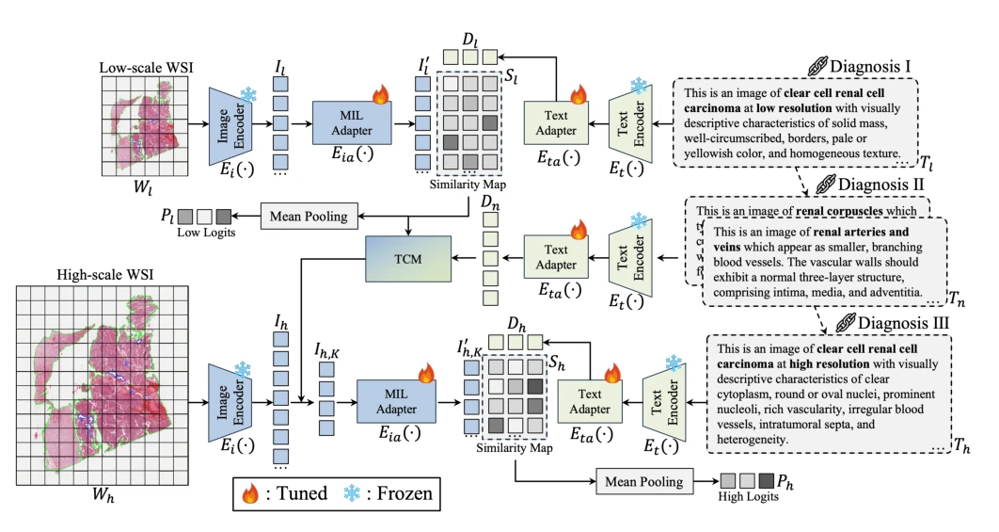

## CoD-MIL: Chain-of-Diagnosis Prompting Multiple Instance Learning for Whole Slide Image Classification

> data: TCGA-RCC、TFAH-RCC、TCGA-Lung
>
> IEEE Transactions on Medical Imaging 2025 · [论文](https://doi.org/10.1109/TMI.2024.3485120)

#### 引言

把低倍率到高倍率的诊断流程分解为连续文本提示，再通过文本引导的对比掩码增强病灶定位和切片分类。

#### 方法

（1）诊断链提示：按低倍率到高倍率的观察流程组织文本子步骤。

（2）文本引导：以病理描述增强不同倍率视觉信息。

（3）对比掩码：遮蔽最显著实例，同时引入正常组织文本，使模型发现补充区域。

原文Fig. 2，PDF 第 3 页。

#### 实验

##### 实验设置

三个数据集按 4:3:3 划分，并开展两个肾癌中心之间的交叉验证。

##### 主要结果

跨中心实验中，相对最佳基线的 AUC、F1、ACC 增益分别报告为 4.7、3.7、4.3 个百分点。

##### 消融与讨论

以 CLIP ResNet50 和配套文本编码器做组件消融，区分诊断链提示与文本引导对比掩码。

#### 参考文献

> CoD-MIL: Chain-of-Diagnosis Prompting Multiple Instance Learning for Whole Slide Image Classification
>
> IEEE Transactions on Medical Imaging 2025 · [论文](https://doi.org/10.1109/TMI.2024.3485120)
