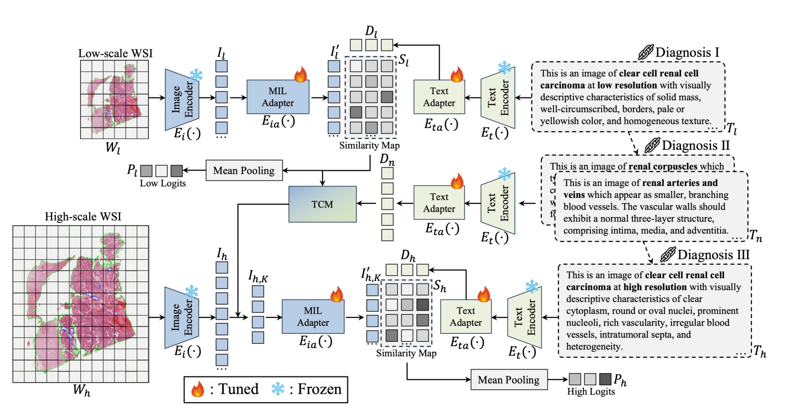
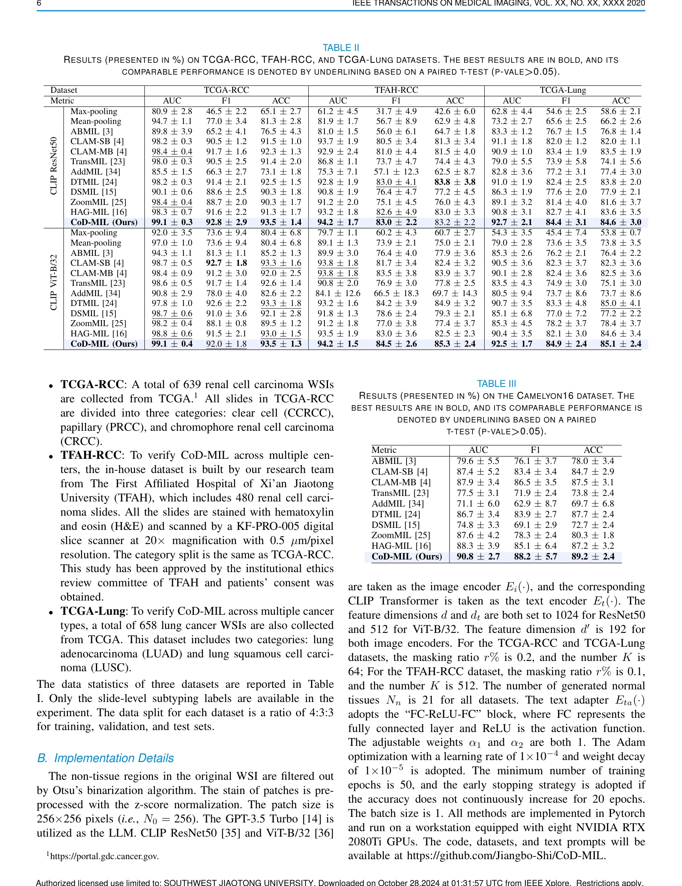
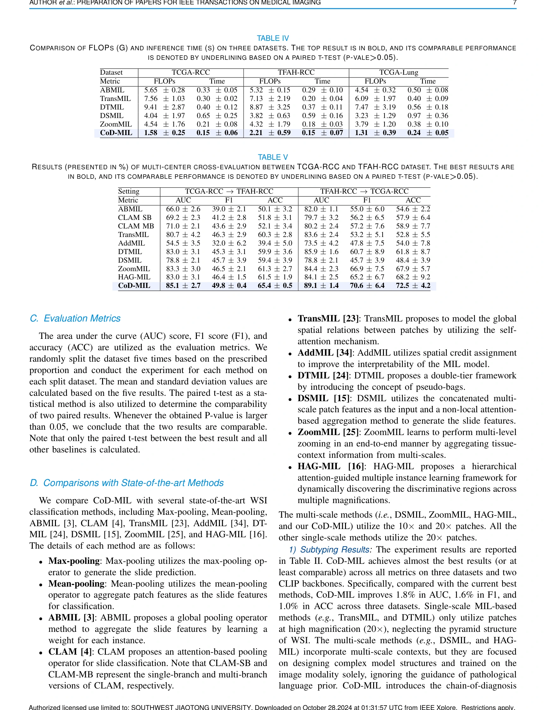
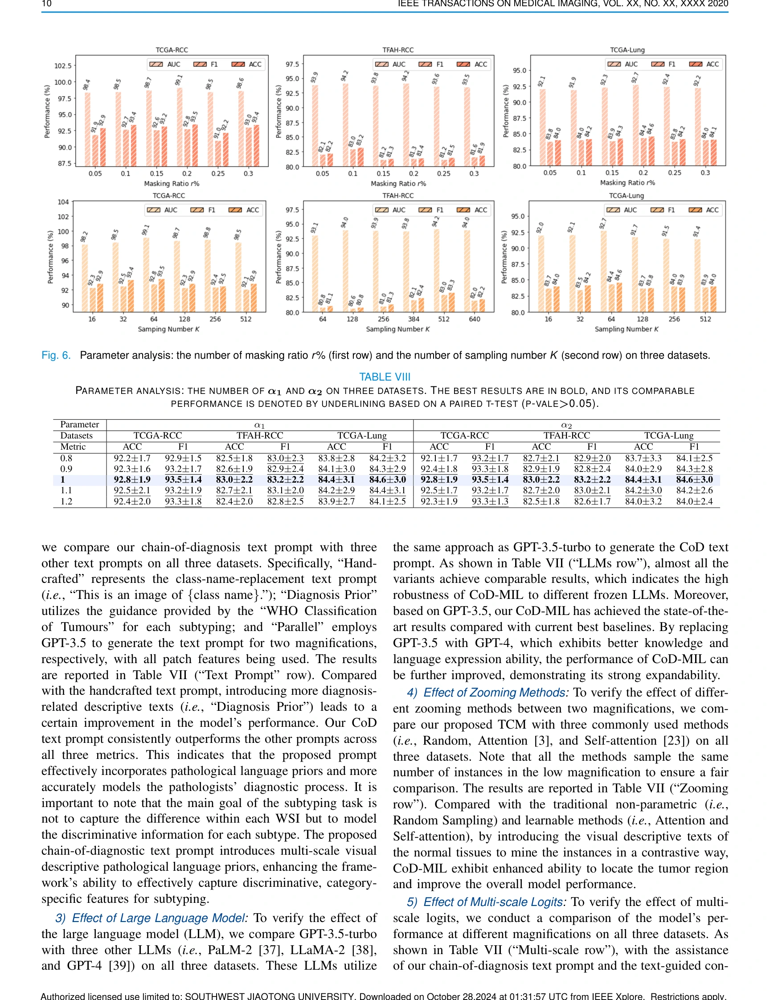
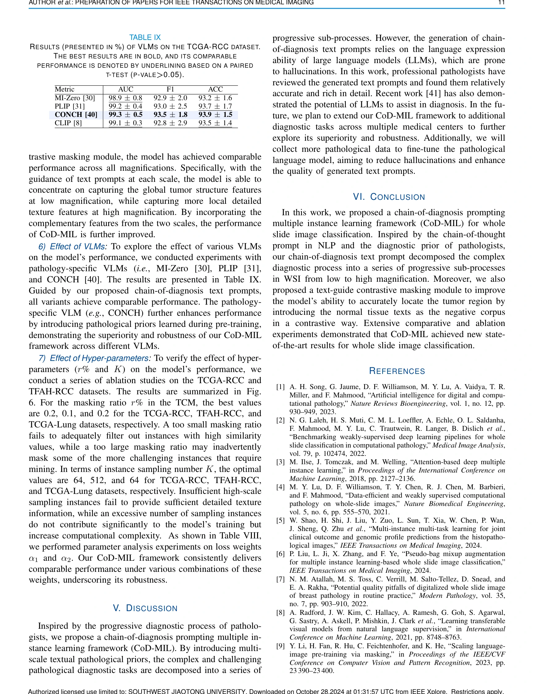
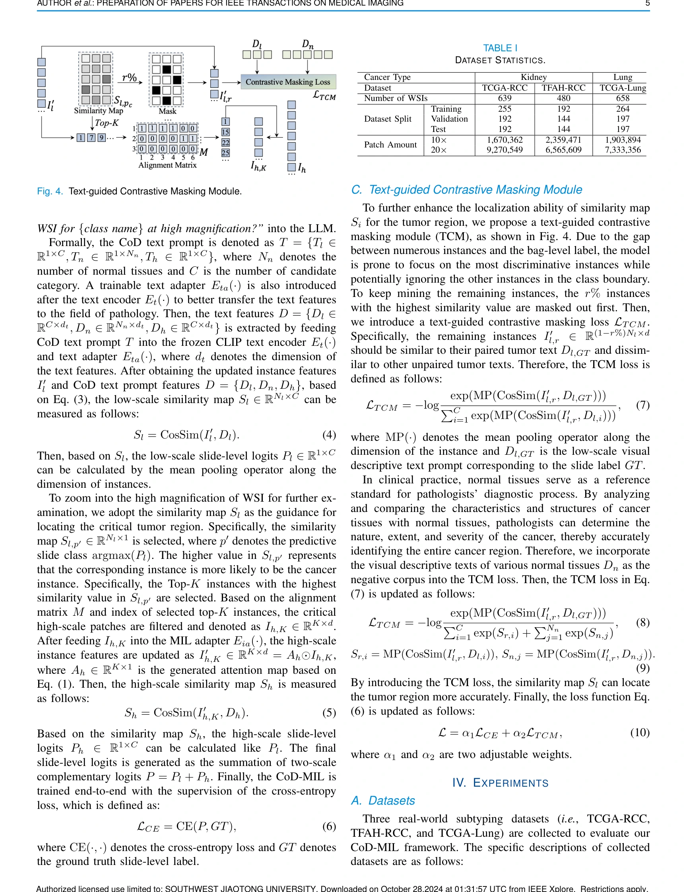
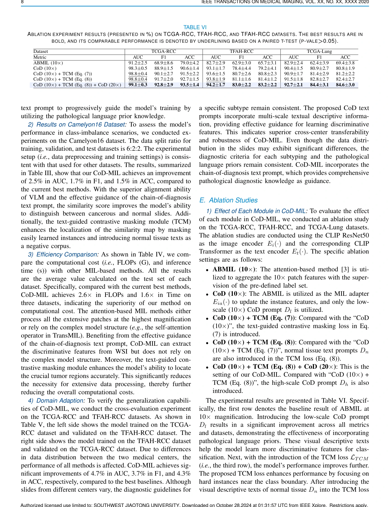
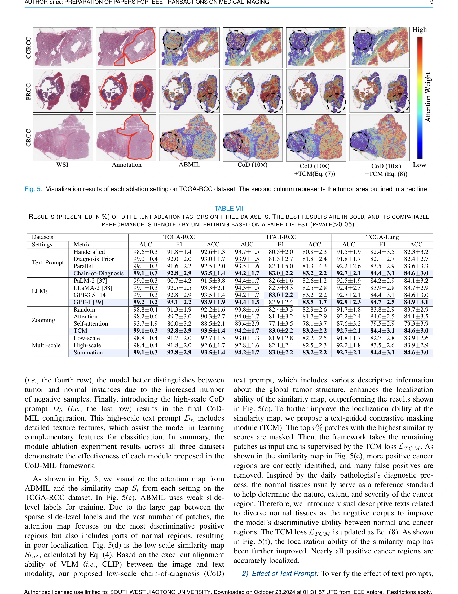

## CoD-MIL: Chain-of-Diagnosis Prompting Multiple Instance Learning for Whole Slide Image Classification

> data: TCGA-RCC、TFAH-RCC、TCGA-Lung
>
> IEEE Transactions on Medical Imaging 2025 · [论文](https://doi.org/10.1109/TMI.2024.3485120)

#### 引言

把低倍率到高倍率的诊断流程分解为连续文本提示，再通过文本引导的对比掩码增强病灶定位和切片分类。

#### 方法

（1）诊断链提示：按低倍率到高倍率的观察流程组织文本子步骤。

（2）文本引导：以病理描述增强不同倍率视觉信息。

（3）对比掩码：遮蔽最显著实例，同时引入正常组织文本，使模型发现补充区域。

<!-- wsi-complete-model -->
##### 模型结构图

**图 2 · 模型结构**（PDF 第 3 页）

> 原文图注：Fig. 2. Illustration of the proposed CoD-MIL framework. The input of the CoD-MIL is the multi-scale WSIs and the chain-of-diagnosis text prompt. TCM is the text-guided contrastive masking module to improve the model’s performance and interpretability. The output is the summation of two- scale slide logits.

[查看原尺寸](assest/CoD-MIL/figure-2-complete.webp)

<!-- /wsi-complete-model -->

#### 实验

##### 实验设置

三个数据集按 4:3:3 划分，并开展两个肾癌中心之间的交叉验证。

##### 主要结果

跨中心实验中，相对最佳基线的 AUC、F1、ACC 增益分别报告为 4.7、3.7、4.3 个百分点。

<!-- wsi-complete-results -->
##### 完整实验指标与对照

下列实验原页保留表头、全部行列、子图、误差说明和脚注，点击可查看原尺寸。比较时请对应相同的数据集、特征编码器和训练设置；`±`、置信区间、百分比和小数均保留原文的单位与统计口径。

| 原表/图中指标 | 读取方式 |
| --- | --- |
| ROC-AUC / AUROC | 越高越好；若原表明确为 PR-AUC，则按 PR 曲线面积读取 |
| ACC / Accuracy | 越高越好；平衡准确率、平均准确率以原表标注为准 |
| F1 | 越高越好；保留 macro / weighted / micro 等平均方式 |
| 时间 / FLOPs / 参数量 | 结合硬件、包长度和计时范围比较；小模型不一定推理更快 |

| 原文页 | 阅读内容 | 图表及正文引用 |
| --- | --- | --- |
| PDF 第 5 页 | 数据与实验设置 | Table I |
| PDF 第 6 页 | 实验结果 | Table II、Table III |
| PDF 第 7 页 | 实验结果 | Table IV、Table V |
| PDF 第 8 页 | 消融与参数分析 | Table VI |
| PDF 第 9 页 | 消融与参数分析 | Figure 5、Table VII |
| PDF 第 10 页 | 实验结果 | Table VIII |
| PDF 第 11 页 | 实验结果 | Table IX |

**实验原页 · PDF 第 6 页**（图表及正文引用：Table II、Table III）

[查看原尺寸](assest/CoD-MIL/experiment-page-06.webp)

**实验原页 · PDF 第 7 页**（图表及正文引用：Table IV、Table V）

[查看原尺寸](assest/CoD-MIL/experiment-page-07.webp)

**实验原页 · PDF 第 10 页**（图表及正文引用：Table VIII）

[查看原尺寸](assest/CoD-MIL/experiment-page-10.webp)

**实验原页 · PDF 第 11 页**（图表及正文引用：Table IX）

[查看原尺寸](assest/CoD-MIL/experiment-page-11.webp)

展开消融、参数、数据设置及效率原页

**实验原页 · PDF 第 5 页**（图表及正文引用：Table I）

[查看原尺寸](assest/CoD-MIL/experiment-page-05.webp)

**实验原页 · PDF 第 8 页**（图表及正文引用：Table VI）

[查看原尺寸](assest/CoD-MIL/experiment-page-08.webp)

**实验原页 · PDF 第 9 页**（图表及正文引用：Figure 5、Table VII）

[查看原尺寸](assest/CoD-MIL/experiment-page-09.webp)

<!-- /wsi-complete-results -->

##### 消融与讨论

以 CLIP ResNet50 和配套文本编码器做组件消融，区分诊断链提示与文本引导对比掩码。

#### 参考文献

> CoD-MIL: Chain-of-Diagnosis Prompting Multiple Instance Learning for Whole Slide Image Classification
>
> IEEE Transactions on Medical Imaging 2025 · [论文](https://doi.org/10.1109/TMI.2024.3485120)
