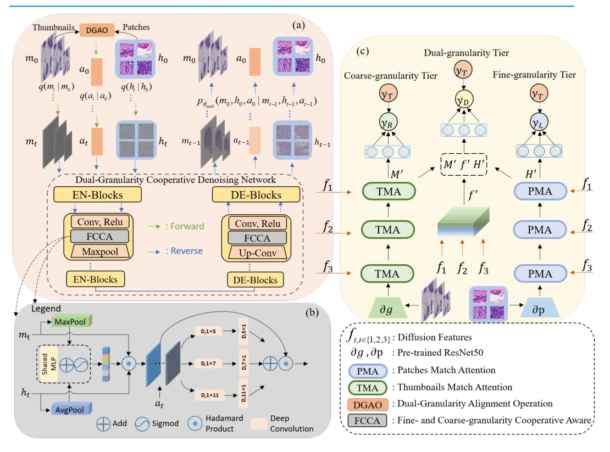

## DCDiff: Dual-Granularity Cooperative Diffusion Models for Pathology Image Analysis

> data: CAMELYON16、TCGA-NSCLC、TCGA-RCC
>
> IEEE Transactions on Medical Imaging 2024（PDF 出版信息） · [论文](https://doi.org/10.1109/TMI.2024.3420804) · [作者代码](https://github.com/hemo0826/DCDiff)

#### 引言

让粗粒度和细粒度信息在前向、反向扩散及耦合 U-Net 去噪中协同交互，以双粒度扩散特征增强病理图像上下文建模。

#### 方法

（1）协同扩散：在前向与反向扩散中同时引入粗细两种粒度。

（2）耦合 U-Net：通过 FCCA 模块交换两种粒度的上下文。

（3）特征分类：从协同去噪过程中提取表示，供病理分类使用。

原文Fig. 1，PDF 第 4 页。

#### 实验

##### 实验设置

采用粗、细两种粒度的扩散特征进行 WSI 分类，对比传统 MIL 及扩散建模方案。

##### 主要结果

作者通过分类主表与上下文相关实验支持双粒度协作；分类证据与扩散重建质量应分开判断。

##### 消融与讨论

区分双粒度协同、耦合去噪和特征提取环节；扩散训练与下游 MIL 分类是不同阶段。

#### 参考文献

> DCDiff: Dual-Granularity Cooperative Diffusion Models for Pathology Image Analysis
>
> IEEE Transactions on Medical Imaging 2024（PDF 出版信息） · [论文](https://doi.org/10.1109/TMI.2024.3420804) · [作者代码](https://github.com/hemo0826/DCDiff)
