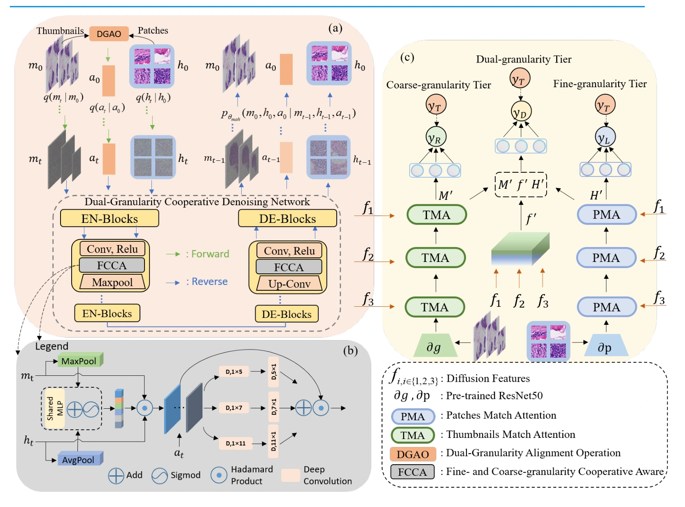
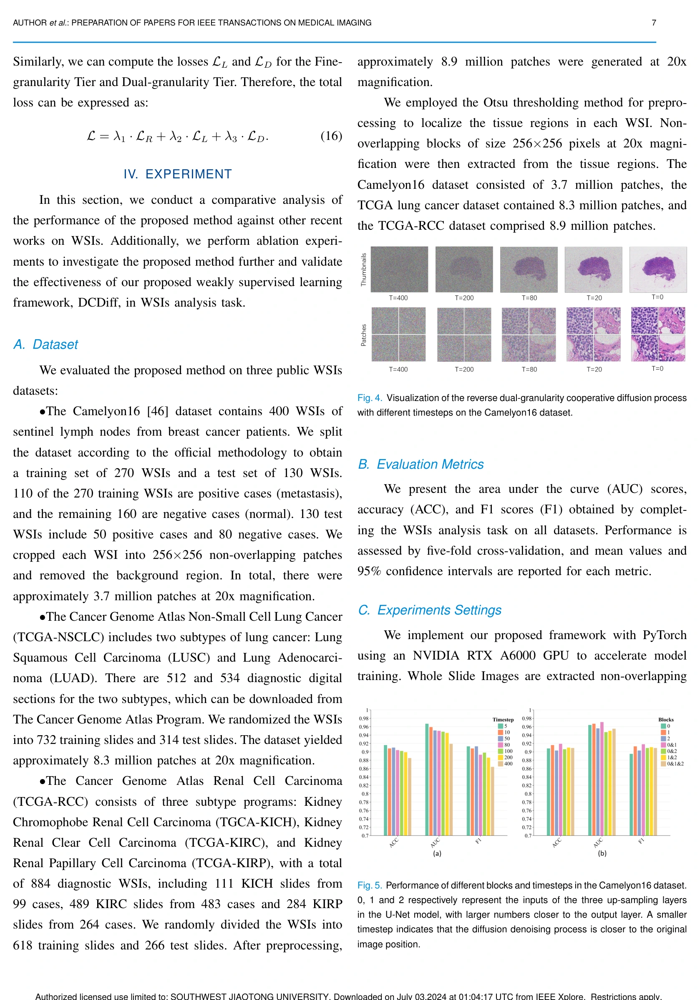
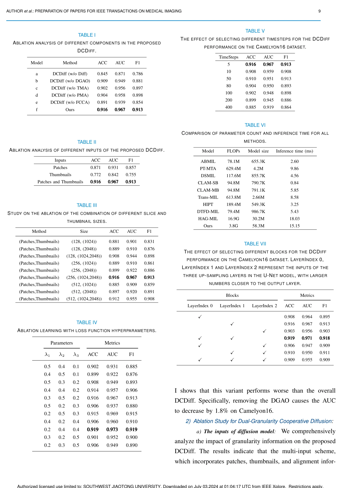
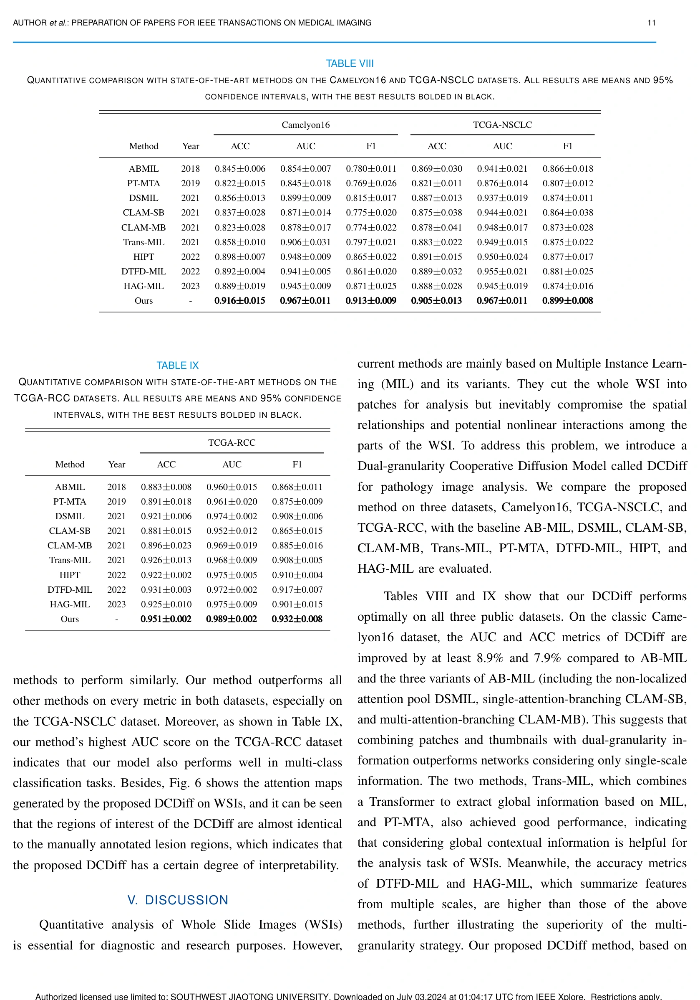

## DCDiff: Dual-Granularity Cooperative Diffusion Models for Pathology Image Analysis

> data: CAMELYON16、TCGA-NSCLC、TCGA-RCC
>
> IEEE Transactions on Medical Imaging 2024（PDF 出版信息） · [论文](https://doi.org/10.1109/TMI.2024.3420804) · [作者代码](https://github.com/hemo0826/DCDiff)

#### 引言

让粗粒度和细粒度信息在前向、反向扩散及耦合 U-Net 去噪中协同交互，以双粒度扩散特征增强病理图像上下文建模。

#### 方法

（1）协同扩散：在前向与反向扩散中同时引入粗细两种粒度。

（2）耦合 U-Net：通过 FCCA 模块交换两种粒度的上下文。

（3）特征分类：从协同去噪过程中提取表示，供病理分类使用。

<!-- wsi-complete-model -->
##### 模型结构图

**图 1 · 模型结构**（PDF 第 4 页）

> 原文图注：Fig. 1. Overview of the proposed DCDiff framework. (a) The detail of the dual-granularity cooperative diffusion process. The green arrows represent forward noise

[查看原尺寸](assest/DCDiff/figure-1-complete.webp)

<!-- /wsi-complete-model -->

#### 实验

##### 实验设置

采用粗、细两种粒度的扩散特征进行 WSI 分类，对比传统 MIL 及扩散建模方案。

##### 主要结果

作者通过分类主表与上下文相关实验支持双粒度协作；分类证据与扩散重建质量应分开判断。

<!-- wsi-complete-results -->
##### 完整实验指标与对照

下列实验原页保留表头、全部行列、子图、误差说明和脚注，点击可查看原尺寸。比较时请对应相同的数据集、特征编码器和训练设置；`±`、置信区间、百分比和小数均保留原文的单位与统计口径。

| 原文页 | 阅读内容 | 图表及正文引用 |
| --- | --- | --- |
| PDF 第 7 页 | 实验结果 | Figure 4、Figure 5 |
| PDF 第 9 页 | 实验结果 | Table I、Table II、Table III、Table IV、Table V、Table VI、Table VII |
| PDF 第 11 页 | 实验结果 | Table VIII、Table IX |

**实验原页 · PDF 第 7 页**（图表及正文引用：Figure 4、Figure 5）

[查看原尺寸](assest/DCDiff/experiment-page-07.webp)

**实验原页 · PDF 第 9 页**（图表及正文引用：Table I、Table II、Table III、Table IV、Table V、Table VI、Table VII）

[查看原尺寸](assest/DCDiff/experiment-page-09.webp)

**实验原页 · PDF 第 11 页**（图表及正文引用：Table VIII、Table IX）

[查看原尺寸](assest/DCDiff/experiment-page-11.webp)

<!-- /wsi-complete-results -->

##### 消融与讨论

区分双粒度协同、耦合去噪和特征提取环节；扩散训练与下游 MIL 分类是不同阶段。

#### 参考文献

> DCDiff: Dual-Granularity Cooperative Diffusion Models for Pathology Image Analysis
>
> IEEE Transactions on Medical Imaging 2024（PDF 出版信息） · [论文](https://doi.org/10.1109/TMI.2024.3420804) · [作者代码](https://github.com/hemo0826/DCDiff)
