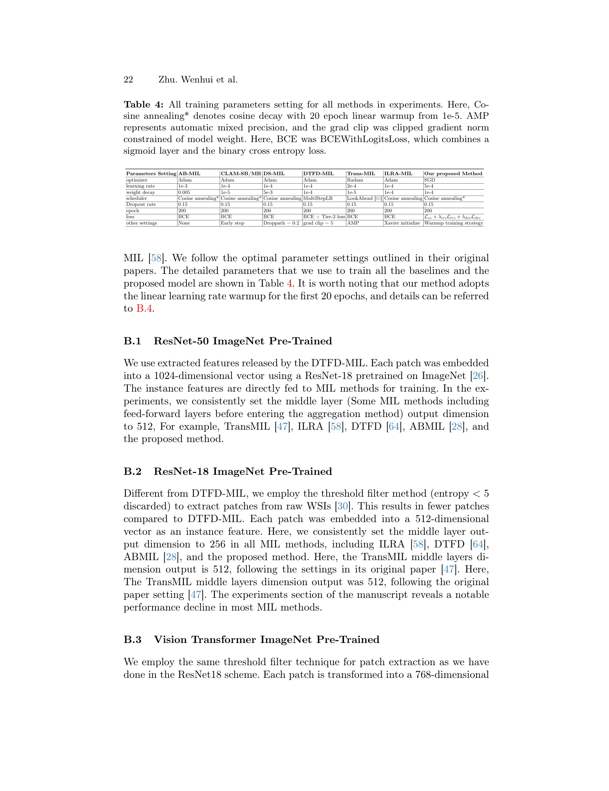
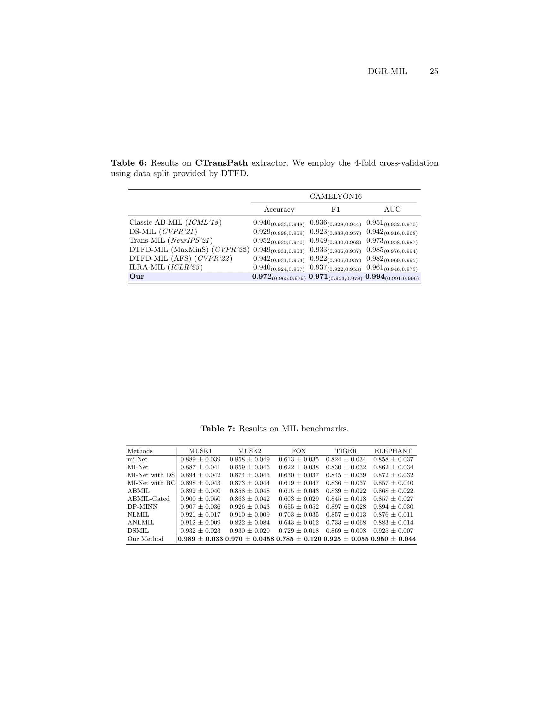
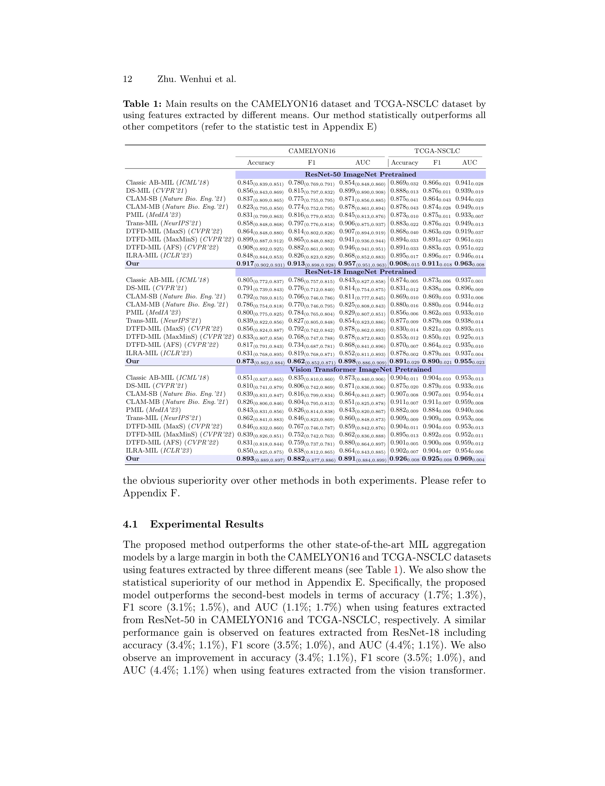
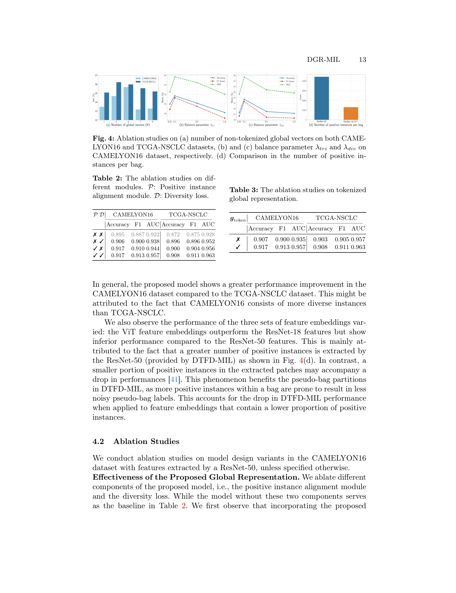
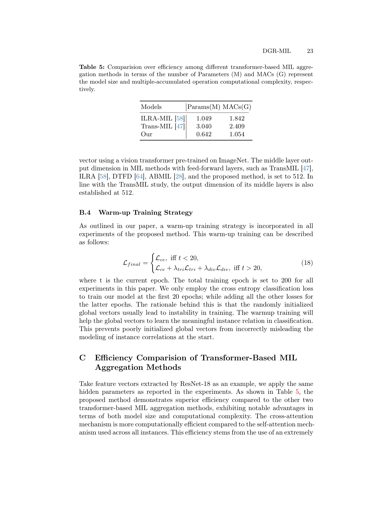

## DGR-MIL: Exploring Diverse Global Representation in Multiple Instance Learning for Whole Slide Image Classification

> data: CAMELYON16、TCGA-NSCLC
>
> ECCV 2024 · [论文](https://arxiv.org/abs/2407.03575) · [作者代码](https://github.com/ChongQingNoSubway/DGR-MIL)

#### 引言

用多个全局向量通过交叉注意力概括切片，再结合阳性实例对齐和行列式点过程约束，鼓励全局表示之间的多样性。

#### 方法

（1）全局向量：用一组可学习向量概括切片中不同组织模式。

（2）交叉注意力：让全局向量从全部实例中提取对应信息。

（3）多样性约束：结合阳性实例对齐与行列式点过程，防止全局向量趋同。

<!-- wsi-complete-model -->
##### 模型结构图

**图 2 · 模型结构**（PDF 第 5 页）

> 原文图注：Fig. 2: Overview of the proposed DGR-MIL where the global vectors are used for modeling the diversity of instances. The diverse global vectors are learned through the positive instance alignment module and the diversity learning mechanism.

[查看原尺寸](assest/DGR-MIL/figure-2-complete.webp)

<!-- /wsi-complete-model -->

#### 实验

##### 实验设置

CAMELYON16 训练/验证为 9:1，重复五次；TCGA 按患者 65:10:25 划分并做四折评估，比较三类特征编码方式。

##### 主要结果

ResNet50 特征下，相对次优方法的 AUC 增益分别为 1.1、1.7 个百分点；不同编码器结果需分开读。

<!-- wsi-complete-results -->
##### 完整实验指标与对照

下列实验原页保留表头、全部行列、子图、误差说明和脚注，点击可查看原尺寸。比较时请对应相同的数据集、特征编码器和训练设置；`±`、置信区间、百分比和小数均保留原文的单位与统计口径。

| 原表/图中指标 | 读取方式 |
| --- | --- |
| ROC-AUC / AUROC | 越高越好；若原表明确为 PR-AUC，则按 PR 曲线面积读取 |
| Precision | 越高越好；需结合 Recall 及分类阈值 |

| 原文页 | 阅读内容 | 图表及正文引用 |
| --- | --- | --- |
| PDF 第 12 页 | 数据与实验设置 | Table 1 |
| PDF 第 13 页 | 消融与参数分析 | Figure 4、Table 2、Table 3 |
| PDF 第 22 页 | 实验结果 | Table 4 |
| PDF 第 23 页 | 效率与开销 | Table 5 |
| PDF 第 25 页 | 实验结果 | Table 6、Table 7 |

**实验原页 · PDF 第 22 页**（图表及正文引用：Table 4）

[查看原尺寸](assest/DGR-MIL/experiment-page-22.webp)

**实验原页 · PDF 第 25 页**（图表及正文引用：Table 6、Table 7）

[查看原尺寸](assest/DGR-MIL/experiment-page-25.webp)

展开消融、参数、数据设置及效率原页

**实验原页 · PDF 第 12 页**（图表及正文引用：Table 1）

[查看原尺寸](assest/DGR-MIL/experiment-page-12.webp)

**实验原页 · PDF 第 13 页**（图表及正文引用：Figure 4、Table 2、Table 3）

[查看原尺寸](assest/DGR-MIL/experiment-page-13.webp)

**实验原页 · PDF 第 23 页**（图表及正文引用：Table 5）

[查看原尺寸](assest/DGR-MIL/experiment-page-23.webp)

<!-- /wsi-complete-results -->

##### 消融与讨论

消融阳性实例对齐和多样性损失，分析全局向量个数及损失权重。

#### 参考文献

> DGR-MIL: Exploring Diverse Global Representation in Multiple Instance Learning for Whole Slide Image Classification
>
> ECCV 2024 · [论文](https://arxiv.org/abs/2407.03575) · [作者代码](https://github.com/ChongQingNoSubway/DGR-MIL)
