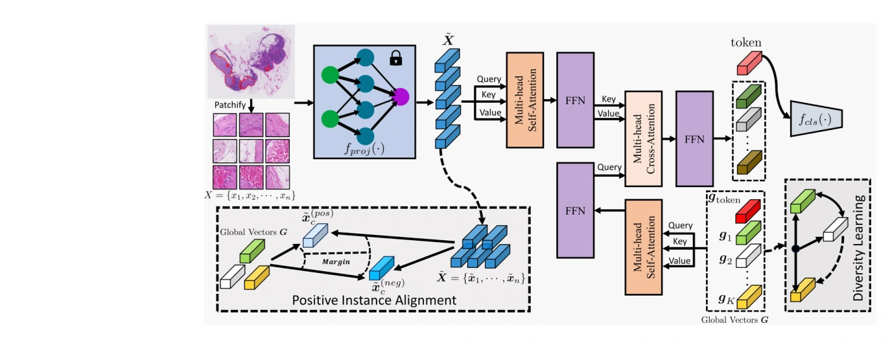

## DGR-MIL: Exploring Diverse Global Representation in Multiple Instance Learning for Whole Slide Image Classification

> data: CAMELYON16、TCGA-NSCLC
>
> ECCV 2024 · [论文](https://arxiv.org/abs/2407.03575) · [作者代码](https://github.com/ChongQingNoSubway/DGR-MIL)

#### 引言

用多个全局向量通过交叉注意力概括切片，再结合阳性实例对齐和行列式点过程约束，鼓励全局表示之间的多样性。

#### 方法

（1）全局向量：用一组可学习向量概括切片中不同组织模式。

（2）交叉注意力：让全局向量从全部实例中提取对应信息。

（3）多样性约束：结合阳性实例对齐与行列式点过程，防止全局向量趋同。

##### 模型结构图

图 2（PDF 第 5 页）

#### 实验

##### 实验设置

CAMELYON16 训练/验证为 9:1，重复五次；TCGA 按患者 65:10:25 划分并做四折评估，比较三类特征编码方式。

##### 关键指标 { #key-results }

| 数据集 | ACC | F1 | AUC |
| --- | --- | --- | --- |
| CAMELYON16 | 0.917（0.902–0.931） | 0.913（0.898–0.928） | 0.957（0.951–0.963） |
| TCGA-NSCLC | 0.908 ± 0.015 | 0.911 ± 0.018 | 0.963 ± 0.008 |

数据来源为原文表 1，PDF 第 12 页，ImageNet 预训练 ResNet-50，两个数据集的统计口径按原表保留。

##### 结果解读

多个全局向量和多样性约束用于捕捉不同的组织形态。CAMELYON16 上，在相同编码器下 DGR-MIL 的 AUC 比次优基线高 1.1 个百分点。换用 ResNet-18 或 ViT 后，结果应在各自特征组内比较。

##### 消融与讨论

消融阳性实例对齐和多样性损失，分析全局向量个数及损失权重。

#### 参考文献

> DGR-MIL: Exploring Diverse Global Representation in Multiple Instance Learning for Whole Slide Image Classification
>
> ECCV 2024 · [论文](https://arxiv.org/abs/2407.03575) · [作者代码](https://github.com/ChongQingNoSubway/DGR-MIL)
