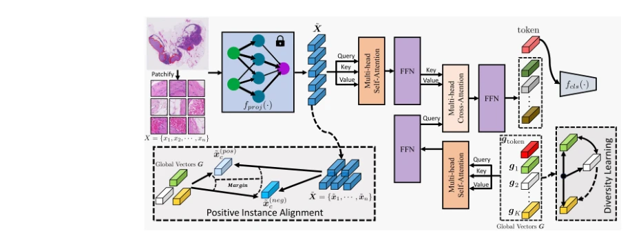
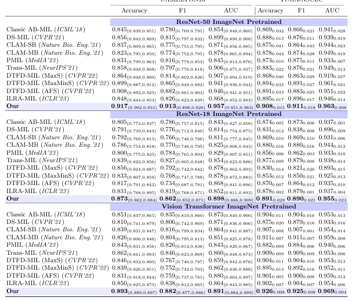

## DGR-MIL: Exploring Diverse Global Representation in Multiple Instance Learning for Whole Slide Image Classification

> data: CAMELYON16、TCGA-NSCLC
>
> ECCV 2024 · [论文](https://arxiv.org/abs/2407.03575) · [作者代码](https://github.com/ChongQingNoSubway/DGR-MIL)

#### 引言

用多个全局向量通过交叉注意力概括切片，再结合阳性实例对齐和行列式点过程约束，鼓励全局表示之间的多样性。

#### 方法

（1）全局向量：用一组可学习向量概括切片中不同组织模式。

（2）交叉注意力：让全局向量从全部实例中提取对应信息。

（3）多样性约束：结合阳性实例对齐与行列式点过程，防止全局向量趋同。

原文Fig. 2，PDF 第 5 页。

#### 实验

##### 实验设置

CAMELYON16 训练/验证为 9:1，重复五次；TCGA 按患者 65:10:25 划分并做四折评估，比较三类特征编码方式。

##### 主要结果

ResNet50 特征下，相对次优方法的 AUC 增益分别为 1.1、1.7 个百分点；不同编码器结果需分开读。

原文Table 1，PDF 第 12 页。

##### 消融与讨论

消融阳性实例对齐和多样性损失，分析全局向量个数及损失权重。

#### 参考文献

> DGR-MIL: Exploring Diverse Global Representation in Multiple Instance Learning for Whole Slide Image Classification
>
> ECCV 2024 · [论文](https://arxiv.org/abs/2407.03575) · [作者代码](https://github.com/ChongQingNoSubway/DGR-MIL)
