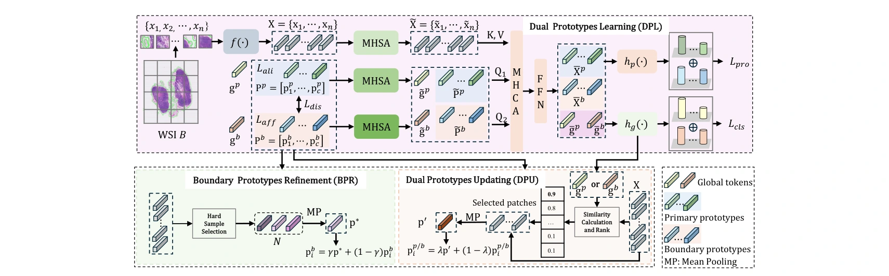

## Dual-Prototype Learning in Multiple Instance Learning for Histopathology Image Classification

> data: CAMELYON16、TCGA-NSCLC、TCGA-BRCA、BRACS
>
> Proceedings of the 33rd ACM International Conference on Multimedia 2025 · [论文](https://doi.org/10.1145/3746027.3755663)

#### 引言

分别学习描述常见组织特征的主原型与刻画困难样本的边界原型，并通过专用损失和动量更新降低原型偏差。

#### 方法

（1）双原型：主原型描述一般组织，边界原型覆盖难判别样本。

（2）专用目标：以疏离、亲和及距离损失分别约束两类原型。

（3）动态更新：通过全局 token 筛选实例进行动量更新，并以难例细化边界原型。

##### 模型结构图

图 2（PDF 第 3 页）

#### 实验

##### 实验设置

前三者主要用 ResNet50，BRACS 用 ResNet18；另以 ViT-B/32 检验特征迁移，报告 ACC/AUC/F1。

##### 关键指标 { #key-results }

| 数据集 | ACC（%） | AUC（%） |
| --- | --- | --- |
| CAMELYON16 | 94.86 ± 0.23 | 97.26 ± 0.25 |
| TCGA-NSCLC | 91.40 ± 2.20 | 96.30 ± 0.70 |
| TCGA-BRCA | 91.59 ± 3.20 | 93.20 ± 2.70 |
| BRACS | 56.53 ± 1.94 | 77.43 ± 0.40 |

数据来源为原文表 1、表 2，PDF 第 6 页。

##### 结果解读

主要结果分别覆盖二分类和 BRACS 多分类；原型更新方式与双原型共同影响结果。

##### 消融与讨论

比较主原型、边界原型、各自更新和三类损失，避免把双原型与简单增加原型数量混淆。

#### 参考文献

> Dual-Prototype Learning in Multiple Instance Learning for Histopathology Image Classification
>
> Proceedings of the 33rd ACM International Conference on Multimedia 2025 · [论文](https://doi.org/10.1145/3746027.3755663)
