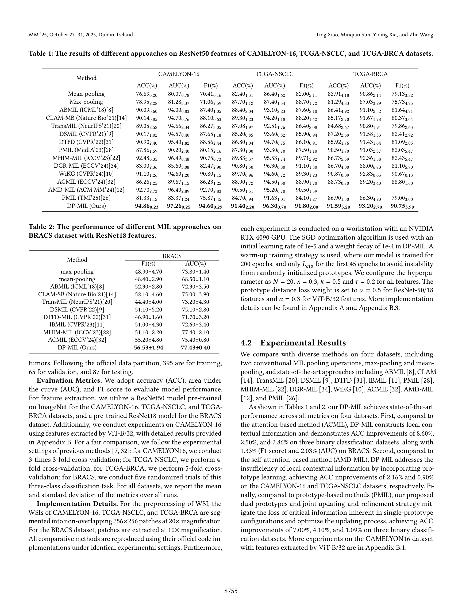
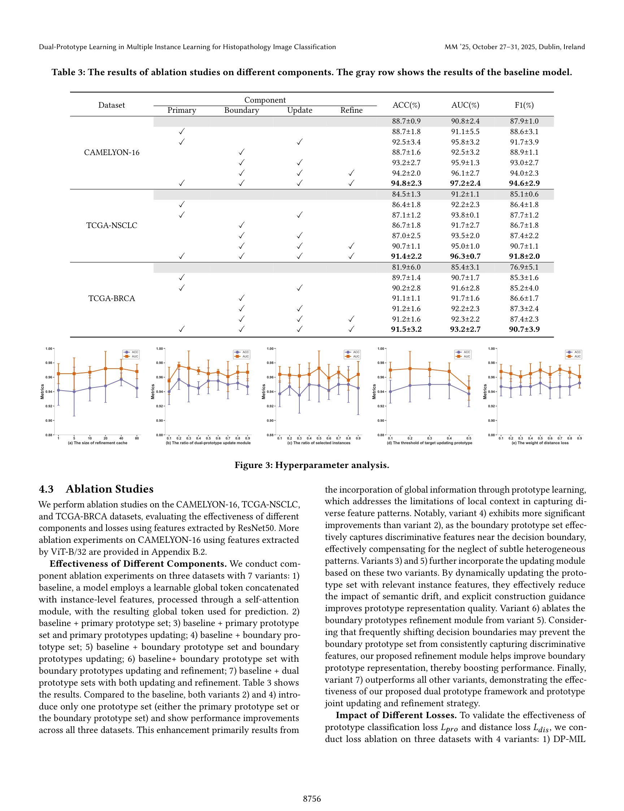
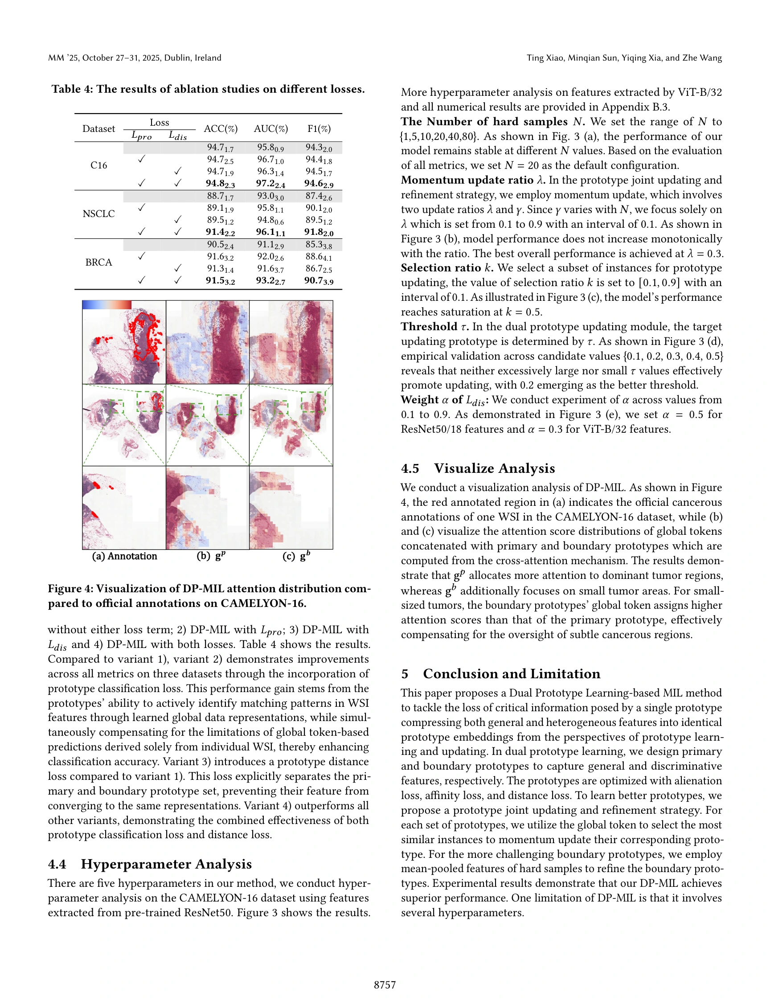

## Dual-Prototype Learning in Multiple Instance Learning for Histopathology Image Classification

> data: CAMELYON16、TCGA-NSCLC、TCGA-BRCA、BRACS
>
> Proceedings of the 33rd ACM International Conference on Multimedia 2025 · [论文](https://doi.org/10.1145/3746027.3755663)

#### 引言

分别学习描述常见组织特征的主原型与刻画困难样本的边界原型，并通过专用损失和动量更新降低原型偏差。

#### 方法

（1）双原型：主原型描述一般组织，边界原型覆盖难判别样本。

（2）专用目标：以疏离、亲和及距离损失分别约束两类原型。

（3）动态更新：通过全局 token 筛选实例进行动量更新，并以难例细化边界原型。

<!-- wsi-complete-model -->
##### 模型结构图

**图 2 · 模型结构**（PDF 第 3 页）

> 原文图注：Figure 2: The framework of DP-MIL consists of a dual prototype learning branch and a prototype updating and refining branch. In the dual prototype learning branch, three prototype-specific losses, 𝐿𝑎𝑙𝑖, 𝐿𝑎𝑓𝑓, and 𝐿𝑑𝑖𝑠are used to learn dual prototypes. The prototype updating and refining branch updates the dual prototypes by selecting similar instances for momentum updates and refining the boundary prototypes using the mean pooling features of the hard samples.

[查看原尺寸](assest/DP-MIL/figure-2-complete.webp)

<!-- /wsi-complete-model -->

#### 实验

##### 实验设置

前三者主要用 ResNet50，BRACS 用 ResNet18；另以 ViT-B/32 检验特征迁移，报告 ACC/AUC/F1。

##### 主要结果

主要结果分别覆盖二分类和 BRACS 多分类；原型更新方式与双原型共同影响结果。

<!-- wsi-complete-results -->
##### 完整实验指标与对照

下列实验原页保留表头、全部行列、子图、误差说明和脚注，点击可查看原尺寸。比较时请对应相同的数据集、特征编码器和训练设置；`±`、置信区间、百分比和小数均保留原文的单位与统计口径。

| 原表/图中指标 | 读取方式 |
| --- | --- |
| ROC-AUC / AUROC | 越高越好；若原表明确为 PR-AUC，则按 PR 曲线面积读取 |
| ACC / Accuracy | 越高越好；平衡准确率、平均准确率以原表标注为准 |
| F1 | 越高越好；保留 macro / weighted / micro 等平均方式 |

| 原文页 | 阅读内容 | 图表及正文引用 |
| --- | --- | --- |
| PDF 第 6 页 | 实验结果 | Table 1、Table 2 |
| PDF 第 7 页 | 消融与参数分析 | Table 3 |
| PDF 第 8 页 | 消融与参数分析 | Table 4 |

**实验原页 · PDF 第 6 页**（图表及正文引用：Table 1、Table 2）

[查看原尺寸](assest/DP-MIL/experiment-page-06.webp)

展开消融、参数、数据设置及效率原页

**实验原页 · PDF 第 7 页**（图表及正文引用：Table 3）

[查看原尺寸](assest/DP-MIL/experiment-page-07.webp)

**实验原页 · PDF 第 8 页**（图表及正文引用：Table 4）

[查看原尺寸](assest/DP-MIL/experiment-page-08.webp)

<!-- /wsi-complete-results -->

##### 消融与讨论

比较主原型、边界原型、各自更新和三类损失，避免把双原型与简单增加原型数量混淆。

#### 参考文献

> Dual-Prototype Learning in Multiple Instance Learning for Histopathology Image Classification
>
> Proceedings of the 33rd ACM International Conference on Multimedia 2025 · [论文](https://doi.org/10.1145/3746027.3755663)
