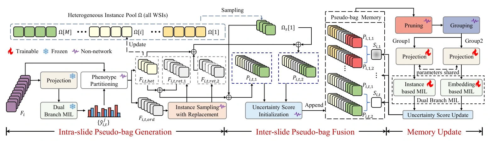
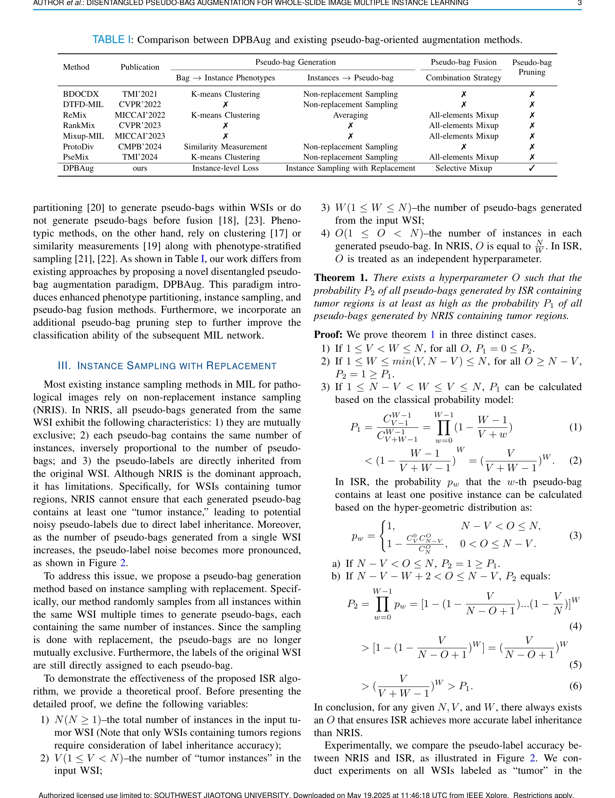
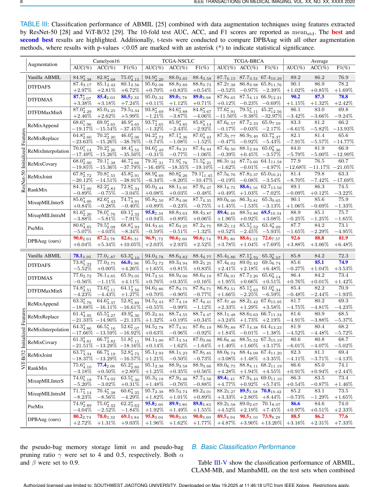
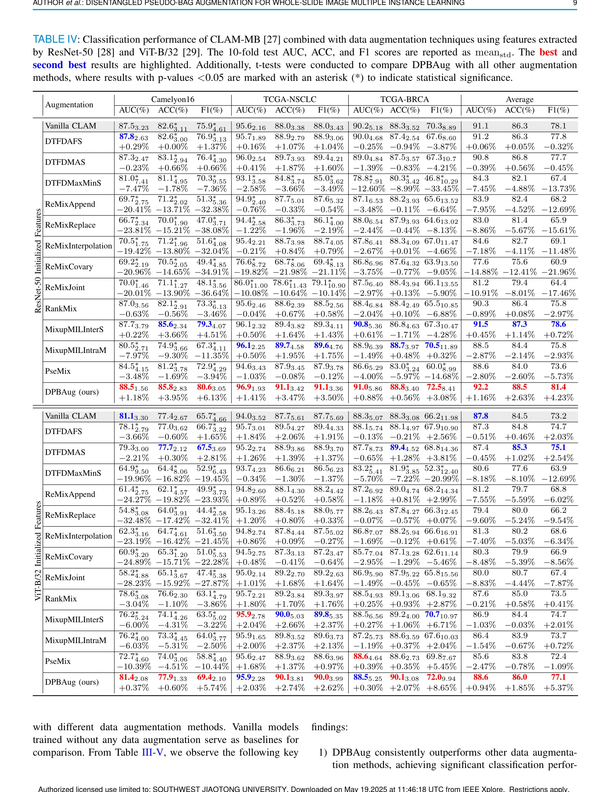
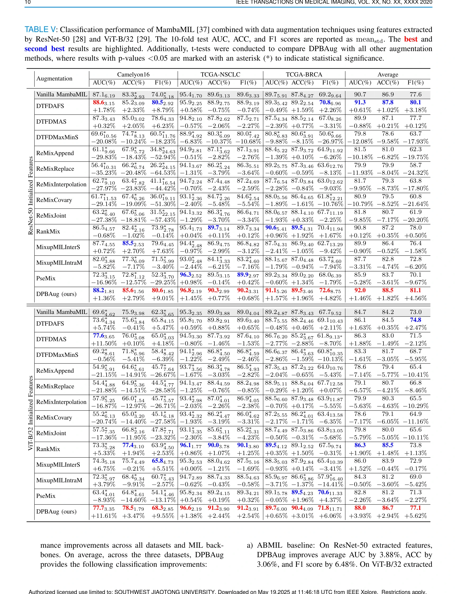
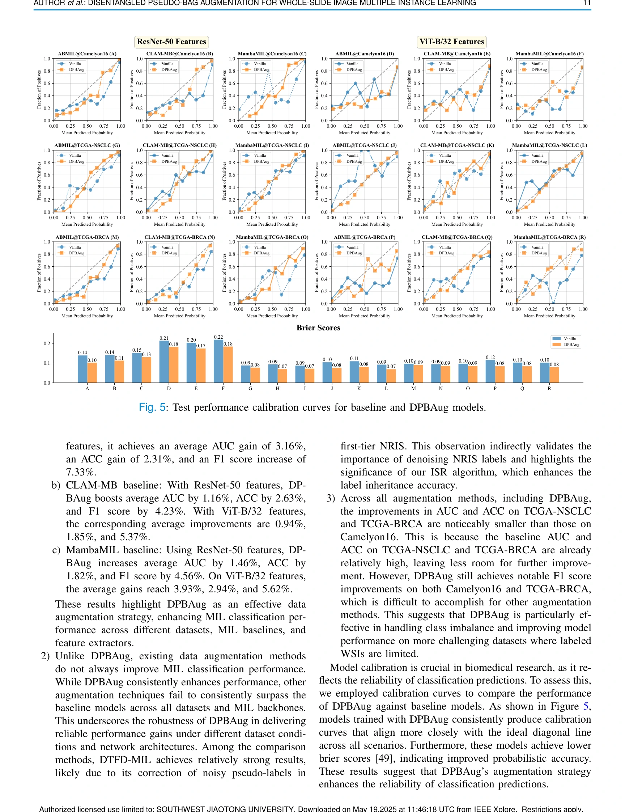
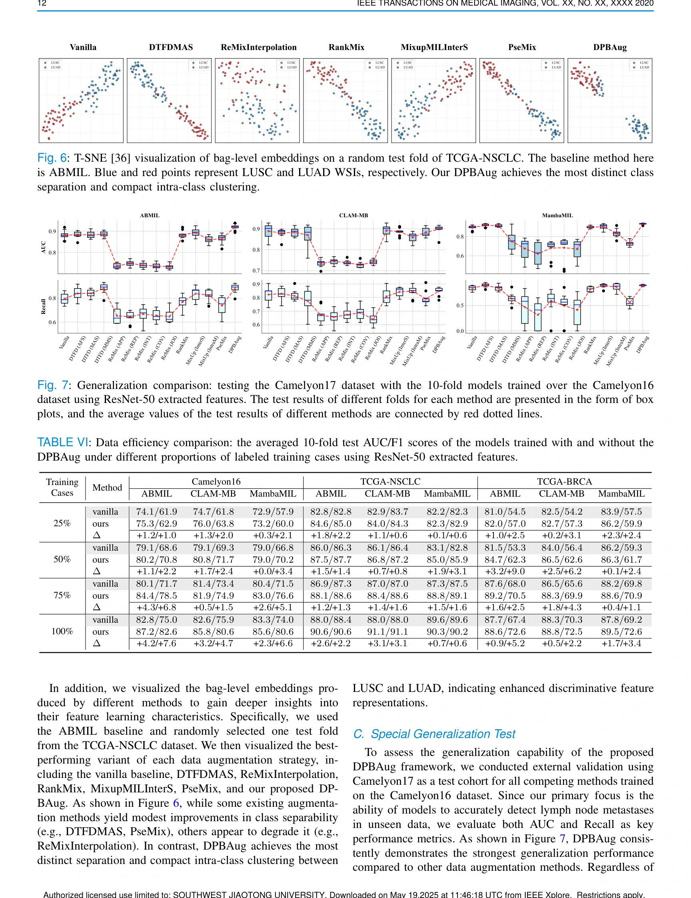
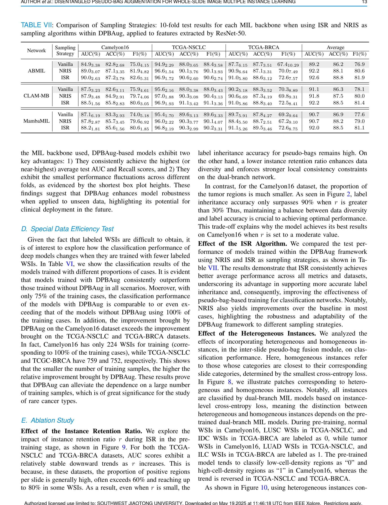
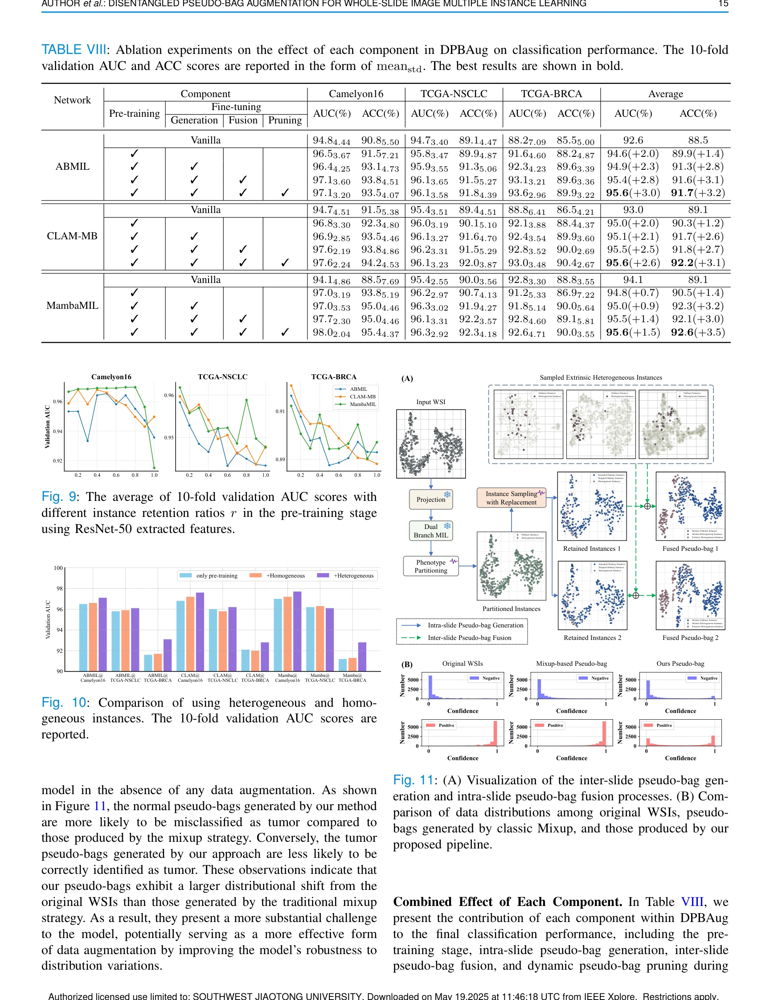
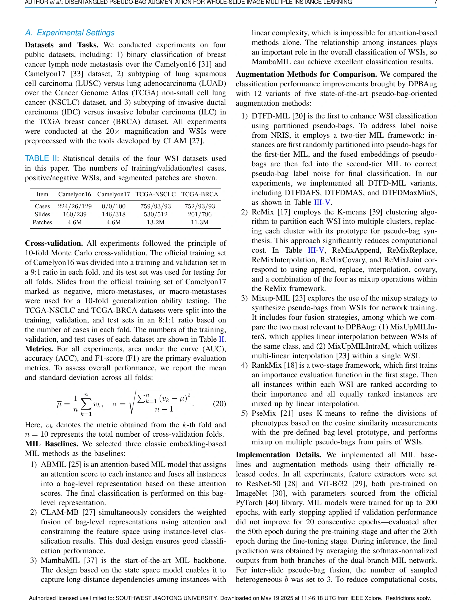

## Disentangled Pseudo-bag Augmentation for Whole Slide Image Multiple Instance Learning

> data: CAMELYON16、CAMELYON17、TCGA-NSCLC、TCGA-BRCA
>
> IEEE Transactions on Medical Imaging 2025 · [论文](https://doi.org/10.1109/TMI.2025.3569941) · [作者代码](https://github.com/JiuyangDong/DPBAug)

#### 引言

通过表型划分和有放回采样构建切片内伪包，再跨切片融合并以记忆模块更新优质伪包，提高增强样本的标签可靠性。

#### 方法

（1）表型伪包：先分离异质组织，再有放回采样以改善标签继承。

（2）跨片融合：用不同 WSI 的互补伪包形成更丰富的训练样本。

（3）记忆更新：优先保留高价值合成包，提高增强质量。

<!-- wsi-complete-model -->
##### 模型结构图

**图 3 · 模型结构**（PDF 第 5 页）

> 原文图注：Fig. 3: The proposed DPBAug framework consists of three modules: 1) In intra-slide pseudo-bag generation, a pair of pseudo- bags corresponding to the input WSI is obtained. 2) In inter-slide pseudo-bag fusion, the heterogeneous information of other WSIs is injected to the pseudo-bag pair derived from intra-slide pseudo-bag generation to generate two fused pseudo-bags, which are then appended to a pseudo-bag memory. 3) In pseudo-bag memory update, dynamic pruning is conducted to screen out unimportant pseudo-bags. For simplicity, we only draw one heterogeneous instance set sampled from Ωas an illustration.

[查看原尺寸](assest/DPBAug/figure-3-complete.webp)

<!-- /wsi-complete-model -->

#### 实验

##### 实验设置

20× 处理，十次 Monte Carlo；C16 保留官方测试集，TCGA 按病例 8:1:1 划分，并对 C17 外测。

##### 主要结果

对比不同伪包增强与多个 MIL 基线，主要评价 ACC/AUC/F1 及总体提升；增强与聚合器收益应分开。

<!-- wsi-complete-results -->
##### 完整实验指标与对照

下列实验原页保留表头、全部行列、子图、误差说明和脚注，点击可查看原尺寸。比较时请对应相同的数据集、特征编码器和训练设置；`±`、置信区间、百分比和小数均保留原文的单位与统计口径。

| 原表/图中指标 | 读取方式 |
| --- | --- |
| ROC-AUC / AUROC | 越高越好；若原表明确为 PR-AUC，则按 PR 曲线面积读取 |
| ACC / Accuracy | 越高越好；平衡准确率、平均准确率以原表标注为准 |
| F1 | 越高越好；保留 macro / weighted / micro 等平均方式 |

| 原文页 | 阅读内容 | 图表及正文引用 |
| --- | --- | --- |
| PDF 第 3 页 | 实验结果 | Table I |
| PDF 第 7 页 | 数据与实验设置 | Table II |
| PDF 第 8 页 | 实验结果 | Table III |
| PDF 第 9 页 | 实验结果 | Table IV |
| PDF 第 10 页 | 实验结果 | Table V |
| PDF 第 11 页 | 实验结果 | Figure 5 |
| PDF 第 12 页 | 实验结果 | Table VI |
| PDF 第 13 页 | 实验结果 | Table VII |
| PDF 第 15 页 | 实验结果 | Table VIII、Figure 9、Figure 10、Figure 11 |

**实验原页 · PDF 第 3 页**（图表及正文引用：Table I）

[查看原尺寸](assest/DPBAug/experiment-page-03.webp)

**实验原页 · PDF 第 8 页**（图表及正文引用：Table III）

[查看原尺寸](assest/DPBAug/experiment-page-08.webp)

**实验原页 · PDF 第 9 页**（图表及正文引用：Table IV）

[查看原尺寸](assest/DPBAug/experiment-page-09.webp)

**实验原页 · PDF 第 10 页**（图表及正文引用：Table V）

[查看原尺寸](assest/DPBAug/experiment-page-10.webp)

**实验原页 · PDF 第 11 页**（图表及正文引用：Figure 5）

[查看原尺寸](assest/DPBAug/experiment-page-11.webp)

**实验原页 · PDF 第 12 页**（图表及正文引用：Table VI）

[查看原尺寸](assest/DPBAug/experiment-page-12.webp)

**实验原页 · PDF 第 13 页**（图表及正文引用：Table VII）

[查看原尺寸](assest/DPBAug/experiment-page-13.webp)

**实验原页 · PDF 第 15 页**（图表及正文引用：Table VIII、Figure 9、Figure 10、Figure 11）

[查看原尺寸](assest/DPBAug/experiment-page-15.webp)

展开消融、参数、数据设置及效率原页

**实验原页 · PDF 第 7 页**（图表及正文引用：Table II）

[查看原尺寸](assest/DPBAug/experiment-page-07.webp)

<!-- /wsi-complete-results -->

##### 消融与讨论

分析表型划分、有放回抽样、跨切片融合和记忆更新，并考察标签可靠性及数据效率。

#### 参考文献

> Disentangled Pseudo-bag Augmentation for Whole Slide Image Multiple Instance Learning
>
> IEEE Transactions on Medical Imaging 2025 · [论文](https://doi.org/10.1109/TMI.2025.3569941) · [作者代码](https://github.com/JiuyangDong/DPBAug)
