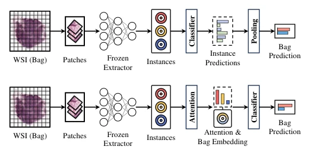

## Disentangled Pseudo-bag Augmentation for Whole Slide Image Multiple Instance Learning

> data: CAMELYON16、CAMELYON17、TCGA-NSCLC、TCGA-BRCA
>
> IEEE Transactions on Medical Imaging 2025 · [论文](https://doi.org/10.1109/TMI.2025.3569941) · [作者代码](https://github.com/JiuyangDong/DPBAug)

#### 引言

通过表型划分和有放回采样构建切片内伪包，再跨切片融合并以记忆模块更新优质伪包，提高增强样本的标签可靠性。

#### 方法

（1）表型伪包：先分离异质组织，再有放回采样以改善标签继承。

（2）跨片融合：用不同 WSI 的互补伪包形成更丰富的训练样本。

（3）记忆更新：优先保留高价值合成包，提高增强质量。

原文Fig. 1，PDF 第 2 页。

#### 实验

##### 实验设置

20× 处理，十次 Monte Carlo；C16 保留官方测试集，TCGA 按病例 8:1:1 划分，并对 C17 外测。

##### 主要结果

对比不同伪包增强与多个 MIL 基线，主要评价 ACC/AUC/F1 及总体提升；增强与聚合器收益应分开。

##### 消融与讨论

分析表型划分、有放回抽样、跨切片融合和记忆更新，并考察标签可靠性及数据效率。

#### 参考文献

> Disentangled Pseudo-bag Augmentation for Whole Slide Image Multiple Instance Learning
>
> IEEE Transactions on Medical Imaging 2025 · [论文](https://doi.org/10.1109/TMI.2025.3569941) · [作者代码](https://github.com/JiuyangDong/DPBAug)
